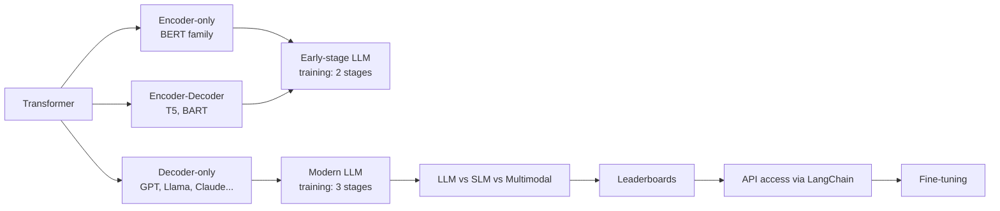
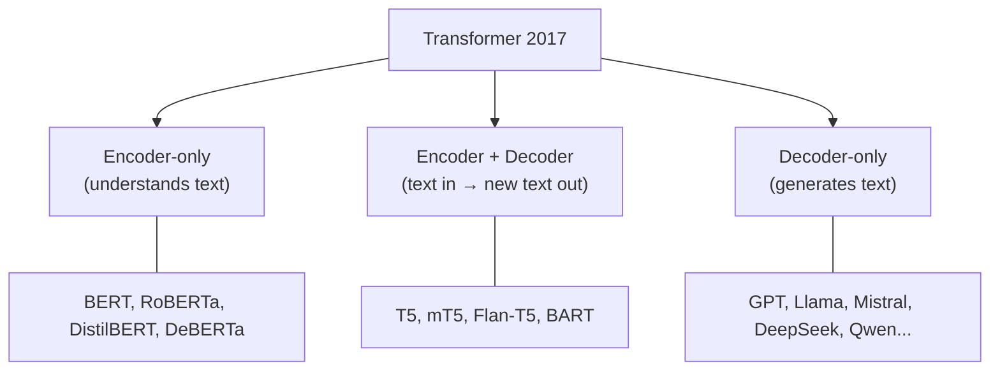
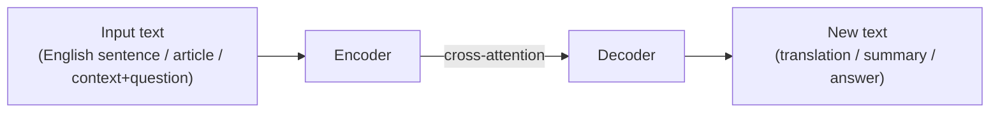
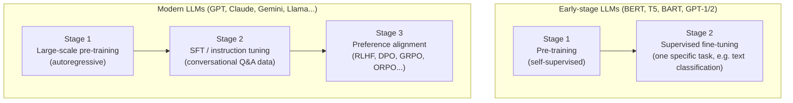
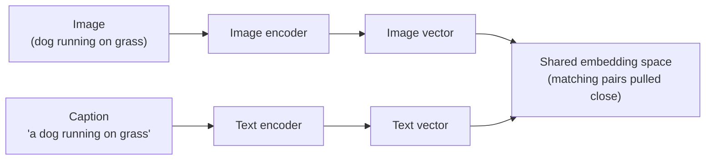

# 🧭 Class: From Transformer to LLMs — Encoder/Decoder Models, Training Pipelines, SLMs & Multimodal Intro
### 📋 FullStack Genie AI Bootcamp (Generative AI)

**🎙️ Mentor:** Sunny Savita
**⏱️ Duration:** ~4 hours (incl. two breaks and a long doubt session) | **📅 Session:** Weekend class, Sat 14 Nov 2026 *(class number not stated in the recording)*

---

## 📰 Quick Updates

- **Transformer is done.** The previous class wrapped up the transformer; this session opens the next block: the *LLM landscape* → API access → fine-tuning.
- **Assignment: Transformer from Scratch.** Sunny shared a complete, ready-made PyTorch implementation (imports → data loading/tokenization → positional encoding → multi-head attention → feed-forward → encoder layer → decoder layer → hyperparameters → optimizer → training loop). He is *not* teaching it live, because the course focus is RAG, fine-tuning, agents, MCP and cloud. Run it on **Google Colab** (free GPU; `torch` is preinstalled, else `pip install torch`). The dataset is **Multi30K** (a translation dataset, on GitHub and the Hugging Face Hub). Code is on GitHub; an older 15-minute walkthrough recording (Advanced NLP with GenAI → "25th January, Day 19") will be uploaded to the dashboard.
- **Study tip:** rewatch the transformer recordings and write your *own* notes from the whiteboard — a one-time job that doubles as interview revision.
- Notes and research papers will all be collected in the **FullStack Genie AI Bootcamp** GitHub repo; links will be posted in the community chat.
- **Start exploring Hugging Face** (Models, Datasets, Spaces, Docs). A dedicated Hugging Face session will come before fine-tuning. Libraries to expect: `transformers`, `datasets`, `accelerate`, `bitsandbytes`, `optimum`, `TRL`, `PEFT`, `safetensors`, `sentence-transformers`, `diffusers`.

---

## 🗺️ Today's Roadmap

Sunny's framing: the transformer is the base of **every** LLM, so once you know it you can read any LLM architecture. We don't study each architecture (that's an AI-researcher's job, not a developer's) — we build a *high-level map* and then go practical. The two attention variants to truly master: **masked self-attention** and **cross-attention**.

---

## 🧱 Three Families of Transformer-Based Models

A transformer has two halves — an **encoder** and a **decoder**. After the 2017 paper, models appeared that use one half or both:

---

## 🔍 Family 1: Encoder-Only Models (BERT & Friends)

Sunny pulled up the original BERT paper on arXiv to show that BERT uses *only the encoder stack* from the "Attention Is All You Need" diagram. Variants: **RoBERTa** (*Robustly optimized BERT pre-training approach*), **DistilBERT** (a smaller, faster, cheaper distilled version), **DeBERTa** (*Decoding-enhanced BERT with disentangled attention*). Tip he repeated: paste a paper into ChatGPT to get a summary instead of wading through jargon.

**What the encoder outputs:** a **contextual embedding** — a vector representation of the input text. A small *output head* on top turns that vector into a prediction.

**Typical use cases** (all "text classification" in the broad sense):

| Task | Example from the board |
|---|---|
| Sentiment analysis | Sentence → positive / negative / neutral |
| NER (Named Entity Recognition) | "Virat Kohli lives in India" → Virat Kohli = person, India = location |
| POS (Part-of-speech) tagging | "Ram eats mango" → noun, verb, noun |
| Embedding generation | Vectors for semantic search |

**Pre-training technique: Masked Language Modeling (MLM).** Hide a word in the sentence and predict it using **both left and right context**.

**Key takeaway:** encoder-only models are excellent at *deeply understanding* text but are not naturally built to *generate* it.

**Sunny's practical note:** in 3–4 years of GenAI work he has never used BERT directly for classification or summarization — prompting a modern LLM does that now. He uses BERT-style variants mainly as **embedding models** from the `sentence-transformers` repo, which we'll revisit in the RAG chapter. BERT is a legacy model (≈2019) but a great reference. You can download `bert-base-uncased` from the Hugging Face Hub.

**Parameter count** — Sunny showed live how to look it up rather than memorize it: BERT-base ≈ **110 million**, BERT-large ≈ **340 million** parameters. *(The class search summary read "10 million" for base; the figure in the BERT paper is 110M.)* A **parameter** is simply a learnable **weight** (and bias) — e.g., attention weights and feed-forward weights in a transformer.

---

## 🔁 Family 2: Encoder–Decoder Models (T5, BART)

Both halves are used: the encoder reads the input, the decoder generates a **new structured output**.

- **T5** — Google. *"Text-to-Text Transfer Transformer"* (the paper is "Exploring the Limits of Transfer Learning with a Unified Text-to-Text Transformer"). Variants: **mT5**, **Flan-T5**.
- **BART** — Meta (Facebook). *Denoising sequence-to-sequence pre-training for natural language generation, translation and comprehension.*
- **BERT** — Google (for the "who built what" quiz Sunny ran).

**Use cases:** machine translation, summarization, question answering (context + question → answer). These dominated 2019–2020; once modern LLMs arrived, everyone moved to prompt-based generation.

**Reality check Sunny gave the class:** by now you've seen ~6 research papers. Nobody can read every paper. Deep architecture study is for PhDs / research scientists / AI researchers at Google, Meta, Apple, universities, or R&D teams in pharma and finance. ~95–99% of the audience are *developers* — you need the high-level map and the ability to **build applications**.

---

## ✍️ Family 3: Decoder-Only Models (GPT, Llama, Claude, Gemini…)

These power today's industry. The core task is **next-token prediction / generation**, which is why they're **general-purpose models**: if everything is framed as text generation, one model can do chat, code, writing, summarization, translation and reasoning.

**Conversational AI** is the highlight application. Sunny's advice: if you want to become strong in GenAI, build a conversational system — it forces you to combine almost every concept (the class will build one later).

### 🎨 Multimodal LLMs

Modern LLMs aren't limited to text. Input → output combinations:

| Input → Output | Name | Example mentioned |
|---|---|---|
| Text → Text | text-to-text | any chat LLM |
| Text → Image | text-to-image | image generators (Nano Banana, etc.) |
| Image → Text | image-to-text | captioning / vision LLMs |
| Image → Image | image-to-image | editing models |
| Text ↔ Audio | TTS / STT | Whisper (speech-to-text) |
| Text → Video | text-to-video | Sora, Runway |

- **Homogeneous** = same input and output modality; **heterogeneous** = different input and output modality.
- **Masked self-attention** is the heart of *every* decoder-style LLM. **Cross-attention** appears when the model must bridge two different kinds of data (e.g., image ↔ text).

> 💡 **Clarification from the Q&A:** in a plain GPT-style decoder there is **no** cross-attention block — the diagram is just: embedding + positional encoding → masked self-attention → add & norm → feed-forward → output probabilities for the next token. Cross-attention shows up for heterogeneous setups (and in encoder–decoder models like T5).

---

## 🏋️ How LLMs Are Trained: Early-Stage vs Modern Pipelines

The two-stage idea (pre-train, then fine-tune) comes from the **ULMFiT** paper (*Universal Language Model Fine-tuning for Text Classification*, ~2018), which BERT and GPT both borrowed. Sunny recommends reading it for the origin of the pipeline.

| | Early-stage LLMs | Modern LLMs |
|---|---|---|
| Size | Millions of parameters | Billions to trillions |
| Pre-training data | Relatively small | Internet-scale (terabytes to petabytes) |
| Fine-tuning goal | One specific task (e.g., classification) | General-purpose conversation |
| Stages | 2 | 3 (adds preference alignment) |

### Stage 1 — Pre-training (self-supervised)

The raw data has **no labels**, so the training code *creates* the labels from the text itself — that's why it's called **self-supervised**.

- **BERT → MLM:** mask a word, predict it from left + right context.
- **GPT → autoregressive / next-token prediction:** predict the next token from what came before. **Modern LLMs use this autoregressive approach.**

**Worked example (window size 3)** — text: *"My name is Sunny Savita and I teach AI"*

| Input (3 tokens) | Target (next token) |
|---|---|
| My name is | Sunny |
| name is Sunny | Savita |
| is Sunny Savita | and |
| Sunny Savita and | I |

Input/target pairs are generated automatically with a sliding window — no human labeling. The model learns grammar, facts, reasoning patterns, code and general knowledge. The result is a **base model**: broadly knowledgeable but not yet conversational.

### Stage 2 — Supervised Fine-Tuning (SFT / instruction tuning)

Take the pre-trained model and train it on curated, human-written **question → answer** data (conversations from places like Reddit, etc., curated by the lab). This makes the model good at general-purpose conversation, instruction following and formatting. Modern SFT usually uses **PEFT** (*Parameter-Efficient Fine-Tuning*) techniques — **LoRA**, **QLoRA**, **DoRA** (a more optimized variant).

### Stage 3 — Preference Alignment

The model produces multiple answers to a prompt; humans (or AI) mark which they **prefer**; the model is trained further on those preferences. Methods: **RLHF** (the classic), **DPO**, **ORPO**, **GRPO**, Constitutional-AI-style RLAIF. Benefits: more helpful and polite answers, better reasoning style, less harmful output, better refusal behavior, better instruction following.

> **ChatGPT vs GPT:** ChatGPT is an *application*; **GPT** is the model behind it (first ChatGPT model: GPT-3.5 Turbo; then 4, 4.1, 4o, 5.x…). When explaining the training pipeline, say "the GPT model was trained", not "ChatGPT was trained". The diagram Sunny showed (pretrain → SFT → RLHF) is a GPT-family training pipeline.

**Who can pre-train?** Practically only the large labs (Google, OpenAI, Microsoft, NVIDIA…) because pre-training takes enormous data (Sunny cited a rough 45–100 TB range for the early GPT-3/3.5 era, with the caveat that he might be off) and infrastructure. As developers, we **fine-tune**, we don't pre-train.

> ⚠️ **Don't confuse:** *Masked language modeling* (BERT's pre-training objective) is **not** the same as *masked self-attention* (the decoder's causal mask).

---

## 🏷️ LLM Families (as listed in class)

| Family | Company |
|---|---|
| GPT | OpenAI |
| Claude | Anthropic |
| Gemini | Google |
| Llama | Meta |
| Mistral | Mistral AI (France) |
| DeepSeek | DeepSeek |
| Grok | xAI |
| Qwen | Alibaba |

All have billions to trillions of parameters, are decoder-based, and (for the frontier versions) multimodal.

**Alternatives to the transformer?** Sunny mentioned **Mamba** (a *state-space model*): a promising research direction that handles very long sequences, but not what you'll find in current production LLMs.

---

## 🪶 Small Language Models (SLMs)

- **SLM** = small language model: fewer parameters → lower cost, faster inference, strong performance on a *specific* domain.
- Working definition (from an NVIDIA research paper in 2025, *Small Language Models are the Future of Agentic AI*): roughly **under ~10 billion parameters** is "small"; above is "large". It's a reference convention, not a law. There's no hard lower bound (500M–2B models are common).
- **Examples:** Phi (Microsoft), Gemma (Google), small Qwen (Alibaba), small Llama (Meta), Mistral 7B.
- **Use cases:** on-device/mobile, edge AI, private/on-prem deployment, domain-specific RAG, cheap fast customer-support bots, enterprise chatbots for one company's task.
- **Honest trade-off:** for general enterprise solutions teams still prefer larger LLMs; SLM success rates are lower. But "not every problem needs a GPT-level giant" — a well-tuned SLM can be cheaper, faster and more controllable.
- Sunny's example: Indian startup **Sarvam** — it took an existing pre-trained model, fine-tuned on Indian-language data, and hosted it on its own infrastructure (pre-training from scratch is too expensive).
- Resources: his GitHub repo `complete fine-tuning` → `fine-tune any SLM` folder (handwritten notes included), and his YouTube SLM video. SLM fine-tuning is coming in the fine-tuning chapter.

---

## 🖼️ Multimodal Concepts: ViT, CLIP & Diffusion

Three ideas sit at the heart of text↔image work:

### 1. ViT — Vision Transformer
Treats an image like text: **split into patches → patch embeddings → transformer encoder → image representation.** (Patches are produced by a convolution-style projection.) Lets the transformer solve computer-vision problems.

### 2. CLIP — Contrastive Language-Image Pre-training
Trained on **image–caption pairs**. A text encoder produces a text vector and an image encoder produces an image vector, and training pulls matching pairs together in the **same embedding space** (a contrastive loss is computed during training; there is no explicit "comparison" step at the end).

**Use case:** **semantic image search** — type text, get matching images. Sunny demoed his own end-to-end project (*semantic image search* in his GitHub repo) built using CLIP.

### 3. Diffusion — a *process*, not a model
Generate an image by starting from **random noise** and **denoising it step by step** until a final image (or video/audio) emerges. Sunny's analogy: like learning a topic — first messy, then structured by repeated revision, then clean.

- Older pipeline: text → CLIP-style embedding → **U-Net** (a CNN) as the denoiser → **VAE** decoder → image.
- Newer models (e.g., Stable Diffusion 3.x) swap the U-Net for a **transformer-based denoiser**.
- Diffusion is **not** part of the transformer; a transformer can be a *component* of a diffusion process.
- Priority: high-level understanding only. Diffusion isn't in the core syllabus.

> 📌 *Sunny will give a quick ViT/CLIP recap and finish multimodal topics in the next class.*

---

## 🗺️ What's Next

Planned for the next class (some of these were started or touched today):
1. Finish **multimodal LLM** overview (about half an hour), a quick ViT/CLIP recap.
2. **Leaderboards** — he showed **LMArena (LLM Arena)**, **Artificial Analysis**, and category leaderboards (vision, document, web-dev, text); **MTEB** (Massive Text Embedding Benchmark) is the embedding-model leaderboard. Use these to *choose* a model for your task.
3. **Accessing models via API** — through **LangChain** integrations (OpenAI, Anthropic, Google, AWS, Microsoft…), plus inferencing demos.
4. Then move into **fine-tuning**, preceded by a Hugging Face session.
5. **Practical sessions** start from the next module onward. LangChain / LangGraph / LangSmith will be covered (LangChain = parent framework for LLM apps; LangGraph = agentic flow/orchestration; LangSmith = observability/monitoring dashboard).

---

## 💬 Live Q&A Highlights

| Question | Answer |
|---|---|
| **Sunil:** Where does cross-attention fit in encoder-based or decoder-only models? | In the original transformer, Q comes from the decoder side and K, V from the encoder output. In decoder-only models (GPT-style) there's no encoder input: input and output are one combined prompt of tokens, and Q/K/V are computed from the same sequence by the same process. A separate cross-attention block is only needed when two different kinds of input/output are bridged (e.g., image ↔ text), as in heterogeneous/multimodal setups. |
| **Sunil:** Is "prediction" different from "generation" mathematically? | No — same mechanics. During training the combined sentence (e.g., "AI is a future") goes through embedding + positional encoding → masked self-attention → add & norm → feed-forward → softmax over the next token. "Generation" is just repeating next-token prediction at inference. |
| **Sunil:** Is translation (text → text) heterogeneous? | Yes in the sense of a *cross* setup: both are text but in different languages, and cross-attention bridges the two. Cross-attention/cross-encoders are also used for re-ranking in RAG, semantic similarity, QA, duplicate-question detection and image–text pairing. |
| **Sunil:** I'm non-technical — how do I move into AI roles (e.g., product manager)? | Spend ~2–3 months in the bootcamp to get hands-on confidence with LLM applications, learn to use AI/copilots in day-to-day work and coding, and aim for techno-functional roles. Reach out separately for guidance. |
| **Ruchi S:** What is denoising — early-stage or modern models? Is diffusion part of the transformer? | Denoising belongs to diffusion models: start from random noise and denoise step-by-step to get an image/video/audio. Earlier denoiser = U-Net (CNN); newer = transformer-based denoiser. Diffusion is not part of the transformer, but transformers can be used inside it. |
| **Ruchi S:** How does CLIP work, and is there a comparison at the end? | CLIP trains on image–caption pairs: text → text encoder → vector, image → image encoder → vector, learned in one shared space. No explicit comparison at the end — a loss is calculated in training. Easier to grasp if you know CNNs and transformers. |
| **Krishna Bala:** Moving from Java to GenAI — is ML/DL required to get a GenAI job? | Not directly. GenAI applications can be built without ML/DL; in GenAI interviews only ~1–2 of 10 asked basic ML. If JDs mention ML and it worries you, cover the ML/DL basics in ~1 week via a short prerequisite video. |
| **Akshay Pisal:** How to use the 5 weekdays between weekend classes? | Pre-read/explore the *upcoming* topic (e.g., LLM APIs via LangChain) so the live class lands on prior understanding; avoid wandering YouTube projects that add confusion. |
| **Akshay Pisal:** Which roles should I target? | Titles vary by company: AI Engineer, GenAI Engineer, Applied AI Engineer, AI Research Engineer, GenAI Developer, Agentic AI Developer, AI Solution Engineer; also Data Scientist / MLE roles that include GenAI work. Consulting firms use Associate → Manager → Director titles, and you may still be staffed as a GenAI engineer. Research the target company's designations. |
| **Akshay Pisal (feedback):** Keep the theory-heavy flow? | He appreciated the research-paper depth, as it's not easily found on YouTube. Sunny will keep his flow (theory now, continuous practicals from the next module). |
| **Bhagwandas (feedback):** Mix theory and practical? | Suggested alternating theory and practical. Sunny: this module has no practicals; continuous practicals begin from the next module — be patient. |
| **Krish S:** Healthcare app — LLM output is probabilistic; should I train my own model? | If you want your own model on healthcare data, fine-tune a pre-trained **SLM** (see his SLM video + practical), run a small POC on a data subset and test inference. |
| **Rajnish Sharma:** (Java / Spring AI) How do I prioritize among so many topics? | AI sits inside a hierarchy: AI → ML → DL → GenAI → Agentic AI. The AI ecosystem (LangChain, LangGraph) is Python-first; Spring AI provides API integrations (LLM, vector DB, tool calling) to build RAG/agent apps in Java. Sunny recommended focusing on Python for AI work. Rajnish countered that much enterprise code is Java/.NET and legacy migration is hard; Sunny agreed it's challenging but advised Python as the primary AI path. |
| **Akash Bhalshankar:** 2 yrs Java/Spring Boot — continue with Java or learn Python? | Learn Python; fresh AI applications are written mostly in Python. |
| **Mohan:** Can I run a small open-source model on-prem/Kubernetes for summarization/intent instead of paid APIs? | Yes. Use the code from Sunny's SLM video; for a small POC, host on AWS SageMaker and expose via Lambda + API Gateway. A pre-trained model may work for general tasks but can hallucinate on domain-specific ones — fine-tune and get your data clean first. |
| **Ramesh:** Do GenAI interviews need ML algorithms (gradient boosting etc.)? | Rarely (~8–9 times out of 10 not). Expect transformers, model types, RAG and agents. Build at least one RAG-style app (his semantic/hybrid image search counts) and show it on your resume. |
| **Geyani Lingamallu:** Is an MTech in AI/ML still worth it? What is the future of ML roles? | LLMs replace much classical model-training for classification/prediction tasks; ML fundamentals (feature engineering, EDA, time series, evaluation) still matter. An MTech from a good college helps career-wise, but experience matters equally — do it only if you want the academic credential. Apply to varied titles (MLE, Applied AI, AI Engineer, Data Science with AI) rather than branding yourself "AI/ML engineer". |
| **VeeraSekhar Ponakala:** LangChain/LangGraph/LangSmith are open source — what do cloud providers add? | Cloud providers host model services (e.g., Amazon Bedrock) that LangChain can call as a unified wrapper. LangChain/LangGraph are just Python packages (pip/uv) that install anywhere — local machine, Linux VM, Docker, Kubernetes. Docker/Kubernetes deployment will be shown in the projects section. |
| **VeeraSekhar Ponakala:** Do I need LLMOps/MLOps? | Sunny sees it as a fancy name — the role is DevOps extended with knowledge of hosting LLM apps / AI infrastructure. |
| **Diffusion not in syllabus — important? (chat)** | Not important beyond a high-level understanding. |
| **Parameters — what are they? (chat)** | Learnable weights (and biases) inside the model. |
| **Minimum SLM size? (chat)** | No strict minimum; sub-billion models also count. The conventional upper bound is ~8–10B parameters. |

---

## 🔑 Key Pointers to Remember

- **Transformer = encoder + decoder.** Every LLM builds on it; self-attention is its heart.
- **Encoder-only (BERT family):** understands text → contextual embeddings → classification/NER/POS/embeddings. Pre-trained with **MLM**. Legacy, but variants still power embedding models.
- **Encoder–decoder (T5, BART):** translation, summarization, QA. Legacy since LLMs.
- **Decoder-only (GPT, Llama, Claude, Gemini, DeepSeek, Qwen…):** next-token generation → general-purpose model → today's LLMs.
- **Early-stage LLM training = 2 stages** (pre-training → task SFT); **modern LLM training = 3 stages** (pre-training → SFT/instruction tuning → preference alignment).
- **Self-supervised** = labels are generated from the data itself (sliding-window next token).
- **MLM** (BERT) ≠ **masked self-attention** (decoder).
- **Preference alignment** methods: RLHF, DPO, ORPO, GRPO. **PEFT** methods: LoRA, QLoRA, DoRA.
- **Parameter** = learnable weight. Early models: millions (BERT-base ≈ 110M, large ≈ 340M); modern: billions–trillions.
- **SLM** ≈ under ~10B parameters; cheaper, faster, great for private/on-device/domain-specific use.
- **ChatGPT is an app; GPT is the model.**
- **Multimodal:** ViT (image as patches), CLIP (image + text in one embedding space), diffusion (denoising process to generate images).
- **Cross-attention** is needed when bridging different modalities; plain GPT-style decoders just use masked self-attention.
- **Developers vs researchers:** you need the high-level map; your job is to build RAG/agent applications.
- **Pre-training is a big-lab job** — developers fine-tune.
- **Python is the primary language for AI**; Java/Spring AI is an API-integration layer.
- **LangChain** = LLM app framework, **LangGraph** = agent orchestration, **LangSmith** = monitoring dashboard.
- **MTEB** = leaderboard for embedding models.

---

## ✅ Action Items After This Class

- [ ] Download the **Transformer from Scratch** notebook from GitHub and run it on Colab (Multi30K dataset).
- [ ] Rewatch the transformer recordings and write your own notes.
- [ ] Optional homework: skim the **BERT**, **T5** and **GPT-1/2/3** papers (use ChatGPT to summarize).
- [ ] Open the **Hugging Face Hub**; browse models, datasets and docs.
- [ ] Memorize the family map: encoder-only / encoder-decoder / decoder-only, with 2–3 model names each.
- [ ] Be able to explain **MLM vs autoregressive pre-training** and the **3-stage modern training pipeline** out loud.
- [ ] Look at the **LMArena** and **Artificial Analysis** leaderboards.
- [ ] Browse the `fine-tune any SLM` folder in Sunny's GitHub and watch his SLM video.
- [ ] Skim LangChain's integration docs to preview next class's API access.

---

*📝 Notes compiled from the full class transcript — "From Transformer to LLMs," FullStack Genie AI Bootcamp.*
