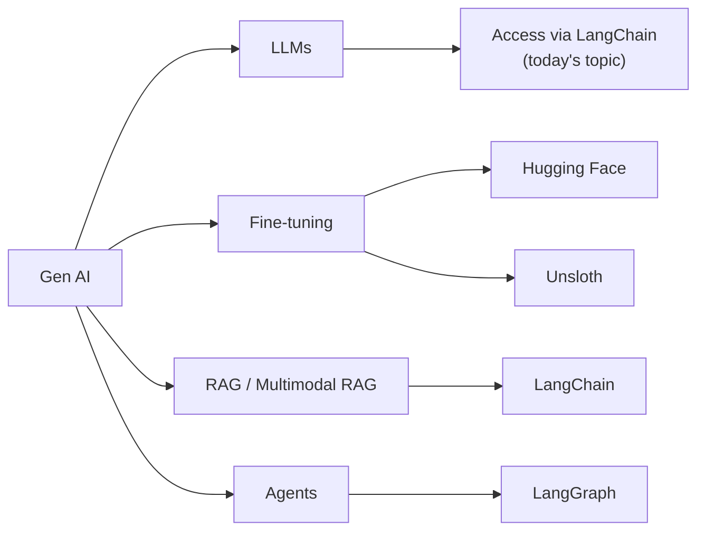
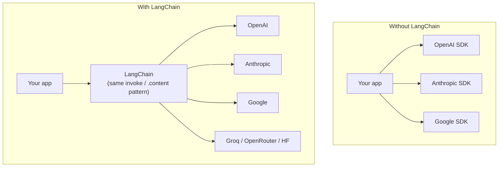
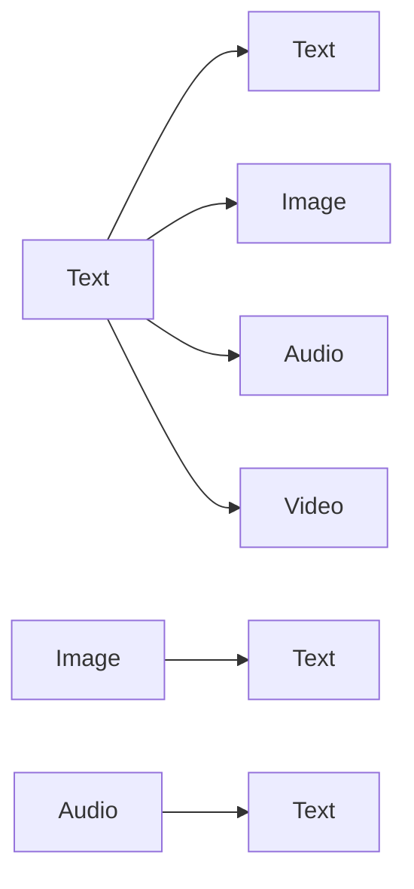
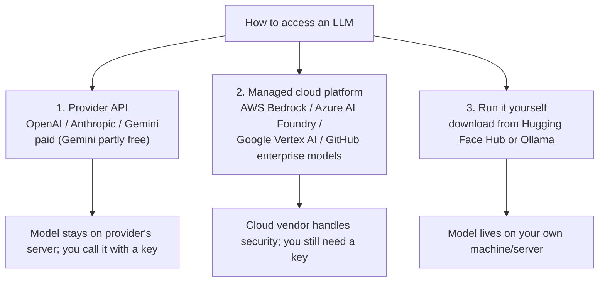

# 🔗 Class: One Interface for Many LLMs — LangChain, Multimodal Models & Free Model Access
### 📋 Gen AI Bootcamp

**🎙️ Mentor:** Sunny Savita
**⏱️ Duration:** ~3.3 hours (about 2.5 hours of teaching + a ~50-minute open doubt session)

---

## 📰 Quick Updates

- All previous-class resources (research-paper links on Notion, handwritten notes PDF) are on the course GitHub. If the PDF won't render in GitHub, download it locally. Sunny will now publish **one small PDF per class** (earlier ones ran 40–45 pages and lost pages while rendering). If a page is still missing, send him the page number.
- An updated `requirements.txt` was pushed to GitHub during class. Pull it before running the practicals.
- Sunny said he will **pre-write detailed notebooks** (more code and explanation than can be typed live) and then walk through them in class. He asked students to agree to this approach.
- This session's practical notebook is `access different LLM and multimodal LLM.ipynb`.
- He was recovering from a cough and cold, so the session was kept shorter than usual.

---

## 🧭 Recap and Where We Are in the Syllabus

Sunny opened with a recap of the previous class: transformers, encoder-only / encoder-decoder / decoder-only models, how BERT was trained, modern LLM families, the ChatGPT-style training pipeline, SLMs, and the start of multimodality. The topics still pending were **multimodal concepts and families, leaderboards, and APIs to access models**. Most of today's time went to the last one.

He then sketched the whole Gen AI stack and the tool that dominates each layer:

Fine-tuning has **not** started yet. Sunny expects to begin it in one or two classes, starting with Hugging Face basics and then Unsloth. Counting the earlier topics, three syllabus modules will be done once this access section finishes. Fine-tuning will then take roughly 4–6 classes before RAG and projects.

---

## 🏢 Who Provides LLMs (and Who Only Distributes Them)

Sunny separated companies that **build** models from platforms that only **serve** them:

| Role | Examples (as named in class) | Models |
|---|---|---|
| Model builders | OpenAI, Anthropic, Google, Meta, Microsoft, Mistral AI | GPT, Claude (Haiku / Sonnet / Opus), Gemini / Gemma, Llama, Mistral |
| Distributors / hosting platforms | Groq, OpenRouter, Perplexity | They integrate models made by others |

He stressed the **Groq vs Grok** confusion more than once:
- **Grok** (with a "k") is the model from Elon Musk's xAI.
- **Groq** (with a "q") is a separate company and platform that hosts open-source models (Llama, Qwen, DeepSeek, Gemma, Mistral, Whisper). Its selling point is ultra-fast inference on its own LPU hardware, with a free tier and an enterprise paid tier.

Open-source models from Meta and others can be downloaded from the **Hugging Face Hub**.

---

## 🧰 Why Not Just Use Each Provider's SDK?

Every provider ships its own **SDK (Software Development Kit)**: OpenAI, Anthropic and Google each have their own package, documentation and code style. Sunny opened the OpenAI, Anthropic and Gemini quick-start pages side by side to show that each has a different import, a different way of initialising the client, and a different way of pulling the text out of the reply.

Two problems follow:

1. **An SDK talks to one provider.** The OpenAI SDK can't call Claude, and the Google SDK can't call GPT.
2. **A real application needs far more than a model call.** Sunny listed prompt templates, memory, document loaders, text splitters, embeddings, vector databases, tools, agents, tracing, evaluation and model switching. No single provider SDK covers all of that.

LangChain's pitch, in Sunny's paraphrase: *"let's integrate everything in one place and use me to build the Gen AI application."*

Sunny showed the OpenAI and Gemini SDK snippets next to the LangChain version. Initialising the model, calling it and reading the content looks structurally the same in LangChain, whichever provider sits behind it. To switch from OpenAI to Google you mostly change the **package/class name and the model name**; the rest of the code stays put. He demonstrated this in one of his end-to-end projects, where a single model-loader class imports the right LangChain class (Groq, Google and so on) and everything downstream just calls `invoke`.

He also gave a pragmatic caveat: calling an SDK directly is technically fine. LangChain earns its place once you build the full application around the model.

---

## 🏗️ What LangChain Actually Is

Sunny cleared up vocabulary that trips people up:

- **LangChain is a company** (US-based) that publishes several products:
  - **LangChain**: the core open-source Python framework, used for RAG and LLM apps
  - **LangGraph**: open-source, used for agents and multi-agent systems
  - **LangSmith**: a platform for tracing, observability, evaluation, debugging, and now deployment. He described it as the company's main revenue source, and enterprises typically buy the paid tier.
  - **Langfuse**: an observability / tracing tool. Sunny grouped it with the LangChain family; it is worth knowing it is a separate open-source project that is commonly used alongside LangChain.
- Both LangChain and LangGraph are on GitHub (he pointed out the repo has well over 100K stars and 20K+ forks, and that `langchain-core` is the same code published as a package).
- **Module, package, framework**: in everyday usage, they all mean the same thing: a **codebase of predefined classes and functions written by someone else, which you install (with `pip` or `uv`) and consume**. You are a *user* of LangChain, not the author.
- Sunny said LangChain and LangGraph are used in the large majority of enterprise Gen AI work (he used figures like 90–95%; treat that as his experience rather than a measured statistic). The reasons he gave: it's open source, you can install it anywhere, and it gives one unified way to build.
- Deep dives on LangChain, LangGraph, LangSmith and Langfuse are **deferred** to the RAG chapter.

---

## ⚙️ Setup for the Practical

Packages needed in `requirements.txt` (LangChain integration packages, one per provider):

- `langchain-google-genai`
- `langchain-openai`
- `langchain-groq`
- OpenRouter integration
- `langchain-huggingface`

Python 3.12 is fine. API keys are kept in a **`.env` file**, loaded in the notebook, and set as environment variables. The notebook first runs a simple `print("OK")` to confirm the kernel works.

---

## 🧩 Types of Models by Input → Output

Sunny listed the modality combinations and flagged which ones matter:

- **Text → text**: the workhorse. He said it's what you'll use roughly 90–95% of the time.
- **Text → image** and **image → text** (parsing / OCR): both demoed today. Image → text matters a lot for RAG over documents.
- **Text → audio** and **audio → text**: promised for a later class.
- **Text → video**: possible to look at; he'll give video as an assignment.
- **Image → image, audio → audio, image → video**: noted as generally not required.

---

## 🧪 Practical 1: Text → Text with a Paid Model (OpenAI)

The pattern is the same one he'll reuse for every provider:

1. Import the LangChain class for the provider (`ChatOpenAI` from `langchain_openai`).
2. Create an object with a model name (he used a GPT-5 Nano model first) and keep it in a variable, `llm`.
3. Call `llm.invoke("What is the capital of India?")`.
4. The result is a message object; read the answer from its `.content` (he got "New Delhi").

The API key comes from the environment (loaded from `.env`). Sunny noted the key is created from the OpenAI platform's "Create an API key" link, and you must add credit to your account.

**Important point students raised repeatedly:** a ChatGPT Plus (or Claude Plus) subscription is for the *chat app* and does **not** give API access. API usage is billed separately through credits.

---

## 🎨 Practical 2: Text → Image

Sunny used a GPT-5.4 model through the same `ChatOpenAI` class and asked it to "draw a picture of a cute, fuzzy cat with an umbrella."

- A plain `invoke` returned **only text**, so decoding it as an image failed. This was the teaching moment.
- To get an image, he defined a tool-config dictionary with `type` set to image generation and `quality` set to low, then attached it with **`llm.bind_tools([...])`** and invoked the bound model.
- The response held the image inside its **content blocks**. He pulled out the image data, **Base64-decoded** it, and displayed it. The cat image appeared.

Takeaway: the image comes back as encoded data inside the message, not as a ready-made picture.

---

## 👁️ Practical 3: Image → Text (Vision / OCR)

Sunny used the `GPT-4o mini` model (chosen for its good OCR on images) and a local PNG of the self-attention formula.

1. Read the file in **binary (`rb` = read bytes)** and encode it as **Base64**.
2. Build a **`HumanMessage`** whose content has a text part ("what is inside the image?") and an `image_url` part carrying the Base64 data.
3. `invoke` the model and print the response. It correctly described and parsed the image.

He then showed that you can pass a **direct image URL** instead of Base64, and it worked too.

**What is Base64?** In Sunny's words, a binary representation of a file. Images, audio, video and even PDFs can all be turned into this form so they can travel inside a request.

On JPG vs PNG (asked in Q&A): PNG was just a safe, standard choice for the demo; other formats such as JPG, GIF and WebP can be tried.

---

## 🆓 Where to Get Models Without Paying

Sunny split model access into three routes:

- **Provider APIs (OpenAI, Anthropic)** are paid. You read the model from their server with an API key; you can't download it.
- **Managed cloud platforms** (AWS Bedrock, Azure AI Foundry, Google Vertex AI, GitHub enterprise models) also need a key, but the cloud vendor handles security and controls. All of them can be reached through LangChain. Sunny said he'll show Foundry and Bedrock in the project phase.
- **Hubs** (Hugging Face Hub, Ollama Hub) are repositories you can **download** models from, in the same way you download code from GitHub or pull images from Docker Hub. The downloaded model lives on your own system. Hugging Face and Ollama are slated for the next class.

**Free (or partly free) options he listed for learning:**

| Platform | Notes |
|---|---|
| Groq | Free access to open-source models, very fast inference |
| OpenRouter | Free access to certain models |
| Google Gemini API | Partly free, limited access to limited models |
| Hugging Face Inference API | Serves models from the Hugging Face Hub |

---

## 🧪 Practical 4: Text → Text and Image → Text on Groq (Free)

- **Text → text:** he imported `ChatGroq` from LangChain, used an open-source Qwen model, and asked it to translate English to Hindi. The same `invoke` → `.content` pattern worked, proving free text-to-text inference.
- **Image → text:** he switched to **Llama 4 Scout 17B 16E Instruct** (open source, hosted on Groq), passed an image URL in the message, and got a description back.

Takeaway: the code is nearly identical to the OpenAI version; only the class and model name changed. That was the whole point of the class.

---

## 🗺️ What's Next

- More examples (Sunny mentioned 10–15) across **OpenRouter, Hugging Face API and Gemini**, including text → audio and audio → text. Video is an assignment.
- Message types (system, human, AI) explained properly, with examples.
- Quick theoretical recap of the remaining multimodal slides and leaderboards.
- **Hugging Face and Ollama hubs**, then **fine-tuning** basics before Unsloth.
- LangSmith / Langfuse tracing, Pydantic and the full LangChain deep dive come later, mostly in the RAG chapter.

---

## 💬 Live Q&A Highlights

| Question | Answer |
|---|---|
| Difference between system, human and AI messages? (Venkata Raju) | System message sets the model's context. Human message is what the user asks. AI message is what the model returns. Deeper examples next class. |
| Which topics to study for an Agentic AI Delivery Lead interview in manufacturing? (Yogeshwar) | Think in three layers: (1) business problem understanding (quality, production, root cause, inventory, safety, supply chain; agents are more than chatbots); (2) the Azure AI Foundry ecosystem (Azure OpenAI, Azure AI Search as vector DB, prompt flow, content safety / responsible AI, RBAC); (3) agentic architecture (single vs multi-agent, planner-executor, supervisor, tool/function calling, memory, guardrails). RAG matters too. |
| How is Bedrock more secure than calling Claude directly? (Mahesh) | With Bedrock you run the model inside the cloud vendor's managed service, so network security, access control (RBAC) and observability sit with AWS under their agreement with the model provider. With a raw API you depend on the provider's own terms and enterprise arrangements. In practice, check each provider's data-usage terms for your use case. |
| Why use LangSmith and Langfuse? (Raghu) | For tracing and observability. Easy to configure with API keys; shown later once the class moves from notebooks to proper projects. |
| Should we learn LlamaIndex, CrewAI and other frameworks? (Raghu) | Master LangChain in depth first; add others later. |
| Will course projects use paid components? (Yash) | Paid pieces will be flagged when they come up. Using LangChain with OpenAI or Anthropic requires an API key with credits. |
| Groq API key creation failed (Sauvik) | The attempt with a name containing an underscore and no expiration failed; a simple name such as "test" with a 30-day expiry worked. Sunny suspected the name. |
| Gemini calls erroring out (Narasaiah) | The older model name was not found; he switched to Gemini 2.0 Flash, restarted the kernel and reloaded the key. A later "resource exhausted" message was a rate limit; try a fresh key from another Google account. Model names are retired over time, so check Google's current model list. |
| How to choose the right model for cost, latency and complexity? (Pushpendra) | There's no fixed answer. Run a spike/POC: shortlist 4–5 models, then compare on use case (chat, coding, OCR, agents, on-device), latency/speed, cost and context window, and evaluate before picking one. |
| Are there predefined security roles for LLM access? (Jyoti) | Sunny relies on Azure AI Foundry and AWS Bedrock in production; they provide the controls and many models, including open-source ones. |
| Do models only work with PNG, not JPG? (Jyoti) | No; PNG was just a standard format for the demo. Try JPG, GIF, WebP too. |
| How is Groq positioned if it has no models of its own? (Lakshmi) | It hosts open-source models on its own fast infrastructure, free for learning with a paid enterprise tier, similar in spirit to managed platforms like Bedrock. |
| Does LangChain keep code compatible across SDKs? (Lakshmi) | Yes, that is its main value. Message formats (plain strings, human message, lists of messages) will be covered next class. |
| What is Pydantic? (Lakshmi) | Used for data validation; covered later. |
| Is Azure AI Foundry in the course? (Ashish) | Yes, in the project phase. |
| Does a ChatGPT Plus or Claude Plus subscription include API use? (Ashish) | No, the subscription is for the chat app. API usage is bought separately. |
| Do different platforms host the same LLMs? (Ganesh) | Groq and Hugging Face both serve mainly open-source models, but with different infrastructure and support. Groq doesn't host GPT models. Groq (company) ≠ Grok (xAI model). |
| Is RAG part of training? (Ganesh) | No. RAG isn't training; fine-tuning is. Detail comes when RAG is taught. |
| Does Cursor use LangChain internally? (akulkar2) | Not sure. Cursor is an IDE that integrates models from the big providers; it may have its own integration layer. |
| What does "inference" mean? (Tej) | Giving input to a trained model and getting its output (the prediction), whether through Groq, ChatGPT or any other. |
| Do locally hosted models have limits vs. API models? Is Hugging Face the standard framework? (AWS Demo) | Yes, local/open models are generally less capable, and you need enough infrastructure and often fine-tuning. Good for learning; few companies host their own LLMs. Hugging Face is for downloading and training models; LangChain / LangGraph dominate RAG and agent work. |
| Are the three access routes right, and does downloading mean only free models? (Admin) | Yes to the three routes. Free options for learning are Groq, OpenRouter and Gemini; self-hosting is rare in industry. |
| Can LangChain call Bedrock and Microsoft Foundry models? (VeeraSekhar) | Yes, there are direct LangChain integrations; Sunny noted Azure OpenAI is now branded under Foundry, and models in Foundry can be accessed from LangChain. |

---

## 🔑 Key Pointers to Remember

- Provider SDKs talk to **one** vendor; LangChain gives **one pattern** (`invoke` → `.content`) for many.
- Switching providers in LangChain mostly means changing the **class and model name**.
- LangChain, LangGraph, LangSmith and Langfuse each have a distinct job (RAG apps, agents, tracing and evaluation).
- "Module", "package" and "framework" all mean installed code written by someone else.
- A ChatGPT / Claude **subscription is not API access**.
- Three ways to reach a model: **provider API**, **managed cloud**, **download from a hub**.
- You **cannot download** models from OpenAI or Anthropic's API; you can from Hugging Face or Ollama.
- Images travel as **Base64** (or a URL); image generation needs `bind_tools`.
- **Groq ≠ Grok.** Groq is a fast host for open-source models.
- Pick a model by use case, latency, cost and context window, and **evaluate** before committing.

---

## ✅ Action Items After This Class

- [ ] Pull the latest repo changes (updated `requirements.txt`, notebook, class PDF)
- [ ] Install the five LangChain integration packages and set up your `.env`
- [ ] Re-run the notebook: text → text, text → image, image → text
- [ ] Create a free **Groq** API key and run the Qwen and Llama 4 Scout examples
- [ ] Try a **Gemini** key with a currently available model name
- [ ] Read through the OpenAI, Anthropic and Gemini SDK quick-starts to see how each differs
- [ ] Send Sunny the page number if any note page is missing
- [ ] Bring doubts about message types and Base64 to the next class

---

*📝 Notes compiled from the full class transcript — "One Interface for Many LLMs," Gen AI Bootcamp. Code behaviour is described from the live walkthrough; the notebook itself was not provided, so check the course GitHub for the exact code.*
