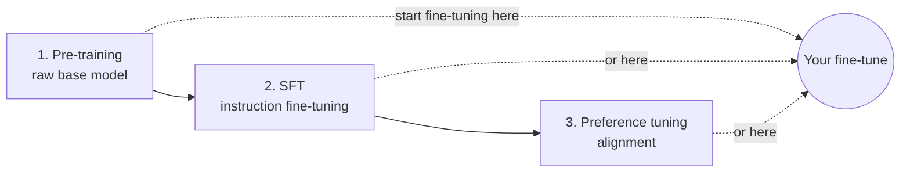
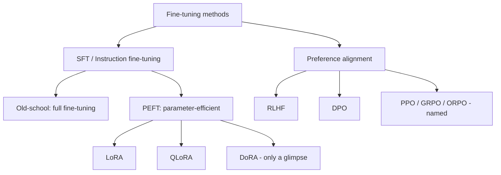
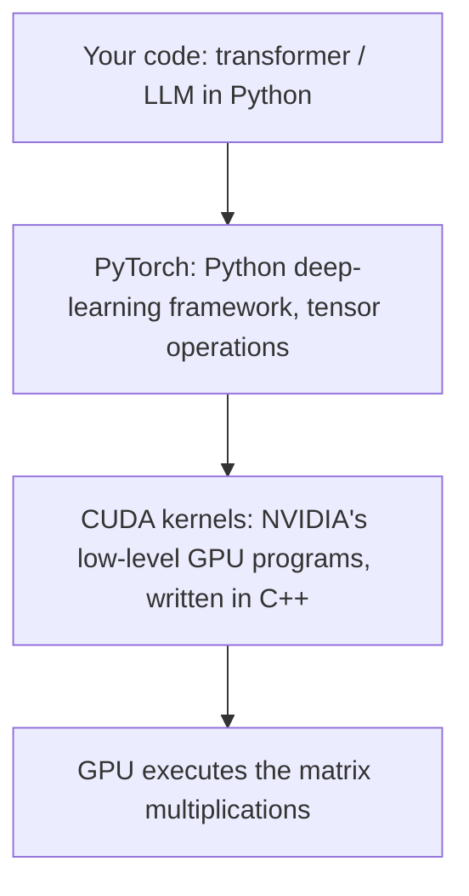
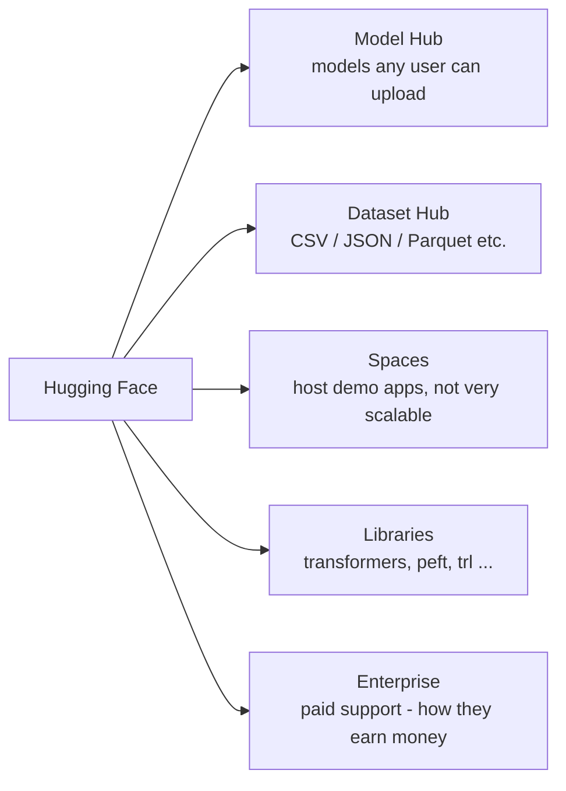
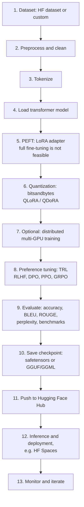
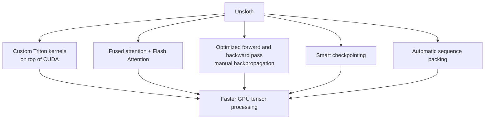
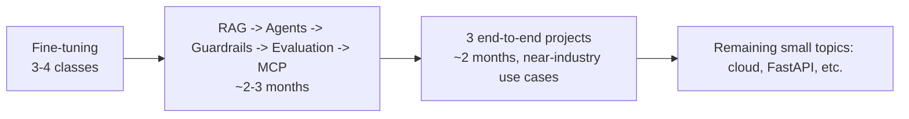

# 🤗 Fine-Tuning Module: Hugging Face Ecosystem, Unsloth & Colab Setup
### 📋 Generative AI Course | Live Cohort

**🎙️ Mentor:** Sunny
**⏱️ Duration:** ~2¼ hours of teaching (with a dinner break) + ~1 hour open doubt session
**📅 Session:** Fine-tuning chapter, framework fundamentals (the actual fine-tuning practical starts next class)

---

## 📰 Quick Updates

- Recordings and resources for earlier classes are on the course dashboard (resources section). Sunny asked everyone to watch the previous recording, since this class builds directly on it.
- Notes for this class were pushed to his GitHub repo (open the `latest` folder) and will also live in Notion. The Colab notebook from the class was shared **view-only**; the code is also on GitHub.
- The practical for the whole fine-tuning module has **moved to Google Colab**, because most people don't have a suitable GPU locally.
- Sunny's advice on following along: **don't type simultaneously**. Watch and listen now, practise afterwards from the shared code.

---

## 🔁 Recap: What Fine-Tuning Actually Is

Fine-tuning means **continuing to train a model's weights** on your own data. A student's one-line version in class was "training an LLM with custom data", which is right once you add that you are *adjusting existing weights*, not building a model from scratch.

Sunny placed those weights inside the transformer: in the decoder stack, in the **self-attention** blocks and the **feed-forward network**.

**Three stages of building an LLM**, and you can pick up a model from *any* of them:



The model-selection question from the previous class carries over: take a **raw/base model** or an **already instruct-tuned model**, then run SFT on top.

**Methods covered in this chapter**



Sunny will focus on **LoRA and QLoRA**, show DoRA briefly, and demo preference tuning with **RLHF and DPO**.

**Two frameworks for implementation:** **Hugging Face** (the foundation) and **Unsloth** (the optimized layer on top). Nobody writes this from scratch, so frameworks are essential.

---

## 🔥 Side Clarification: PyTorch vs TensorFlow

A student question the day before prompted a "disclaimer" on where PyTorch fits.

**The stack, bottom to top:**



- **PyTorch** is an open-source deep-learning framework (from **Meta**) whose parent library, Torch, has a C++ core. It exposes **tensors**, which are special matrices, and the point Sunny kept returning to is that deep learning is essentially matrix multiplication, executed on the GPU through NVIDIA's **CUDA** layer.
- **TensorFlow** (from **Google**) is the alternative framework.
- The transformer-from-scratch code Sunny shared earlier is written in PyTorch. Hugging Face's own low-level model code is built on PyTorch or TensorFlow too.
- **His recommendation:** PyTorch, because it is easier to learn. But it is **optional**. You only need it when coding networks or LLMs from scratch. For RAG, agents, and even fine-tuning, ready-made frameworks are used instead, and the course won't teach PyTorch because it isn't required.

If asked "what is PyTorch?" in an interview, his model answer is: *an open-source deep-learning framework used to write models, such as any LLM, from scratch.*

---

## 💻 Where to Train: Google Colab and Alternatives

Fine-tuning needs a GPU. Sunny's own GPU is a consumer card meant for gaming, editing and rendering. It can only do basic training, and serious LLM training wants high-end hardware (he joked about DGX-class machines). Unsloth makes smaller GPUs workable, but he still advised Colab for everyone.

**What he demonstrated in Colab**

1. Search "Google Colab" and open the main site. You can create a new notebook, open from Google Drive or GitHub, or **upload a local `.ipynb`**.
2. A Colab notebook is just a Jupyter notebook (`.ipynb`), the same format as the local one used earlier.
3. **Runtime → Change runtime type → T4 GPU.** On the free tier T4 is the only GPU option, and other GPUs unlock via paid compute units.
4. After connecting, **View resources** shows what you actually get.

**Free-tier resources as shown in class**

| Resource | Amount |
|---|---|
| GPU RAM (VRAM) | ~15 GB |
| System RAM | ~12.7 GB |
| Disk | ~112 GB total (about half already used by the Linux VM and sample data) |

Colab is a **virtual machine provided by Google**, used here for computation only. You **cannot deploy a real application from Colab**.

**Plans quoted in class (prices as stated by Sunny, so check current pricing):** Colab Pro is roughly $11/month (~₹1,000) with about 100 compute units, faster GPUs and more memory. A higher tier is about $58, and there is an enterprise option.

**Other GPU options he listed:** RunPod, Paperspace Gradient, Vast.ai, Kaggle notebooks (free GPU), Lightning AI, Lambda, and the clouds themselves (AWS, GCP, Azure). Sunny's rule of thumb: Colab or Kaggle for learning and small runs, and RunPod or cloud GPUs for production-grade training. VS Code also has a Colab extension, though he demoed on the website.

> **One practical point:** the GPU is only consumed **while training**. Reading files and making API calls (today's demos) don't use it, which is why Colab warned "connected to a GPU but you're not using it".

---

## 🤗 What Is Hugging Face?

### The website tour

Sunny opened huggingface.co and walked through **Models, Datasets, Spaces, Docs, Pricing**. The Hub works like **GitHub for AI artifacts**:

- Anyone can upload a model or dataset to a repository, and anyone can download or use it.
- He showed his own repos. One tiny DPO chatbot adapter repo holds `adapter_model.safetensors` (about 4.25 MB, a binary weights format), a tokenizer, and JSON configuration files.
- The **Docs** section shows each library's documentation.

### What it is, in one line

> An **AI company** providing a complete ecosystem for AI development: models, datasets, libraries, and hosting. It is open-source-first and works for the community.

**Core components**



Sunny's claim, which he made emphatically: *almost the entire modern LLM fine-tuning industry workflow revolves around the Hugging Face ecosystem.* Whatever other tools exist (Unsloth, Llama-Factory, Axolotl), they are built on top of it.

### Libraries you need for LLM fine-tuning

| Library | Role |
|---|---|
| **transformers** | The model library, including LLMs coded in PyTorch. This is the key one. |
| **datasets** | Load and process datasets |
| **tokenizers** | Convert text into tokens |
| **peft** | Parameter-efficient fine-tuning (LoRA, DoRA) |
| **accelerate** | Training across hardware / multi-GPU |
| **trl** | Reinforcement and preference training (RLHF, DPO, PPO, GRPO) |
| **bitsandbytes** | Quantization (QLoRA) |
| **safetensors** | Saving weights in binary format |
| **evaluate** / **lighteval** | Metrics: accuracy, F1, BLEU, ROUGE, perplexity, benchmarks |

Others mentioned: diffusers, optimum, Gradio, sentence-transformers (used earlier in the embeddings chapter for embedding models, not LLMs).

### "Native vs outsider" libraries

Not everything in the ecosystem was written by Hugging Face. Natively built: transformers, datasets, tokenizers, peft, accelerate, trl, diffusers, evaluate, optimum, safetensors. Built by others but integrated: **bitsandbytes**, sentence-transformers, timm, Argilla, Gradio-style tools. The ecosystem is integrated even where ownership differs.

### Hugging Face vs LangChain

This came up repeatedly, and Sunny separated them clearly:

| | Hugging Face | LangChain |
|---|---|---|
| What it is | AI company / hub: models, datasets, training libraries, hosting | Unified framework for **building applications around LLMs** (RAG, agents) |
| Rules which area | **LLM fine-tuning** | **RAG and agentic apps** (LangGraph, LangSmith, LangFuse) |
| Open source? | Yes | Yes (framework and LangGraph fully open) |
| How they earn | Hugging Face Enterprise (paid) | Enterprise offerings, mainly LangSmith / LangFuse |

Story in brief: Hugging Face started early as a free platform for models and datasets, then expanded into libraries for retraining and hosting. LangChain arose after ChatGPT and the OpenAI API, providing a unified way to wire LLMs to vector DBs, memory, and tools.

---

## 🛠️ The Hugging Face Fine-Tuning Pipeline (Roadmap)

Sunny drew the full workflow on the board. It is the skeleton for the upcoming practical.



**On monitoring and iteration:** monitoring covers quality/accuracy, latency, CPU/GPU resource use, token usage and cost. Iteration means adding new data, updating the LoRA adapter, further preference tuning, and hyperparameter tuning.

**Small clarifications from chat**
- **GGUF/GGML** are optimized binary model formats for running models efficiently (Sunny couldn't recall the runtime's name; llama.cpp-style tools such as LM Studio are where these are used).
- **Distributed multi-GPU training** was mentioned with a tool name that came through garbled in the transcript, most likely **Axolotl**. Sunny stressed it is *optional*.
- **Guardrails are not part of training.** They apply at inference time, together with RAG for hallucination control. This pipeline is purely the model-training level.
- **Reinforcement learning** enters at the preference-tuning step (RLHF).

---

## ⚡ Unsloth: The Optimized Layer

> **Definition (from his slide):** Unsloth is an ultra-optimized LLM fine-tuning framework, built on top of the Hugging Face ecosystem, that enables fast LoRA, QLoRA and RLHF training with very low VRAM usage.

### Why it exists

Plain Hugging Face training is **slow, VRAM-hungry and expensive**. Unsloth is the "rescue". It is free and open source, with documentation, a GitHub repo, wide model support (including vision fine-tuning) and even a UI for setting parameters.

### The claims Sunny walked through

- **2–3× faster training** (the official headline claim).
- **Far lower VRAM**, so large models can train even on a free T4. His Llama example: standard Hugging Face needs ~24 GB to fine-tune, Unsloth does it in roughly 7–8 GB.
- **Much longer context training.** A table in the repo shows the context length reachable at each VRAM size (for example, tens of thousands of tokens on 12–20 GB cards), compared with Hugging Face needing far bigger GPUs and still hitting out-of-memory errors.
- **No accuracy loss.**

> ⚠️ **Numbers in the class were a bit loose, so treat the claims carefully.** Sunny gave illustrative figures live, including a "30 min → 5 min, roughly divide by 10" example, a "10 hours vs 5 hours" example, and a page-count estimate that shifted mid-way. The headline claim in the Unsloth docs is 2–3× faster. Page estimates: at roughly 500–600 tokens per page, **~28K tokens is on the order of 50 pages**, not hundreds. Verify any benchmark against the Unsloth docs before quoting it.

### Why it's faster (his interview answer)



- **CUDA** is NVIDIA's low-level GPU layer. **Triton** is a Python-like GPU language that generates highly optimized kernels, and Unsloth uses custom Triton kernels instead of the stock CUDA path.
- Sunny noted he wasn't sure in class whether the Triton kernel was open source. For accuracy: Triton, the language/compiler, **is** open source (the tutorials he opened are part of that project). Unsloth's own kernels are their custom work.
- **Flash Attention** is public (from the Dao AI Lab). **Fused attention** is another attention optimization he looked up live.
- The key claim: **Unsloth does not use approximation tricks.** It optimizes how the math is executed but keeps full-precision output, so accuracy loss is negligible. He used a "round the numbers before multiplying" analogy to explain what approximation would mean.
- Under the hood it still uses **transformers + PEFT + TRL**, with attention and kernel optimizations on top, running on PyTorch → CUDA/Triton → GPU.

> **Interview tip from Sunny:** no one asks for the maths. Just name the points: Triton kernels, fused/flash attention, smart checkpointing, auto sequence packing, no approximation.

### Which to use?

Sunny taught Hugging Face first to build the basics, but for a **real-time/production fine-tuning use case he would pick Unsloth**. It is industry-grade, has good community support, and supports virtually every model.

---

## 🧪 Hands-On: Talking to the Hugging Face Hub from Code

Sunny stressed this was a warm-up and not fine-tuning yet. Fine-tuning comes next class.

### 1. Tokens, the secrets panel, and the `HF_TOKEN` gotcha

On the Hub: **Profile → Access Tokens → Create token.** Types: **read**, **write**, and **fine-grained** (custom permissions per token).

- **Read token** = download or read models and datasets.
- **Write token** = upload your own models/datasets. Sunny's file analogy: reading a file vs writing to it.

In Colab, click the **🔑 key icon** and add secrets. Make sure notebook access is enabled for each secret. The icon even generates the loading snippet:

```python
from google.colab import userdata
hf_token = userdata.get("HF_TOKEN")   # secret name as defined in the Colab panel
```

> ⚠️ **The one that bit half the class.** Hugging Face libraries look for an environment variable/secret named exactly **`HF_TOKEN`** by default. Sunny had named his secrets "HF Read" and "HF Write" for clarity, which worked for him but not for students who copied that. The doubt session fixed it repeatedly:
> 1. Create a secret literally named `HF_TOKEN` and paste a **read** token (copy with the copy icon so it's complete).
> 2. Restart the session and run from the top.
> 3. Alternatively, pass the token explicitly in code. He said he'll show exactly where to pass it next class.

### 2. `HfApi`: querying the Hub

Install the client and create an API object (as narrated in class):

```python
# pip install huggingface_hub
from huggingface_hub import HfApi

api = HfApi()   # next class: the token parameter on this object

api.model_info("<repo_id>")                      # metadata of one model repo
list(api.list_models(search="llama", limit=50))  # search models by term
api.list_repo_files("<repo_id>")                 # files inside a repo
api.dataset_info("<dataset_repo_id>")            # dataset metadata
```

What each call returns:
- `model_info`: tags, commits, last modified, likes, author, whether it's private, download counts (the repo's **metadata**).
- `list_models(search=...)`: iterate the result and read model names. Searching "qwen" returned well over a thousand repos, and the same trick works for "embedding" or any term. Remove `limit` to get everything.
- `list_repo_files`: all files in a model repo (the same set you'd get from training and later push yourself).
- `dataset_info`: files such as Parquet, JSON and README for a dataset.
- Press `.` after the `api` object to explore every method (list organization members, papers, and so on).

The repo ID is the `owner/name` string shown at the top of any model page.

### 3. Calling a hosted model with `InferenceClient`

The same class of calls through the Hub's own client: create an `InferenceClient`, then call `client.chat.completions.create(...)` with your prompt and print the response.

**Key point:** this is an **API call** to Hugging Face's servers. Nothing is downloaded to your machine.

### 4. The same thing through LangChain

Sunny recapped his earlier LangChain classes, installing `langchain-huggingface` and `langchain-community`:

```python
from langchain_huggingface import ChatHuggingFace, HuggingFaceEndpoint

llm = HuggingFaceEndpoint(repo_id="<repo_id>", task="text-generation", max_new_tokens=...)
chat = ChatHuggingFace(llm=llm)
chat.invoke("your prompt")
```

He also showed prompt templates and a `RunnablePassthrough` chain as a teaser to show that **any free Hugging Face model can be plugged into a RAG or agent pipeline**. Those pieces are for the RAG chapter, so he told students to skip them for now.

---

## 📓 Preview: The Hugging Face Core Notebook (Next Class)

Sunny showed a prepared notebook he'll teach in the next class (~1 hour), which is the "core of Hugging Face" before fine-tuning proper. Contents:

1. **Login** to Hugging Face: several ways.
2. **Datasets**: separate examples for unsupervised pre-training, supervised fine-tuning, and RLHF; preprocessing; **streaming** mode for very large datasets; creating a **custom dataset**, converting it to Hugging Face format and uploading it to your repo.
3. **Tokenization**: what happens to text, pre-trained tokenizers (every model ships with its own: Llama, Mistral, Qwen, Google), algorithms like **BPE** and **SentencePiece**, and training a **custom tokenizer** (practical only, no maths).
4. **Loading models** into memory: `AutoModel` and `AutoModelForCausalLM` (GPT-style text generation), and `snapshot_download` to pull model files locally.
5. Skipped or deferred: the pipeline helper (skipped), sentence-transformers (already covered), evaluation metrics (held for the evaluation chapter).

---

## 🗺️ What's Next

**Immediate:** the Hugging Face core notebook → fine-tuning with Hugging Face → fine-tuning with Unsloth (separate notebook). Fine-tuning is estimated at **3–4 more classes**, all trained on Colab. A "when to fine-tune vs when to use RAG" discussion is deferred until RAG is introduced. Data format questions (for closed-model fine-tuning too) will be handled during the practical.

**Overall roadmap Sunny laid out**



- About **90–95% of the curriculum** done in roughly **4–5 months** once projects finish.
- **Prompt engineering** isn't a separate chapter. It is taught inside the RAG material.
- Projects will mimic real industry use cases (not actual employer projects, to avoid compliance trouble). One may involve AWS.
- Sunny's day job: generative AI engineer/developer at PwC.

---

## 💬 Live Q&A Highlights

| Question | Answer |
|---|---|
| Can OpenAI and other closed models be fine-tuned? (chat) | Yes, through their APIs (OpenAI, Vertex AI/Gemini). You send data to their platform and get a tuned model back. You **can't download the weights** or configure the infrastructure. |
| Is fine-tuning only for open-source models? Any required data format? (Sankar) | Closed models are tunable via vendor APIs but with little control. Data format is deferred to the fine-tuning practical. |
| Can the same fine-tuning setup be switched between LLMs? (chat) | Yes, you can use any LLM for fine-tuning. |
| Fine-tuning vs RAG, how to choose? (chat) | Deferred, and it becomes self-explanatory after RAG is covered. |
| Do guardrails and reinforcement learning appear in the pipeline? (chat) | RL appears as RLHF in preference tuning. Guardrails are an inference-time concern, not a training step. |
| Can I deploy an app from Colab? Do I use CPU or T4? (chat) | No real app deployment from Colab. Pick the **T4 GPU** runtime (Colab is for GPU use). |
| Where does a model's 30 GB size come from? Is it the internet data stored? (ABR) | No data is stored. A model is an algorithm with learnable **weights and biases**, and those stacked parameters are the file size. It learned to **predict the next token** during training and generates text one token at a time at inference. See the transformer videos. |
| Colab gives "API key missing" for the Qwen model even though tokens were added (Ruchi, Vivek, Prajna, Narasaiah) | Name the secret exactly **`HF_TOKEN`**, put a complete read token in it, restart the session and rerun. Or pass the token explicitly in the `HfApi` object (shown next class). Sunny acknowledged that he should have made the name clearer. |
| How do I pick between read vs write tokens in code? (Khadeja, Vivek) | Read token to read/download, write token to push models or datasets. To use a specific token, set it explicitly in the object or class (detailed next class). |
| Text-to-speech in Amharic loses sounds and stress (Yonas) | Likely the model hasn't seen enough of that language. Try other TTS models (Google TTS, or Meta's multilingual **MMS-TTS** for Amharic, loaded via `transformers`), or **fine-tune via the OpenAI API with 10–15 examples** (see his YouTube fine-tuning video). |
| How do I add external tools in LangChain / LangGraph? (Yonas) | Custom tools are built from LangChain's classes (4–5 ways). Covered in the agentic chapter, and in his LangGraph/agent playlists on YouTube meanwhile. |
| How to build a log-analysis assistant for streaming app logs? (Vivek) | The challenge is the **data pipeline**, not the LLM. Collect logs (CloudWatch, ELK, Kubernetes; stream via Kafka/Kinesis/PubSub) → clean and parse into structured JSON with metadata → embed and store in a **vector DB** → build RAG on top. A capable LLM then explains errors and exceptions. Needs proper engineering, not just a Python script. |
| Which is more dominant in industry: fine-tuning, RAG or agentic/MCP? (Sushanta) | **RAG and agentic pipelines** dominate. Training is not required for most use cases. |
| Which framework for fine-tuning in my company? (Niv) | **Unsloth**. Production-grade, fast, well supported. Hugging Face is taught for the fundamentals. |
| How to build a portfolio/career when working as a product analyst (Khadeja) | Build **end-to-end** AI applications (business problem → architecture → development → deployment), not notebook demos. Wait for the class projects (2–3 months). Keep learning by working, exploring 1–2 hours a day, and **creating content** (blogs, newsletter, videos), which forces depth. |
| How are Hugging Face and LangChain related? Is Hugging Face just GitHub for models? (Tej) | Separate companies. Hugging Face = hub plus training libraries. LangChain = framework for building LLM apps. "GitHub for models" is the right mental picture. |
| Does a model "remember" who the PM is? Why Colab for fine-tuning? (Tej) | Not memory. It predicts from what it saw in **training**. If something changed later, the **application** fetches fresh data (web, tools, RAG/agents/MCP) and passes it into the prompt as context. Colab is for GPU access. |
| Are all Hub models hosted live (24x7 API)? Free? (Anmol) | Yes, Hugging Face hosts them on its servers, accessible any time. Paid options may exist for advanced models (Sunny wasn't sure, check). |
| OpenAI vs Hugging Face: when to use which? (Amol Kulkarni) | OpenAI API gives only OpenAI's own models. The Hub has lakhs of models you can also **download and fine-tune**. |
| Do we need PyTorch/TensorFlow for the course? (Amol Kulkarni) | General understanding only. Not required for RAG, agents, or fine-tuning with ready-made frameworks. |
| How safe/trustworthy are community models for office use? Where to check? (Prajna) | Check **leaderboards**: Hugging Face's open-source LLM leaderboard, Arena leaderboards. (Heavier security vetting wasn't discussed in class.) |
| At which step do we actually consume the GPU? (Ashish) | While **training**, so when fine-tuning starts. |

---

## 🔑 Key Pointers to Remember

- Fine-tuning = **continuing to train the weights**. You can start from base, instruct-tuned, or preference-tuned models.
- SFT = instruction fine-tuning. PEFT (LoRA/QLoRA/DoRA) = partial fine-tuning because full fine-tuning is too heavy.
- **PyTorch/TensorFlow** are for writing models from scratch. Not needed for this course.
- Deep learning ≈ matrix multiplications on tensors, run on the GPU via **CUDA kernels**.
- **Hugging Face** = AI company + Hub (models), Dataset Hub, Spaces, libraries. Earns via Enterprise. The base of all fine-tuning tooling.
- Know the libs: **transformers, datasets, tokenizers, peft, accelerate, trl, bitsandbytes, safetensors, evaluate/lighteval**.
- **Hugging Face vs LangChain:** fine-tuning ecosystem vs RAG/agent application framework.
- **Unsloth** = optimized layer *on top of* Hugging Face: faster, far less VRAM, longer context, no accuracy loss, thanks to Triton kernels, fused/flash attention, smart checkpointing, sequence packing.
- For real-world fine-tuning, pick **Unsloth**. Hugging Face teaches the fundamentals.
- Colab free tier = **T4**, ~15 GB VRAM, ~12.7 GB RAM. GPU used only during **training**.
- Read token = download. Write token = upload. Name the secret **`HF_TOKEN`**.
- `HfApi`: `model_info`, `list_models`, `list_repo_files`, `dataset_info`.
- `InferenceClient` and LangChain wrappers **call the Hub's API** and don't download the model.
- Models don't "know" fresh facts. **Applications** (RAG, agents, MCP) supply current context.
- In industry, **RAG and agents** dominate over fine-tuning.

---

## ✅ Action Items After Class

- [ ] Watch the previous class recording and read the notes pushed to GitHub (`latest` folder).
- [ ] Open the Colab notebook and set the runtime to **T4 GPU**.
- [ ] Create a Hugging Face account and generate a **read** and a **write** token.
- [ ] Add a Colab secret named **`HF_TOKEN`** (read token), restart the session and rerun.
- [ ] Practise `HfApi`: `model_info`, `list_models(search=...)`, `list_repo_files`, `dataset_info`.
- [ ] Try `InferenceClient` and the LangChain `HuggingFaceEndpoint` call with a free model.
- [ ] Skim the **Unsloth docs and GitHub repo** (claims table, supported models).
- [ ] *(Optional)* read about PyTorch basics, if curious.
- [ ] Next class: be ready for datasets, tokenization, and loading models.

---

*📝 Notes compiled from the full class transcript (including the evening doubt session), "Hugging Face and Unsloth Foundations," Generative AI Course. The session recording did not include the shared notebook, so code snippets are reconstructed from Sunny's narrated walkthrough; model names are left as placeholders.*
