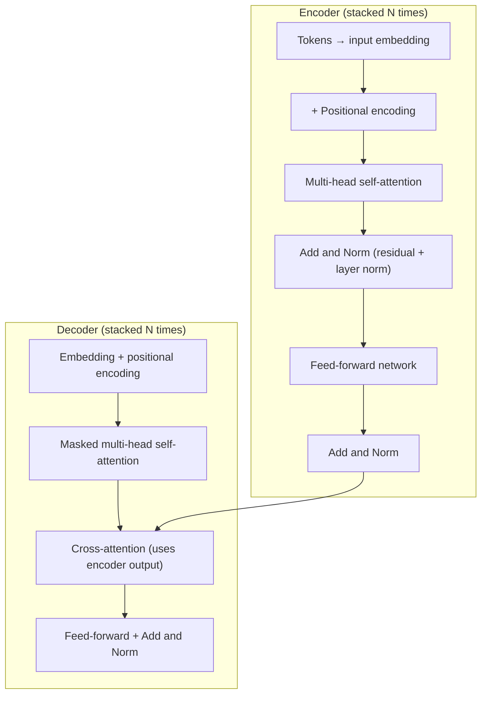
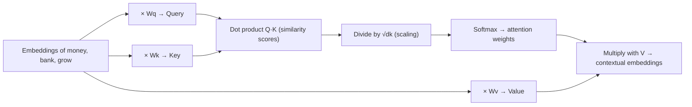
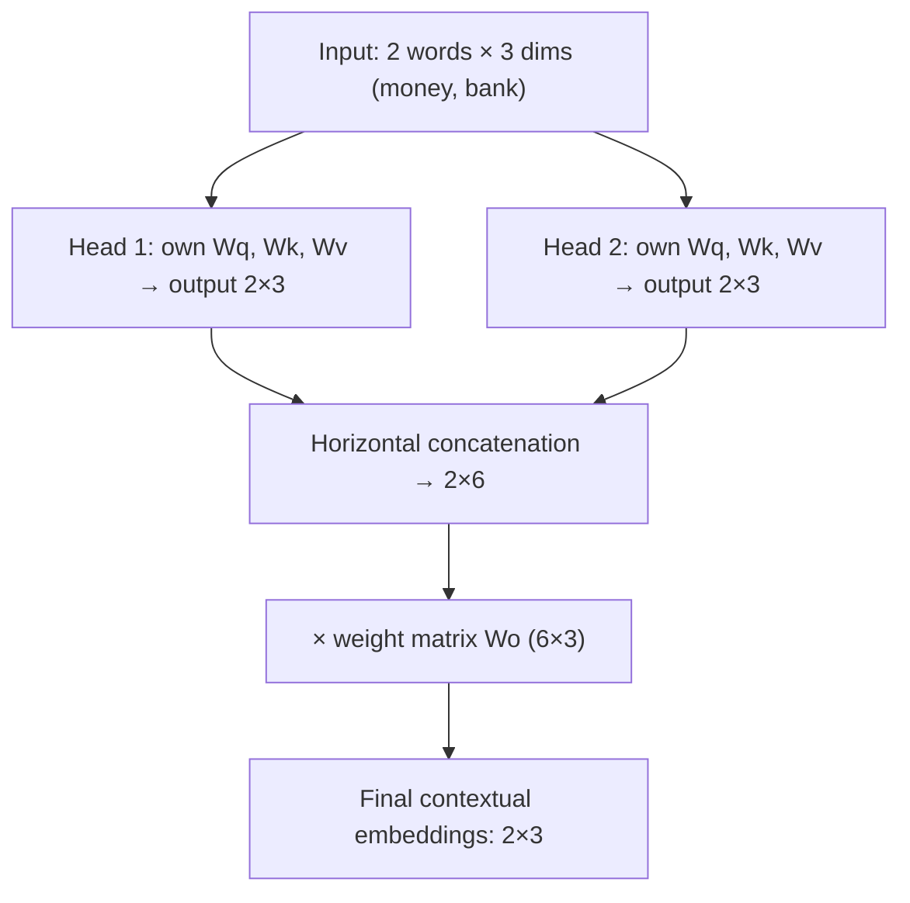
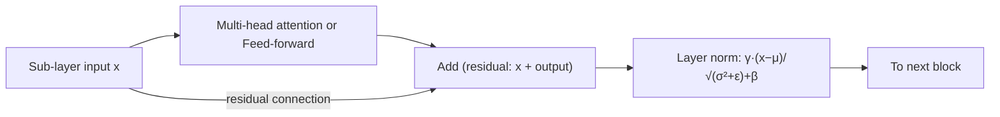
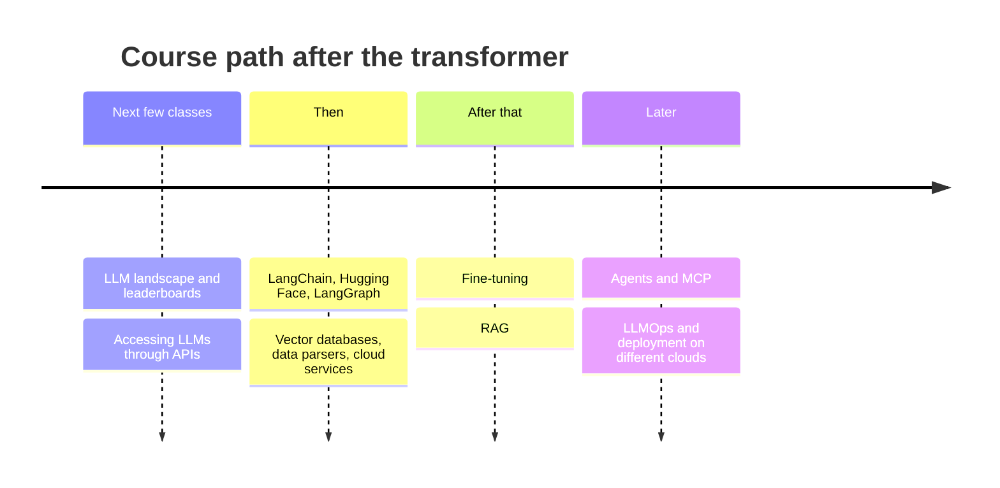

# 🧠 Class 13: Transformer (Part 5) — Multi-Head Self-Attention & Layer Normalization
### 📋 Generative AI — Modern Route | Krish Naik Academy

**🎙️ Mentor:** Sunny Savita
**⏱️ Duration:** ~4 hours (≈2.5 hrs of teaching with a dinner break, then a ≈1 hr live doubt session) | **📅 Session:** 5th transformer session (dated 3 May 2026 in class)

---

## 📰 Quick Updates

- **Where things live:** Recordings are on the student dashboard under the *Live* section. Class-wise resources (slides, notes) are also pushed to the course GitHub repo — Sunny pushed this session's updated notes during class.
- **Pacing of the course:** The batch started on 15 March and is planned to wrap around 15 September (a 6-month "modern route"; the "classical route" runs a year). About a month has gone into Modules 1–2 (theory), with one more transformer session still needed.
- **Don't over-stress the math:** Sunny repeated that understanding ~50% of the transformer at a high level (terms, what each block does) is enough, because the real focus is building applications. No need to memorise formulas.
- **Doubts:** Raise your hand in the doubt session rather than posting in the chat — chat messages get missed during live teaching. The previous class had no doubt session, so today's was extended.
- **Promised for next class:** the transformer-from-scratch code (as an assignment) and a transformer video/notes follow-up.

---

## 🎯 Today's Agenda & Where We Are in the Architecture

Sunny opened with the full encoder–decoder diagram and walked the encoder from the bottom up to show what is already covered and what is left.



| Piece | Status after today |
|---|---|
| Embedding, positional encoding, self-attention, residual connection | ✅ Covered in earlier sessions (quick recap today) |
| **Multi-head self-attention** | ✅ Covered today |
| **Layer normalization** ("Norm" in Add & Norm) | ✅ Covered today |
| Masked multi-head self-attention, cross-attention, end-to-end encoder→decoder flow with the paper's real dimensions | ⏭️ Next class |

A few reminders he drew out of the diagram:

- The **"N×"** label means the encoder block is stacked multiple times (the original paper uses 6).
- **Add** means vector *addition* (the residual connection); **concatenation** means *appending* vectors side by side. These two get mixed up easily and both appear in this architecture.
- The architecture was originally trained for **machine translation**, and it is the backbone of essentially every modern LLM — mainly through the self-attention idea.
- The **feed-forward network** is just an ordinary neural network. Sunny urged everyone to finish the neural-network prerequisite, since terms like *training, loss function, optimizer, learnable parameter* all come from there and won't be re-taught in this route.

---

## 🔁 Quick Recap: Self-Attention in One Diagram

Sunny re-drew the whole self-attention pipeline on a three-word toy sentence ("money", "bank", "grow") so the multi-head idea would have something to build on.



- **Wq, Wk, Wv** are *learnable* weight matrices. They are initialised randomly and updated during training by the optimizer. Multiplying an embedding by them is a **linear transformation**.
- **Query / Key / Value in plain words:** the query is "what I'm looking for", the key is "what I contain and offer", and the value is "the actual information". Query·Key gives a relevance (similarity) score between every pair of words.
- **Why divide by √dk?** In the original paper dk = 64, so √dk = 8. Without scaling, dot products can become very large; fed into softmax they produce extreme, spiky outputs and poor gradients. Scaling keeps values small so training is smooth and stable and the loss reaches its minimum more directly.
- **Softmax** turns the scaled scores into probabilities between 0 and 1 that sum to 1 — this is the "normalization" in this step. A high weight means high attention, a low weight means low attention.
- **Final step:** the attention weights are applied to the value vectors, producing a **contextual embedding** for each word. (Each output is a weighted sum of the value vectors; in matrix form this is one matrix multiplication of the weight matrix with V.)

---

## 🎭 Multi-Head Self-Attention

### What is a "head"?

A **head** is one complete self-attention mechanism, defined by its own set of **Wq, Wk, Wv** matrices. A single head gives the model *one viewpoint* of the sentence. **Multi-head** simply means several independent sets of Wq/Wk/Wv run in parallel, each producing its own view.

### Why bother with more than one?

Natural language is full of ambiguity, and one attention pattern can't capture every reading at once. Sunny used a few examples:

- **"The chicken is ready to eat"** — is the chicken cooked and ready to be eaten, or is the chicken hungry?
- **"The man saw the astronomer with the telescope"** — who holds the telescope?
- **"bank"** — money bank or river bank (single-head self-attention already resolves this through context; multiple heads go deeper).
- **Summaries of one paragraph** — a paragraph about electrical transformers can be summarised from more than one valid angle. A model trained with multiple heads can produce either summary, or tailor it when you add extra instructions. This is why ChatGPT doesn't return the same answer every time you paste the same paragraph.

The takeaway: multiple heads let the model capture **different relationships and meanings simultaneously**, giving a deeper, multi-perspective context.

### Number of heads

The original paper used **8 heads**, but the head count is a **hyperparameter** — an experimental value decided through research, not a fixed constant. Sunny noted that this kind of decision (heads, model dimension) is research-level work done by AI research engineers and scientists at large labs; for application engineers it's enough to know the knob exists. Larger modern models use many more heads (he mentioned figures in the range of 32 heads for ~7B-parameter models, 40 for ~13B and 64 for ~65B).

### The full flow with a 2-head toy example

To keep the numbers small, Sunny used a 2-word sentence ("money bank"), an embedding dimension of **3**, and **2 heads**.



1. Each head runs the full self-attention pipeline independently and yields a contextual embedding for "money" and for "bank".
2. The head outputs are **concatenated horizontally** — two 2×3 blocks become one **2×6** matrix.
3. That matrix is multiplied by one more learnable weight matrix (**6×3**) to bring it back to the original embedding size, giving the final 2×3 contextual embeddings.

Sunny stressed that there are **two kinds of learnable parameters** in the attention layer: the per-head Wq/Wk/Wv, and this final output weight matrix. With the paper's 8 heads, the same procedure simply repeats 8 times before the concatenation.

> **Clarification worth noting:** in the actual paper, each head works at dk = 64, so 8 heads × 64 = 512, which equals the model width — the concatenated output already lands at 512 and the output matrix then mixes the heads. In that standard design the head size is the model dimension divided by the number of heads, so the two are linked even though both are design choices. Class used a deliberately larger toy concatenation (2×6) to make the "compress back" step visible.

### Sizing the output weight matrix

Several students asked who decides its size. The rule Sunny gave: it is fixed by **matrix-multiplication compatibility plus the goal of returning to the original embedding size**. If the concatenated width is 6 and you want 3 columns out, the matrix must be 6×3. The number of *columns* always equals the embedding width you started with; the number of *rows* depends on how wide the concatenation is. The shape is therefore dynamic and determined by your other choices.

### Initial weights

Where do these weights come from? They are **randomly initialised** and then learned. Sunny pointed to the standard deep-learning initialisation methods — zero, random (normal/uniform), **Xavier/Glorot**, **He** — and said the transformer, like CNNs, RNNs and LSTMs, uses these same techniques.

### An intuition for "why multiple sets?"

Sunny connected multi-head attention to why neural networks have multiple hidden layers: more sets of learnable parameters let the model dig deeper into the input. A fun analogy from the doubt session: if you want to judge a class of 30 students, you collect responses from many of them and combine them into a collective conclusion, rather than asking just one. Multiple heads are like that — many views combined into one final representation. In practice, he said, real LLMs always use multi-head attention; single-head attention is mostly a teaching device.

---

## 🧮 Mini-Lesson: Matrix Multiplication

Since the whole transformer is matrix math, Sunny paused to rebuild the basics.

- A matrix is described as **rows × columns**; a column vector is n×1 and a row vector is 1×n.
- To multiply, take each **row** of the left matrix against each **column** of the right matrix and sum the products.

```text
[1 2]   [3 4]   [1·3+2·5  1·4+2·6]   [13 16]
[3 4] × [5 6] = [3·3+4·5  3·4+4·6] = [29 36]
```

- **Shape rule:** an **m×n** matrix times an **n×p** matrix gives **m×p**. The two inner numbers must match. A 2×3 times a 3×3 gives 2×3, which is exactly why the output weight matrix above must be 6×3.

He also reminded the class that all of deep learning is, at heart, large-scale matrix multiplication. The data is held as **tensors**, which are designed to be computed efficiently on GPUs — those GPUs are essentially doing matrix multiplication over billions of parameters.

---

## 📏 Layer Normalization

### Background: normalization in classic ML

*Normalization* means compressing values into a controlled range. Two common techniques:

```text
Min-Max scaling:    x' = (x − x_min) / (x_max − x_min)        → typically range 0 to 1
Standard scaler:    x' = (x − μ) / σ                          → mean 0, std. dev. 1
```

Layer normalization is an **advanced version of the standard scaler**, designed for transformers. It comes from the paper "Layer Normalization" (Ba, Kiros and Hinton), which the original transformer paper cites.

### The formula

```text
LayerNorm(x) = γ · (x − μ) / √(σ² + ε) + β
```

| Symbol | Meaning |
|---|---|
| x | The input vector (the features of one token) |
| μ | Mean of the vector |
| σ² | Variance of the vector |
| ε | A tiny constant that prevents division by zero |
| γ (gamma) | Learnable **scaling** parameter |
| β (beta) | Learnable **shift** parameter |

> In class the denominator was often called "sigma squared plus epsilon" while talking; the standard form takes the **square root** of variance plus epsilon (i.e. the standard deviation, stabilised by ε). The worked numbers in class used the standard deviation, which matches this form.

### Why ε?

Dividing by zero (e.g. if all values in a vector were identical, making variance 0) would blow up to infinity and throw an error in both mathematics and code. Adding a negligible ε sidesteps that without affecting results noticeably.

### Worked example

Sunny normalised the vector **[0.8, −1.2, 2.4]**:

1. **Mean:** (0.8 − 1.2 + 2.4) / 3 ≈ **0.67**
2. **Variance / std. dev.:** average squared distance from the mean, then its root (≈ 1.47)
3. **Normalise each value:** (x − 0.67) / std → **[0.09, −1.27, 1.18]**

The original values were widely scattered (−1.2 to 2.4); after normalization they sit in a tighter, centred range — which makes downstream calculations easier and training more stable.

### Gamma and beta

- If we stopped at the standard scaler, every vector would be forced to mean 0 and std. dev. 1.
- **γ** and **β** give the model **freedom** to rescale and re-centre as it learns what works best — β in particular lets the model choose *where the data should be centred*.
- **Initial values:** γ = 1 and β = 0 (so at the start it behaves like a plain standard scaler). They are then **updated during back-propagation by the optimizer** like any other weight. The basic update rule is gradient descent (new = old − learning rate × gradient); transformers use more advanced optimizers such as **Adam / AdamW (Adam with weight decay)**.

### Why "layer" normalization?

The *layer* here means the **entire vector** — all features of a token are normalised together in a single go. A vector like [5, 6, 8, 9, 1, 2] is 1×6 with six features, and all six are normalised at once using that vector's own mean and variance.

### Where it sits in the transformer

Layer norm appears **after the multi-head attention** and **after the feed-forward network**, together with the residual connection — this pairing is the "Add & Norm" block in the diagram. The residual adds the sub-layer's input back to its output, and the sum is then normalised.



### Benefits

- **Stabilises training** by keeping values in a controlled range.
- **Prevents exploding gradients** and very large activations.
- **Improves gradient flow**, helping avoid vanishing/exploding gradients in deep transformers.
- **Faster convergence** towards a low loss.

Sunny's guidance: for this course, knowing what it does, why it's used and roughly how it's computed is sufficient.

---

## 🏋️ Training vs. Inference (Short Detour)

Sunny briefly flagged a point that will return when masked attention is covered:

- **Training** the transformer happens **in parallel** (the whole target sequence is processed at once, with masking preventing look-ahead).
- **Inference** is **sequential** because generation is **autoregressive** — each new token depends on the previous ones.
- The **parameters** being trained are the **weights** in the attention layers and the feed-forward networks (plus layer-norm γ/β); once training finishes they are frozen, and these frozen numbers are what "a 7B or 70B model" refers to.

---

## 🗺️ What's Next

- **Next class:** masked multi-head self-attention, cross-attention, and the **end-to-end encoder→decoder data flow** using the **original paper's actual dimensions** (this will also answer the "1×512 times 512×64 gives 1×64" shape question raised in the doubt session). Possibly an extra 1–2 hours of transformer if needed.
- **Assignment:** transformer-from-scratch code to run and study.
- **Then, the practical stage** (roughly the next five months):



- Tools mentioned: LangChain, Hugging Face, LangGraph, AutoGen, vector databases, document parsers, cloud services, Copilot, and Claude Code for writing code. Coding starts about two to three classes from now, and from there ~60–70% of the course is practical.
- **Specialisation batches** (separate from this one): RAG Mastery, LLMOps Mastery, Agentic AI Mastery, a no-code/low-code agentic batch, and a longer Gen AI + Data Science programme. Sunny advised joining none yet — learn here first and decide later.

---

## 💬 Live Q&A Highlights

| Question | Answer |
|---|---|
| Which roles can we target after the course? Does 12–20 years' experience still fit? | AI Engineer, Generative AI Engineer, Senior/Lead GenAI Engineer, AI Architect. Experience level doesn't block these titles, but experienced people should have project work — complete a project via this batch. Agent/API engineer are sub-roles under GenAI. |
| How do we avoid being rejected for lack of experience (data engineer moving to Python/AI)? | Companies hire on experience, not learning. Put GenAI project work on your resume — tweak projects toward real use cases from your own workplace, and mention the end-of-course projects. |
| Will MLOps/deployment be covered? | LLMOps will be covered, including deployment on different clouds. |
| What exactly happens inside the Wq/Wk/Wv weight matrices? | They're numeric parameters, randomly initialised (Xavier/Glorot, He, random normal/uniform, etc.) and adjusted by the optimizer during training. Understanding them fully needs neural-network basics from the prerequisites. |
| Why does the output weight matrix have that size, and who decides? | It's set by matrix-multiplication shape rules plus the goal of returning to the original embedding width (columns stay equal to the embedding size). |
| Is there a link between number of heads and embedding size? | In class: both are independent hyperparameters. (In the standard design, head size = model dimension ÷ heads, so they're linked by that split.) |
| Can weights, and hence embeddings, be negative? | Yes. Random initialisation methods such as Xavier/Glorot can produce negative weights, so embedding vectors and Q/K/V values can be negative. Sunny said he'd double-check the details. |
| Is single-head attention used in real models? | No — real LLMs use multiple heads; single head is a teaching simplification. |
| Isn't the input to normalization already a mix of positives/negatives? Why do these scaling and normalization steps exist at all? | At the scale of billion-parameter models, values can blow up; researchers found experimentally that extra scaling/normalization layers keep training stable and improve accuracy. These choices come from experiments. |
| Is the input embedding layer trainable in the transformer? | Sunny said it's part of pre-processing and that a pre-trained Word2Vec-style table isn't updated, but acknowledged a source showing it as learnable and promised to investigate. In the original paper (Section 3.4), the embeddings are a learned lookup table trained along with the rest of the model, whereas the sinusoidal positional encodings are fixed. |
| How does simply *adding* positional encoding tell the model about order? | Each position gets its own distinct vector from sine/cosine waves; adding it to the embedding gives each token a position-dependent shift, which preserves sequence information for self-attention. He compared it to adding a different, function-based increment to each person's age so their ordering stays distinguishable. |
| Do all the parameters stay fixed after training? | Yes. After training the weights are frozen; inference is just matrix multiplications with those fixed numbers. |
| How is training data prepared for GPT-style models? | Autoregressive: from "My name is Sunny and I teach AI" you create (My → name), (My name → is), (My name is → Sunny), and so on. Training can be done in parallel; generation is sequential. |
| Does 64 heads mean 64 predictions? | No — it means 64 different sets of Q/K/V weights, each giving a different perspective on the sentence, all combined into one final contextual vector. |
| Do we remove stop-words/punctuation before tokenization? | If the raw data needs cleaning, yes, do it before tokenizing. |
| Is multiplication with V a dot product or matrix multiplication? | Each softmax weight is a scalar multiplying a value vector (then summed); in matrix form it's one matrix product. |
| (Marina) Will my 7-way intent classifier become a bottleneck as tools grow? | More tools raise the risk of wrong tool selection if routing is too probabilistic — make it more deterministic. LangGraph is flexible and a good fit; share the graph (Mermaid PNG or HTML) for review. |
| (Marina) Is a 1024-token chunk with 120 overlap fine for contracts? | Chunking is a hyperparameter — build ~10 ground-truth Q&As by hand, evaluate answers, and compare chunk strategies. |
| (Tej) What is the whole self-attention mechanism ultimately buying us? | It's what lets modern AI understand input in natural human language, unlike earlier sequential RNN/LSTM models that struggled with long sentences. It builds a contextual embedding for each word. Application engineers mainly need the intuition; AI-specialisation learners need the detail. |
| (Tej) Why does the count of parameters grow? | Each head has its own learnable matrices, so more heads (and layers) mean more parameters. Parameters are values learned during training. |
| (Shobhan, DevOps) Is this course useful for an AIOps path? | Yes — either deploy AI projects with your DevOps skills (cloud AI services, CI/CD, Kubernetes), or become a GenAI developer by learning RAG and agents. The LLMOps course is the closest dedicated programme. |
| (Mohan) Can I learn RAG/agents on my own timeline? | Yes — previous batch recordings are available; use them to move faster and treat this batch as revision. |
| (Sushanta) Will MCP be covered? | Yes, inside the agentic projects. |
| Will vector databases be part of self-attention? | No — separate concept, covered later. |
| Will we learn AI system design? | Building projects means designing systems; it will be covered at that level. |

---

## 🔑 Key Pointers to Remember

- A **head** = one set of Wq, Wk, Wv; **multi-head** = several sets run in parallel to capture different perspectives.
- Original paper: **8 heads**, **dk = 64**, so √dk = 8; heads count is a **hyperparameter**.
- **Concatenate** (append) head outputs horizontally, then multiply by a learnable weight matrix to return to the original embedding width.
- **Matrix multiplication rule:** (m×n) · (n×p) = (m×p).
- **Add** = add vectors (residual connection); **concatenate** = append them.
- Weights are **randomly initialised** and **learned** through the optimizer during training; they freeze after training.
- **LayerNorm = γ·(x−μ)/√(σ²+ε)+β**; γ starts at 1, β at 0, both are learned.
- "Layer" = normalise **all features of one vector together**.
- Layer norm and residual connections appear after attention and after the feed-forward network (Add & Norm).
- Training is **parallel**; generation is **sequential (autoregressive)**.
- Self-attention is why modern models understand natural language so well; ~50% conceptual understanding is enough to proceed.

---

## ✅ Action Items After Class 13

- [ ] Re-watch/re-read today's notes and rework the 2-head toy example (2×3 → 2×6 → 6×3 → 2×3) by hand
- [ ] Redo the layer-norm calculation on [0.8, −1.2, 2.4] and confirm [0.09, −1.27, 1.18]
- [ ] Revise neural-network prerequisites: weights, loss, optimizer, back-propagation, weight initialisation
- [ ] Skim the "Attention Is All You Need" paper — find the 8 heads, dk = 64 and the layer-norm citation
- [ ] Read the Layer Normalization paper's intro (Ba, Kiros, Hinton)
- [ ] Check the GitHub resources and updated notes for Class 13
- [ ] Prepare doubts for the next doubt session (use raise-hand, not chat)
- [ ] Watch for the transformer-from-scratch assignment next class
- [ ] Start thinking about a project idea to put on your résumé

---

*📝 Notes compiled from the full Class 13 transcript — Transformer Part 5, Generative AI Modern Route, Krish Naik Academy.*
