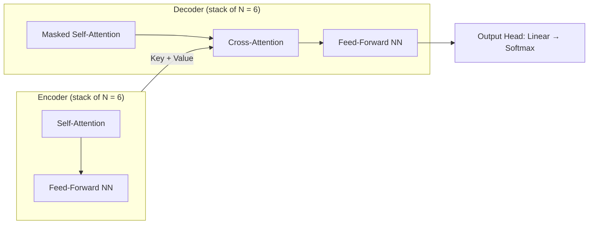
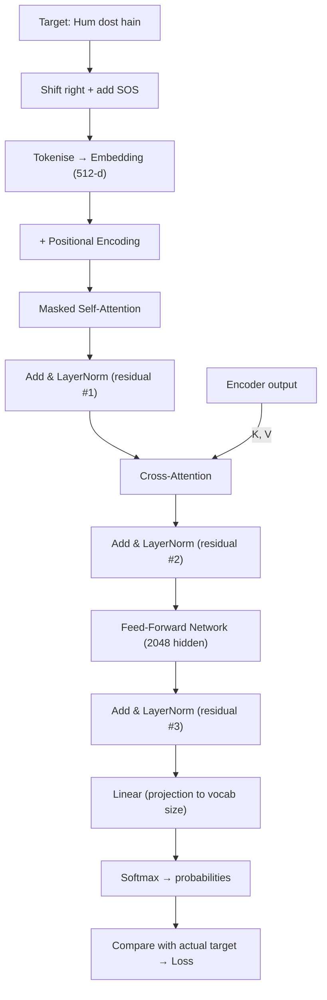
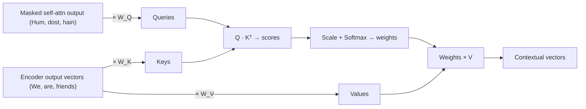
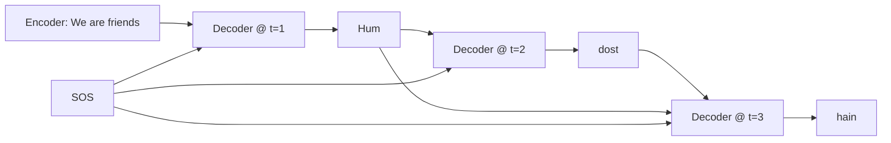

# 🧠 Class 14: Transformer Decoder — Masked Self-Attention, Cross-Attention & Inference
### 📋 Generative AI Course | Live Cohort

**🎙️ Mentor:** Sunny Savita
**⏱️ Duration:** ~4 hours (including breaks and a long doubt session) | **📅 Session:** Class 14 — closes Module 1

---

## 📰 Quick Updates

- The course dashboard shows **15 sessions** done so far, covering embeddings, encoding, the transformer encoder and the roadmap. Today closes **Module 1** (fundamentals). From tomorrow the course moves into the **LLM world**.
- All recordings, notes and resources are organised class-wise in the **GitHub repository**. Sunny pushed today's notes there as "Class 14" (the full *Transformer Complete Guide*, roughly 45 pages of notes). An **interview-questions PDF** (neural networks, CNN, transformer, GenAI) was also shared in the chat and will be updated.
- **Assignments are coming.** A detailed, industry-grade assignment on the transformer is promised for the next session.
- Topics confirmed for later: **MCP**, **n8n**, and an overview of **LlamaIndex** (with the advice to master *one* framework, LangChain, deeply, since the others become easy afterwards).
- A pointed reminder on learning habits: Sunny said a class is only about **50% of learning, with the other 50% being your own self-study**. He asked people to revise the earlier transformer sessions before posting complaints, and to be careful with half-knowledge in the group chat.

---

## 🎯 Today's Agenda

The encoder was finished last class (including residual connections and layer normalisation). Sunny opened by putting the original transformer diagram on screen and asking what is *new* on the decoder side. Four things had to be understood before Module 1 could be closed:

1. **Masked self-attention**
2. **Cross-attention**
3. **The output head** (linear layer + softmax)
4. **How the decoder behaves** at training time versus prediction time



> 💡 **Why this matters:** the *"Nx"* in the diagram means the block is stacked. The paper used **6 encoders and 6 decoders**, but that number is just a **hyperparameter**.

---

## 🌍 Where the Transformer Came From

The paper *"Attention Is All You Need"* was originally built for **neural machine translation** (English→French, French→English, German→English). The encoder reads the source sentence, and the decoder produces the target sentence **word by word**.

An encoder has two main components: **self-attention** and a **feed-forward network**. A decoder has three, plus a head: **masked self-attention**, **cross-attention**, a **feed-forward network**, and then the **output head**.

---

## ⚡ Training Is Parallel, Inference Is Sequential

This is the central idea of the session. Sunny put it as one sentence on the board:

> The decoder is **non-autoregressive at training time** and **autoregressive at prediction time**.

### Where "autoregressive" comes from

The word comes from **time series**. To predict a stock price on day 4, you look at days 1–3. The current value is predicted from previous values.

### Why RNN/LSTM training was slow

He drew an LSTM unrolled over time for the sentence *"Nice to meet you"*. At t=0 you feed "Nice", at t=1 you feed "to", and so on. Each step must wait for the previous one. **Training and prediction were both sequential**, which made training very slow on large data.

| | RNN / LSTM | Transformer |
|---|---|---|
| **Training** | Sequential, one timestep at a time | **Parallel**, whole sentence at once |
| **Prediction (inference)** | Sequential | **Sequential** (autoregressive loop) |
| **Consequence** | Slow to train on huge data | Can train on enormous data, which is what made **LLMs** possible |

Parallel training creates a problem, though: if the whole target sentence is shown at once, the model can *see the future*. **Masked self-attention** was introduced to solve exactly that, and is covered below.

---

## 🔄 The Decoder During Training — Full Data Flow

Sunny used one training pair: **input** *"We are friends"* (into the encoder) and **target** *"Hum dost hain"* (into the decoder). Training is **supervised**, meaning the target output acts as the "supervisor" (the label).

### Step by step

1. **Shift right + SOS.** The target is shifted one position to the right, and a special **SOS (Start Of Sentence)** token is added at the front. Now the decoder input is `SOS, Hum, dost, hain`. This is what the "Outputs (shifted right)" label in the paper's figure means. The SOS token tells the model where the sentence starts.
2. **Tokenisation → embedding.** Each token becomes a vector (512 dimensions in the paper), looked up from an embedding table.
3. **Positional encoding** is added, giving vectors X1…X4.
4. **Masked self-attention** produces contextual vectors, then **Add (residual) + LayerNorm**.
5. **Cross-attention**, where the encoder's output joins in, then **Add + LayerNorm**.
6. **Feed-forward network** (hidden size **2048** in the paper, again a hyperparameter), then **Add + LayerNorm**.
7. The result is a **4 × 512 matrix** (4 tokens × 512 dims), which goes to the **output head**.
8. **Linear → Softmax → probabilities**, which are compared with the actual target to compute a **loss**. Training minimises that loss over many epochs.



---

## 🔗 Cross-Attention

### Self-attention vs cross-attention

Sunny's single-line interview answer was this:

| | Self-Attention | Cross-Attention |
|---|---|---|
| **Question it answers** | How important is each word *relative to the other words in the same sentence*? | How does each word in *one sequence* relate to words in a *different sequence*? |
| **Sequences involved** | One (same sequence) | Two (e.g. English source, Hindi target) |
| **Where it lives** | Encoder (and, masked, in the decoder) | Decoder |

He drew a similarity-circle diagram. In self-attention, "We" is strongly tied to itself and to "friends". In cross-attention, "Hum" is strongly tied to "We". He stressed this is **only a visual illustration** of weights, not an exact word-to-word match.

### Q, K, V — where each one comes from

> **Cross-attention uses the *queries from the output (decoder) sequence* and the *keys and values from the input (encoder) sequence*.**

That is why the diagram shows **two arrows from the encoder** (K and V) and **one arrow from the decoder** (Q).

**The dictionary analogy:** think of a Python dictionary. A *query* asks for something, a *key* is looked up, and a *value* is returned. In the same way, the decoder's query "asks" the encoder's keys which source words matter right now, and the matching values are retrieved.



### Worked example

With decoder tokens *Hum, dost, hain* and encoder tokens *We, are, friends*:

1. Embeddings are computed for every word.
2. The decoder-side vectors are multiplied by **W_Q** to give queries: Q(Hum), Q(dost), Q(hain).
3. The encoder-side vectors are multiplied by **W_K** and **W_V** to give K and V for We, are, friends.
4. Each query is dotted with every key, giving a 3×3 score matrix (S11, S12, S13 / S21 … / S31 …).
5. Softmax turns the scores into weights (W11, W12, W13 …).
6. Each weight is multiplied by the matching **value** vector and the results are summed. For the first row that is `W11·V(We) + W12·V(are) + W13·V(friends)`. The sum is the **contextual vector** for "Hum".

Sunny also noted that input and output lengths can differ (for example 4 Hindi words versus 3 English words), and that **the calculation is identical**. The score matrix is just rectangular. He gave this as a homework exercise: draw a 3-input/2-output or 4-input/3-output version.

---

## 🎭 Masked Self-Attention

**Definition:** masked self-attention is self-attention where **future tokens are blocked**, so each token can only attend to *itself and the tokens before it*.

### Why it is needed

Training feeds the whole target sentence in parallel. For the token *"Hum"*, the words *dost* and *hain* are in the **future**. If the model could see them while training, it would be **cheating**. This is the **data-leakage** problem (Sunny also linked it to overfitting: very high training accuracy, poor accuracy at test time). At prediction time those future words don't exist yet, so a model trained with leakage would fail.

### How masking works

Everything is the same as normal self-attention (Q·Kᵀ, divide by √d_k, softmax, multiply by V) except for **one extra step before softmax**: add **−∞** to the positions that look into the future. Softmax turns −∞ into **0**, so those words contribute nothing.

```
Scaled scores            Mask added            After softmax
S11' S12' S13'           0   -∞   -∞           W11   0    0
S21' S22' S23'    +      0    0   -∞    →      W21  W22   0
S31' S32' S33'           0    0    0           W31  W32  W33
```

- Row 1 ("Hum") sees only itself.
- Row 2 ("dost") sees Hum and dost.
- Row 3 ("hain") sees all three.

Each row's contextual vector is then built only from the allowed words, for example row 2 is `W21·V(Hum) + W22·V(dost)`.

### Why the encoder doesn't mask

The encoder is only *encoding* the input and never predicts anything, so it can look at the full sentence. The decoder's training task is prediction, so it needs the mask.

> 📝 Also note: inside masked self-attention, Q, K and V **all come from the decoder's own tokens**. Nothing comes from the encoder at this stage. That only happens in cross-attention.

---

## 🎯 The Output Head: Linear Layer + Softmax

The final vectors are **512-dimensional**, but we need a prediction over the **vocabulary**. A softmax on a 512-vector would give 512 probabilities with no way of knowing which belongs to which word.

- The **linear (projection) layer** maps 512 → **size of the output vocabulary**.
- In the toy example the output vocabulary is `SOS, Hum, dost, hain` = **4**, so the vector becomes 4 values.
- **Softmax** then gives one probability per vocabulary word, for example `Hum 0.7, dost 0.2, hain 0.1`. This is the predicted output, which is compared with the actual target to compute the loss.

Sunny's remark: the 512 comes from the embedding size, and it **could be 1024, 2048 or anything**, since it is a hyperparameter.

---

## 🔁 Inference (Prediction): The Autoregressive Loop

At prediction time the target isn't known, so the decoder generates one token at a time and **feeds each output back in**:

| Time step | Decoder input | Predicted token |
|---|---|---|
| t = 1 | `SOS` | **Hum** |
| t = 2 | `SOS, Hum` | **dost** |
| t = 3 | `SOS, Hum, dost` | **hain** |



Important clarifications Sunny made:

- **It is the same decoder** at t=1, t=2 and t=3, run in a loop, like an RNN over time. It is **not three separate decoders**. His analogy: "Sunny in the morning, afternoon and evening is the same Sunny."
- With a **stack of 6 decoders**, the stack is *vertical*: one layer's output is the next layer's input, and the whole stack runs again at every time step.
- During inference, **masking isn't needed**, because the future tokens simply haven't been generated yet.

---

## 🗺️ What's Next

- **Tomorrow:** the **LLM landscape**. This covers which models exist, leaderboards, where to access them, and a high-level architecture overview of roughly **5–6 models** from different categories, with research papers shared for further reading. Sunny will not go into the mathematics for each, since every model is built on the transformer.
- **Hands-on notebook:** he will build a notebook (students can follow along) showing how to access models via **OpenAI, Google Gemini, Groq (free models), Mesh API and OpenRouter**, mostly through **LangChain**. Installation and setup will begin tomorrow or next Saturday.
- **Transformer code:** a small training simulation (data loading, multi-head attention, position-wise FFN, encoder/decoder layers, full transformer) will be shared, with dimensions, number of heads and number of layers all adjustable.
- **Assignment:** a detailed one on the transformer.
- **Timeline:** Modules 2–3 within about a week, then **fine-tuning**. Real **RAG and agentic projects** come after a few more weeks.

---

## 💬 Live Q&A Highlights

| Question | Answer |
|---|---|
| **Vivek:** How do I integrate this into real applications (e.g. on Azure)? | Not yet. The transformer is the *base architecture* of every LLM, and real LLMs need huge infrastructure to train. Small training simulation code comes tomorrow. Real RAG/agentic projects come in a few weeks, and projects are part of every course. |
| **Aiswarya:** What do "unidirectional" and "bidirectional" mean for BERT vs GPT? | BERT is an **encoder**, GPT is a **decoder**. Unidirectional means data flows one way (left→right). Bidirectional means it is read left→right *and* right→left. Understand **BiLSTM** first, then apply the same idea to the encoder. |
| **Naveen G:** Where does the Hindi text for the decoder come from during training? | From the **training data**. It has both input and output columns, so English goes to the encoder and Hindi goes to the decoder. Softmax doesn't translate anything; it only outputs probabilities that are mapped to vocabulary words and compared with the actual target. |
| **Ali:** Does the transformer use a Word2Vec model for embeddings? | It uses a **lookup table** (a word-to-vector lookup), not a separately trained Word2Vec model. Its only job is to turn tokens into numbers. *(Strictly, in the original transformer this embedding table is learned together with the rest of the model.)* |
| **Ali:** What is vectorless RAG? | Information is retrieved **without storing numeric embeddings in a vector database**. It will be shown in the RAG module. |
| **Ali:** Are the decoders at t=1, 2, 3 four different decoders? And with 6 stacked layers? | No. One decoder is reused at each time step, like a recurrent loop. With 6 layers, they are **stacked**, so one output feeds the next, and the whole stack runs at each time step. |
| **Ali:** Does it still work when input and output have different lengths? | Yes, the process is the same. The matrices are just rectangular. Draw a 3×2 or 4×3 case as homework. |
| **Anil:** Does LSTM have self-attention? | No. LSTM/RNN is a separate architecture. **Encoder–decoder** is just a data-flow pattern (the 2014 seq2seq paper used LSTMs). A separate neural machine translation paper introduced **attention**. The transformer added **self-attention**. Suggested order: RNN → LSTM → seq2seq paper → attention paper → transformer. |
| **Anil:** Is the number of stacked layers (6) fixed? | No, it's a **hyperparameter**, tuned experimentally for your data and context size. If you use pre-trained models someone else already chose it. It can be changed when training your own. |
| **Anil:** Are some models encoder-only or decoder-only? | Yes. **BERT** is encoder-only (it gives contextual embeddings, and you can add a head for predictions). Modern **GPT-style** models are decoder-based, using masked self-attention, and produce very good embeddings too. |
| **Anil:** In training, does the decoder wait for the encoder? | Both sides process in parallel. By the time the decoder reaches the cross-attention step, the encoder output is available. |
| **Utkarsh:** Is the linear layer's size variable? | It equals the **output vocabulary size**, so it varies with the dataset or language pair. |
| **Utkarsh:** What does masked self-attention pass forward, and how does it connect to Q? | Masked self-attention outputs **contextual vectors**. In cross-attention those vectors are multiplied with **W_Q** to produce the queries. |
| **Smit:** How do K and V come out of the encoder if it only outputs vectors? | The encoder's final output vectors are multiplied by **W_K and W_V inside the cross-attention layer** (not in the encoder). The decoder side's vectors are multiplied by **W_Q**. |
| **Saroj:** Does cross-attention take every encoder's output or just the last? | The output of the **whole encoder stack**. The decoder's cross-attention waits until all the encoder layers finish. |
| **Roma:** I work in tech ops. How do I quickly learn Agentic AI and Amazon Bedrock? | Start with Sunny's **Agentic AI roadmap** video, then the **LangGraph playlist** (about 21 videos) on his YouTube channel. **Bedrock** is a managed AWS platform for models, vector DBs and embeddings. Spend 4–5 days exploring it hands-on with an account and its docs. LangGraph (open source) and Bedrock (platform) are different and can be learned in parallel. |
| **Ramachandra:** Which part is parallel and which is sequential? | The **decoder**: parallel in training, sequential in inference. The encoder only encodes the input. |
| **Ayush:** Where do the Q/K/V weights come from? | Covered in earlier classes (they are learned weights). |
| **Mohan Kumar:** Is the linear projection a learnable parameter? | Sunny said no and called it a plain matrix multiplication. *(In standard implementations the output projection weights are learned during training.)* |
| **Viksha:** Why do "We" and "Hum" get the same weight? | They don't. The weights are **similarity scores** and the circle diagram was only a visual aid. |
| **Monies:** The linear layer wasn't clear. | Sunny gave a second recap of the head (see *The Output Head* section) and pointed to the previous class. |

---

## 🔑 Key Pointers to Remember

- Every LLM's fundamental architecture is the **transformer**.
- **Encoder:** self-attention + feed-forward. **Decoder:** masked self-attention + cross-attention + feed-forward + output head.
- The paper used **N = 6** stacks, but that count is a **hyperparameter**.
- **Training = parallel; inference = sequential (autoregressive).** This parallel training is what made LLMs possible.
- **Shift right + SOS** tells the decoder where the sentence begins.
- **Masking:** add **−∞** to future positions before softmax, so they become **0**. This stops data leakage.
- **Cross-attention:** **Q from the decoder**, **K and V from the encoder**.
- **Self- vs cross-attention:** same sequence vs two different sequences.
- The **linear layer** maps the 512-dim vector to **vocabulary size**, and softmax then gives word probabilities.
- Loss compares predicted probabilities with the actual target. Training minimises it.
- At inference, the **same decoder runs in a loop**, feeding each output back as input.
- Typical sizes in the paper: embedding **512**, FFN hidden **2048**.
- **BERT = encoder-based; GPT = decoder-based.**

---

## ✅ Action Items After Class 14

- [ ] Pull the **Class 14 notes** and the **interview-questions PDF** from the GitHub repo and chat.
- [ ] Re-watch the earlier transformer sessions and rewrite your own handwritten notes of the full architecture.
- [ ] Redo the cross-attention and masked-attention matrices on paper, including a **non-square** example (3 inputs → 2 outputs).
- [ ] Read the **seq2seq (encoder–decoder)** paper and the **attention** paper for background.
- [ ] Revise **BiLSTM**, so unidirectional/bidirectional makes sense for BERT/GPT.
- [ ] Get ready for tomorrow: an API key or two (OpenAI, Gemini, Groq, OpenRouter), and the transformer assignment.
- [ ] Optionally explore **AWS Bedrock** and Sunny's **LangGraph playlist** if you are working on agentic projects.

---

*📝 Notes compiled from the full Class 14 transcript — "Transformer Decoder: Masked Self-Attention, Cross-Attention & Inference," Generative AI Course.*
