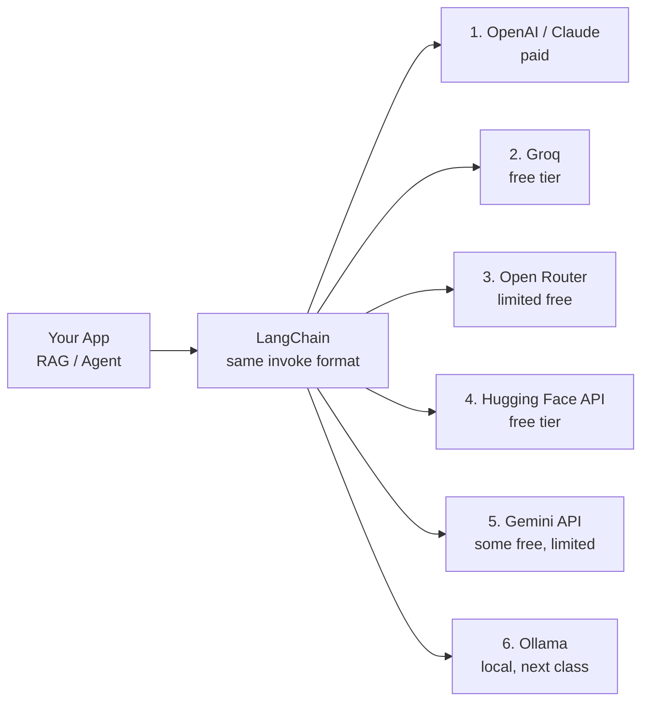
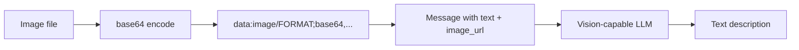
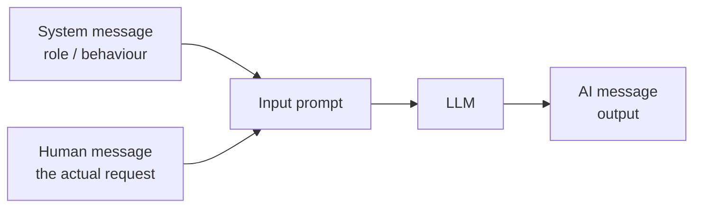
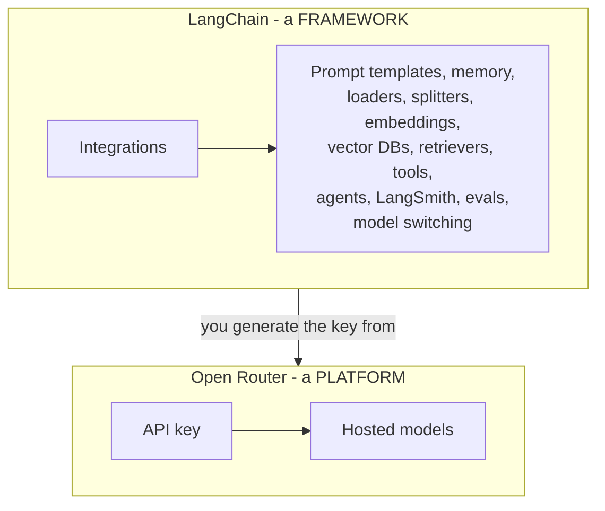
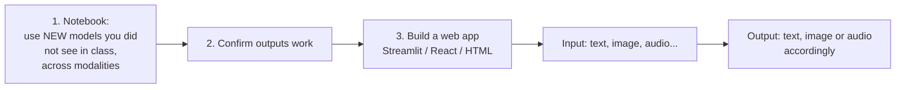

# 🔌 Class 17: Accessing LLMs from Many Providers (Open Router, Hugging Face, Gemini) + Multimodal APIs
### 📋 Generative AI Course | Sunny Savita's batch

**🎙️ Mentor:** Sunny Savita
**⏱️ Duration:** ~3.5 hours (including dinner break and a long doubt session) | **📅 Session:** Day 17

---

## 📰 Quick Updates

- A **new learning dashboard** holds all recordings (the previous class is already up) and a resources section. Code and notes also live on Sunny's GitHub.
- A combined **Notion notes PDF for Classes 16 and 17** was exported and committed to the GitHub folder. It has every link needed to generate API keys (OpenAI, Claude, Gemini, Groq, Open Router, Hugging Face, LangChain).
- A **secret-scanning alert** fired on the repo push: a Google API key had been committed by mistake. Sunny deleted it, and the key later stopped working (see the Gemini section). Lesson: never commit `.env` or keys.
- A second batch (low-code / no-code) started in parallel, so attendance was lower than usual.
- **Ollama was deferred** to the next class. Install it beforehand (the Windows installer is about 2 GB).

---

## 🧭 Today's Roadmap: Six Ways to Get an LLM

Sunny opened with a recap. Class 16 covered the APIs for OpenAI and Groq, accessed through LangChain. Today finishes the list, and every model gets reused later in RAG and agentic applications.



| Provider | Cost model (as stated in class) |
|---|---|
| OpenAI / Claude | Paid |
| Groq | Free access for learning, plus paid |
| Open Router | Free up to a limit, then charges |
| Hugging Face | Free access (with limits) |
| Gemini | A few models free with limits, plus paid |
| Ollama | Download the model and run it locally |

The core point is that for RAG and agent work you mostly need **text-to-text** and sometimes **text-to-image** models. You do **not** code the transformer architecture. You only need enough theory for interviews and for understanding LLMs, then API and LangChain/LangGraph skills, then projects.

---

## 🧱 Quick Revision: The Pattern from Class 16

Sunny recapped the pattern so the new providers would feel familiar:

1. Store keys in a `.env` file and load them as environment variables.
2. Import the provider's LangChain chat class and create an object of it.
3. Call `.invoke(...)` with a message and read the reply from `.content`.

He also showed that Claude (a Haiku model) works the same way, and that OpenAI's multimodal models can generate images and read images.

### Image → Text with base64

Models cannot take raw pixels directly. An image is a collection of pixels, so it needs encoding. The class used **base64** to turn media into a string that can be sent anywhere. The same trick works for audio and video.



The same input also works with a plain image URL instead of base64. Sunny noted that this kind of model doubles as **OCR** (Optical Character Recognition). OCR was once done with CNN-based computer vision models. It can now be done with transformer-based models, thanks to the **Vision Transformer (ViT)** paper discussed earlier. This matters a lot in **multimodal RAG pipelines**.

### Anatomy of a Prompt

The message you pass is the **prompt** (or **input**). It can be a plain user message, or split into two parts.



- **System message**: sets the model's behaviour for the active session (for example "you are a helpful assistant"). It sets role and rules, nothing more.
- **Human message**: whatever the user wants to ask.
- **AI message**: the model's output.

There are two ways to write these in LangChain:

1. **Simple tuple format**, the older way, which is still relevant.
2. **Message classes** (`SystemMessage`, `HumanMessage`), the newer way in recent LangChain versions.

A standalone user message with no system message works fine too. Sunny stressed that the system message is **optional**. It is not needed for something like a simple image-description call.

> 💡 When the message goes to an image model or an audio model, the *content parameters* differ by modality. That is where you need to be careful.

---

## 🌐 Open Router

**What it is:** a unified API and routing platform that gives access to hundreds of models (OpenAI, Anthropic, Google, open source, and more) through **one endpoint and one API key**. Open Router **hosts the models**, much like Groq. It also offers image, audio, video and document-reading models, and the models page lists them by modality.

Setup, as shown in class:
1. Open the Open Router link from the notes and click **New key**.
2. Name the key and create it.
3. Paste it into your `.env` file.

The keys Sunny's template asked for were: Hugging Face token, Anthropic key (optional), Groq key (free) and Open Router key.

### The free-tier token limit (live demo)

Sunny set up a Claude model through Open Router, removed `max_tokens`, and asked about climate change. The call **failed**. Free access caps input plus output tokens together, and the error message said the request could not fit. He then set an explicit `max_tokens` and the call succeeded.

> ⚠️ The exact limit was quoted inconsistently in the live demo (2048 at first, then about 2659 read off the error message). Treat it as roughly "a couple of thousand tokens combined" and **read the number in your own error message**. Paid usage removes the limit.

**Counting tokens:** search for the OpenAI token counter, paste your text and see how many tokens it has (the sample paragraph came to about 259). `max_tokens` is an **upper limit** for the output, not an exact count.

### Environment trouble (a real debugging moment)

Sunny's notebook threw a Pydantic-core version error. The cause was a Python 3.12 environment he had made for Ollama (which did not work on 3.11), now clashing with the packages. His fix was to delete the virtual environment folder, recreate it with `uv venv`, reinstall from `requirements.txt` with `uv pip install -r`, reselect the kernel, and rerun. He called this routine practice. Either Python 3.11 or 3.12 is fine as long as the environment is consistent.

```python
# Reconstructed from the walkthrough (the notebook was not attached).
# Package/class names follow the Open Router LangChain integration listed in requirements.txt.
import os
from dotenv import load_dotenv
load_dotenv()

# llm = ChatOpenRouter(model="<claude-model-id>", max_tokens=1024)
# response = llm.invoke("Can you talk about climate change?")
# print(response.content)
```

**Homework:** try other models from Open Router's model list and see which ones work on free access.

---

## 🤗 Hugging Face API

Hugging Face is an open repository with a huge number of models (Qwen, Llama, Mistral, DeepSeek and others). Sunny reminded the class that the token was already generated back in the embeddings lessons. Create a token with read or write permission and put it in `.env`.

The flow has three steps:

1. Set the token as an environment variable.
2. Create a **Hugging Face endpoint** object with the model's **repo ID**, the task, and the max new tokens.
3. Wrap it in **chat Hugging Face** and `.invoke(...)` it with messages.

```python
# Reconstructed from the walkthrough (the notebook was not attached).
from langchain_huggingface import HuggingFaceEndpoint, ChatHuggingFace

llm = HuggingFaceEndpoint(
    repo_id="<model repo id copied from the Hugging Face model page>",
    task="text-generation",
    max_new_tokens=512,
)
chat_model = ChatHuggingFace(llm=llm)
# ai_msg = chat_model.invoke(messages)   # messages = system + human
```

To switch models, copy the **repo ID** from any model page (Sunny demonstrated with a DeepSeek model) and paste it in. A line like "you are a helpful assistant" in the system message sets the model's role.

**Hugging Face vs. the transformers library:** `transformers` downloads the model to your machine. The Hugging Face **endpoint API** runs the model remotely for inference.

**Homework:** try Hugging Face models for image-to-text, text-to-image, audio-to-text and text-to-audio.

---

## 🔀 Open Router vs. LangChain: What Is the Difference?



- **Open Router** hosts models. You generate an API key and access them.
- **LangChain provides no models.** It is an integration framework. You get a key from OpenAI, Claude, Gemini or Open Router, and LangChain connects you to it in a uniform way.
- LangChain's range (prompt templates, memory management, document loaders, text splitters, embeddings, vector databases, retrievers, tools, agent modules, tracing and observability through LangSmith, evaluation, **model switching**) is why it is used so heavily for RAG and agentic apps.

Sunny's side comments: Open Router, Hugging Face and Groq **serve the same purpose**, and he teaches several so that if one stops working you can switch. Azure AI Foundry and AWS Bedrock play a similar role. Open Router does not offer every model for free.

---

## ✨ Gemini (Google) API

Gemini's pricing page shows free, paid and enterprise tiers. The free tier allows only limited models, usage and time. The free models listed included Gemini 2.5 Flash, 2.5 Pro, 2.5 Flash Lite, a native-audio preview, a text-to-speech model, and embedding models. Hitting an **"exhausted resource"** error means a limit was reached, and a fresh API key is the workaround.

Sunny's key got revoked **live**: the call returned "forbidden" because the key had been leaked on GitHub, so Google had invalidated it. His fix:

1. Delete the old key and create a new one.
2. Paste it into `.env`.
3. **Restart the kernel**. This is always needed after changing a key.
4. If the environment variable still does not take, pass the key **explicitly** as a constructor parameter (`google_api_key=...`).

The usage pattern is the same as every other provider: `.invoke(...)` and then `.content`. That uniformity is the main benefit of LangChain, since you can use models from different places in the same format.

### Image → Text with Gemini
Same encoding step as before, then a message with a text part ("describe this image in detail") and an image part. Sunny used a picture with six dogs, and the model produced a very detailed answer. He called Google's image-to-text strong enough for production.

### Audio → Text (transcription)
The class used the shared `audio.mp3` file from GitHub (a short narration about multimodal AI). The audio is base64-encoded, then sent in a message with a text part (the instruction to transcribe into English) and a **media** part carrying the MIME type and the base64 data. The result matched the audio almost word for word.

```python
# Reconstructed from the walkthrough (the notebook was not attached).
message = HumanMessage(content=[
    {"type": "text", "text": "Transcribe this audio into English text."},
    {"type": "media", "mime_type": "audio/mp3", "data": base64_audio},
])
# response = llm.invoke([message])
# print(response.content)
```

You can add a system message here too. You just have to follow each modality's own content format.

### Text → Audio (no LangChain wrapper)
For tasks like **text-to-audio, text-to-video, image-to-image and audio-to-audio**, you often will **not** find a LangChain wrapper. In that case use the provider's own **SDK** directly (OpenAI SDK, Google Gen AI SDK, Open Router SDK).

The demo used the **Google Gen AI SDK**:
1. Create a `genai` client with your API key.
2. Call generate-content with a free text-to-speech model.
3. Set the response type to **audio** in the generation config.
4. Pick a **prebuilt voice** (the heard name "core" is most likely the voice called *Kore*). Sunny described it as a voice persona, and Google offers many to choose from.
5. Write the returned bytes to a **WAV file**. The frame rate and similar settings can be tweaked.

The output was a clean female voice saying the sample sentence. Sunny added that you can clone voices on other platforms. Audio platforms he listed: OpenAI, Google, **ElevenLabs** (costly but widely used in production voice agents), Deepgram, Azure Speech, AssemblyAI and Sarvam AI.

> 🔑 His practical advice: in real projects the model architecture matters less than **understanding the API structure**.

---

## 📝 Assignment

The goal is to practise every modality (text↔text, text↔image, image↔text, audio↔text and so on).



- Run it **locally**. Do not host it.
- Sunny demoed **vibe coding**: he gave his `.ipynb` to GitHub Copilot with a prompt asking for a Streamlit app that takes input in any modality and generates output accordingly. It produced the code, which he ran with `streamlit run app.py`. The app showed a "missing credential" error until an API key was entered, as expected. Temperature will be explained in a later class.
- Do not create or edit your own files inside the cloned course repo. Keep your own work in a separate folder.

---

## 🗺️ What's Next

- **Ollama** (run models locally). Install it before class.
- From the next class: **fine-tuning, Hugging Face in depth, and Unsloth**, which will take about 5 classes (2 to 3 weeks).
- After that, either a **project** or the **RAG** chapter.
- Parameters such as **temperature** will be covered later (end of a session, or the RAG chapter).
- **LangSmith** (tracing) and the **LangChain API key** will come in a later practical.

---

## 💬 Live Q&A Highlights

| Question | Answer |
|---|---|
| What is the LangChain API key for? | It is used for LangSmith (tracing/observability), a product of the LangChain company. It is covered later. |
| Why do I get a token error on Open Router? | Free access limits combined input and output tokens. Set `max_tokens`. Paid use removes the cap. |
| Do I have to use a system message? | No. It is optional and you can pass only a user message. It just sets role and behaviour for the session. |
| Is `transformers` the same as the Hugging Face endpoint API? | No. `transformers` downloads the model locally, the endpoint API runs it remotely for inference. |
| Do Open Router and Hugging Face serve the same purpose? | Yes. Both (and Groq) give you model access, and Sunny teaches several so you have fallbacks. |
| Why does my Gemini call fail with an "invalid", "expired" or "exhausted" error? (Kalyan, Sunny) | Free Gemini has limits. Generate a fresh key from Google AI Studio (the Gemini API key link in the notes), put it in `.env`, restart the kernel and rerun the cell. Kalyan had made a key in the wrong place. |
| OpenAI "exceeded your quota" error? (Kalyan, Tej) | The account has no credit. Add about $5 to $10 for practice in your OpenAI billing. Otherwise use free providers. |
| Can I follow the class with free models only? (Tej) | Yes. Only the provider/model line changes, and the rest of the code is the same. Free models may fall short on complex agent projects with long context. |
| How is Open Router different from calling the original model? (Tej) | Open Router hosts models on its own servers. Original proprietary models (OpenAI, Anthropic) are the vendors' own. Open-source ones can be hosted by anyone. |
| System vs. human prompt: why needed if the model is general purpose? (Amit) | Models are general purpose. The system message sets rules, role and behaviour (for example "answer only in English"), and the human message carries the actual task. |
| Can the system and user message be merged? (amoljamkar) | Yes, putting the instruction in the user message gives the same output. |
| How do I ask questions about a document or a conversation, with memory? (Bhagwandas) | Build it with state and memory management (LangChain/LangGraph): a user ID, a session, and the conversation saved per session. Context engineering is different. It is about designing and compressing context to save tokens and cost. Sunny's YouTube LangGraph playlist covers it. |
| How do I undo a fine-tune? (Amit) | A fine-tune is just a saved model file (for example safetensors, PyTorch, GGUF). Delete or archive it and the original model remains. Sign-language training was suggested via a YouTube search. |
| Which frameworks do companies use: LangChain/LangGraph vs. Google ADK, AutoGen, CrewAI? (Susmit) | LangChain/LangGraph is used most in industry (Sunny said "99% of the time"). The goal of every framework is the same, so knowing one lets you pick up others. |
| Is this practical session the start of "core" generative AI, and the earlier NLP material mainly for interviews? (Venkata Raju) | Yes. These practicals are the core of generative AI work. |
| How do I add an agentic flow to my kids' study-monitoring app (Angular, Spring Boot, SQL)? (Melwin) | Email the core AI architecture (RAG? simple inference? a database?) and Sunny will advise on the agentic flow. |
| I got a "secret detected" push block and rebasing did not fix it. (Ruchi) | Create a new repo and push clean code. The secret is in an old commit and rewriting history is tedious. Also save files before committing, since autosave can leave stale edits. |
| I cloned/forked the course repo and I get merge conflicts. (Aslam, amoljamkar) | Keep the cloned repo untouched and do your own work in a separate folder (copy the files you run). Edits inside it cause pull/push conflicts and environment mess. |
| I have a Mesh API problem: no free models, module missing. (Yash) | Sunny asked for the feedback by email so it can go to the vendor team. |
| Is training parallel but inference sequential in transformers? (Lakshmi) | Yes. Training is parallel, and prediction (generation) is sequential, one token at a time. |
| What data are GPT-type models pre-trained on, including coding and math? (Lakshmi) | Essentially the entire internet's data. Reducing hallucination comes in the RAG chapter. |
| How do banks handle confidential PDFs with LLMs? (Purna) | Both ways. They use managed APIs (Azure OpenAI/AI Foundry, AWS Bedrock, Vertex) with security guarantees, and also host smaller models on their own infrastructure. |
| Interview preparation for a lead GenAI role (Dwipal), and AI product manager roles (Sunil) | Sunny shared a list of interview questions by email, and offered to review a resume and advise by mail. |

---

## 🔑 Key Pointers to Remember

- **One pattern, many providers:** key in `.env` → LangChain class → `.invoke()` → `.content`.
- **Restart the kernel** after changing any key in `.env`.
- **Never commit keys.** A leaked key gets revoked and a push can be blocked.
- **LangChain does not host models.** Open Router, Groq, Hugging Face and the others do.
- **System message = behaviour; human message = the task; AI message = output.** System is optional.
- Free tiers have **token and usage limits**. Set `max_tokens`, or add a few dollars of credit.
- **base64** is how images and audio are passed as text to models.
- For text-to-audio, text-to-video and similar tasks, use the **provider's SDK directly** when no LangChain wrapper exists.
- Keep **your own code in a separate folder** from the cloned course repo.
- In industry, **LangChain + LangGraph** dominate. Learn the API structure, not the architecture internals.

---

## ✅ Action Items After Class 17

- [ ] Generate and store keys: Open Router, Hugging Face, Gemini, Groq (and optionally Claude/OpenAI)
- [ ] Re-run the Class 16/17 notebook end to end on a free provider
- [ ] Try different Open Router models and note which ones the free tier allows
- [ ] Try Hugging Face models for image and audio tasks
- [ ] Download and install **Ollama** before the next class
- [ ] Build the multimodal notebook with **new** models, then the local web app
- [ ] Move your practice code out of the cloned repo into your own folder
- [ ] Revisit the previous class on transformers and sequence prediction if training vs. inference is still fuzzy

---

*📝 Notes compiled from the full Class 17 transcript, "Accessing LLMs from Many Providers," Generative AI Course, Sunny Savita. Code blocks are reconstructed from the live walkthrough because the notebook was not supplied; check them against the GitHub notebook.*
