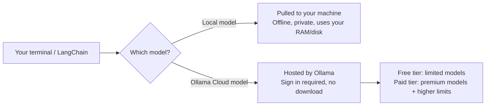
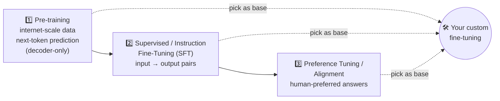
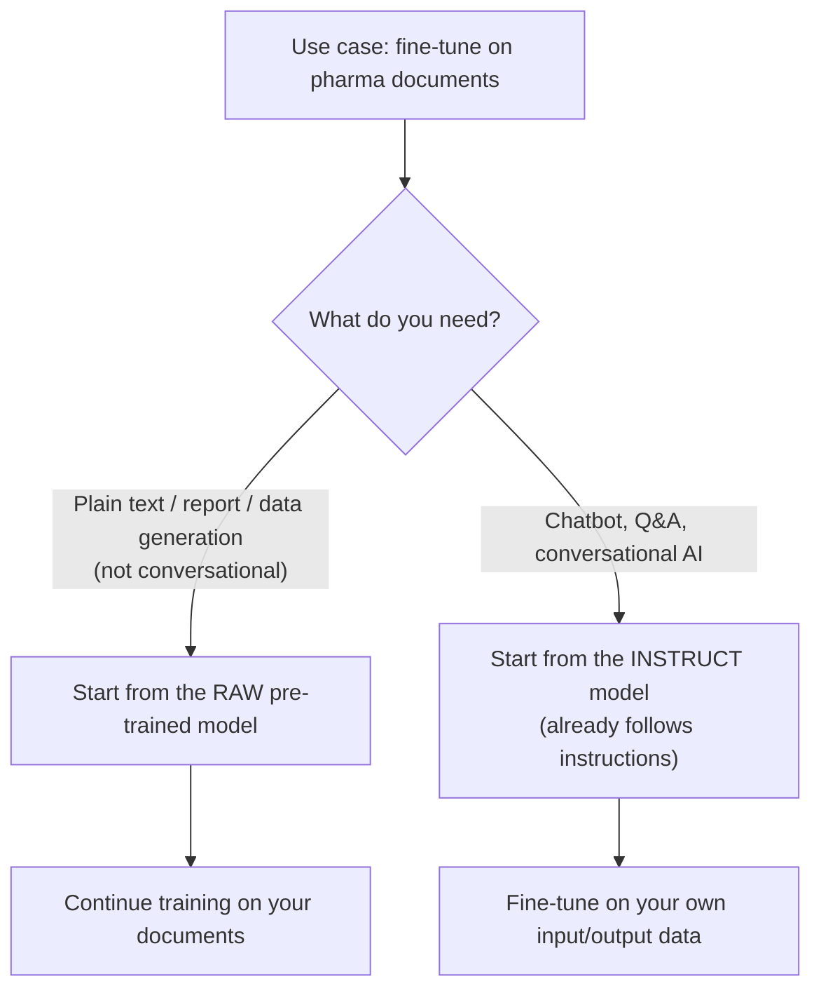
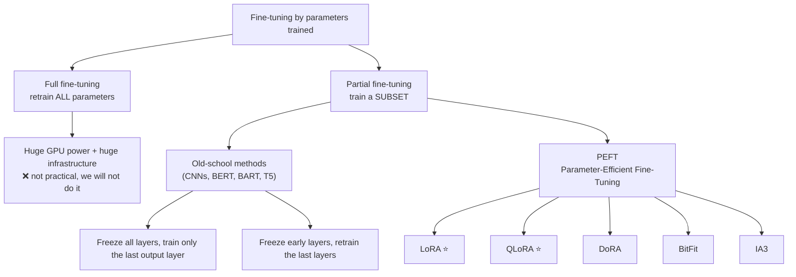
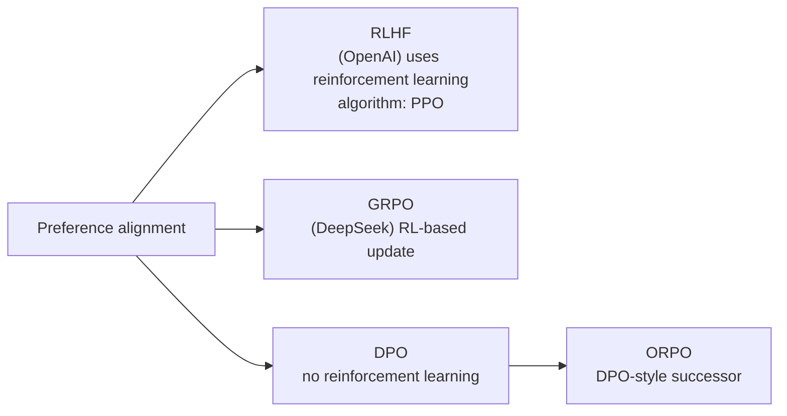

# 🦙 Class 18: Ollama Local & Cloud Models + Introduction to Fine-Tuning
### 📋 Full Stack GenAI Bootcamp 1.0

**🎙️ Mentor:** Sunny Savita
**⏱️ Duration:** ~4 hours (incl. break and open doubt session) | **📅 Session:** Class 18 (23 May 2026)

---

## 📰 Quick Updates

- **Resources** live in two places: the course dashboard (Live Class → recordings, Resources section) and the GitHub repo *Full Stack GenAI Bootcamp 1.0*. Both hold the Notion notes and the handwritten board notes.
- **Assignments are submitted through the Google Form** (pick Assignment 1, 2, 3… from the dropdown). Roughly 103–104 responses had come in, a few already for Assignment 3. Solutions will land in the same repo folder later.
- **Demo spot:** a student (Bala) demoed a multimodal Streamlit app (text→text, text→image, image→text, text→audio, audio→text, video→text across several providers). Only text→text was fully tested; image-to-text hit a "model not found" error. Sunny's feedback: *generating code with a copilot is not a finished solution, so review it end to end.* Prizes (even cash or a course) will be offered from the next assignments for standout solutions shown live. Another student demo gets 15 minutes next class.
- **`requirements.txt` updated**: includes `langchain-ollama`. Check the latest commit if your copy looks stale.
- **Recording** of a ~4 hour class takes roughly 6–8 hours to be processed and uploaded.
- Quick side note on temperature: it controls how creative (and how uncertain) the output is. It gets a proper treatment in the RAG chapter.

---

## 🦙 Ollama: Your Local AI "Operating System"

Ollama began as a way to run open models locally. Sunny's framing: it has grown into a small AI platform that also launches coding tools (Claude Code, Codex, OpenCode, OpenClaw, Copilot CLI, Droid…) and chats with models straight from the terminal.

**Install and verify**
1. Search "Ollama download", grab the installer (about 2 GB for the exe) or use the install command.
2. Open a terminal and run `ollama -v`. A version number means success.
3. Run bare `ollama` to open the interactive menu. If the model picker looks different from the instructor's, press the **right arrow key** to see more options (the UI changed recently and he admitted he hadn't used it in a while).

> ⚠️ **Hardware reality check:** 16 GB RAM is the sensible minimum for running local models. With 8 GB, skip local models (or stick to tiny ones). He experimented only with small models himself.

### Local vs Cloud: the Netflix analogy



Sunny compared cloud access to **streaming a movie on Netflix** (no storage, no powerful hardware needed, just a subscription) and local models to **downloading the movie** (storage plus a capable machine required, but it's yours and works offline).

- **Cloud models** need only a one-time sign-in; no API key is needed. On the free plan he could use one model freely (Nemotron 3 Super cloud); picking a premium one produced an "upgrade your plan" prompt.
- **Local models** are pulled onto whatever server you run on (laptop, AWS box, Azure VM).
- Ollama's own library lists 1,000+ models: text, embedding, vision, reasoning/"thinking" models, with filters for popular/newest.

### Why run a model locally?
Sunny asked the class and listed the answers:
- Works **offline**, with no internet needed.
- **No API cost.**
- **Privacy**: your data stays on your machine, which matters for enterprise or sensitive data.
- **Full control** of the model.

### Command cheat-sheet (demonstrated live)

| Command | What it does |
|---|---|
| `ollama -v` | Show installed version |
| `ollama pull <model>` | Download a model without running it |
| `ollama run <model>` | Run a model (downloads it first if missing) |
| `ollama list` | List models on this machine (cloud and local show up here) |
| `ollama ps` | Show running models (processor/GPU, context length) |
| `ollama show <model>` | Model details |
| `ollama stop <model>` | Stop a running model |
| `ollama rm <model>` | Delete a local model |
| `ollama serve` | Expose models over an HTTP endpoint on a port |

Inside a chat session: `/?` lists commands, `/show`, `/set` (parameters), `/save`, `/load`, `/clear`, `/bye` to exit (or Ctrl-C).

**Sizes he showed:** `llama3.2:1b` is about 1.3 GB, `qwen2.5-coder:1.5b` about 986 MB, and a DeepSeek R1 7B pull was about 5.2 GB, which he interrupted. (He mentioned "1 million parameters" for the 1B model; that's a slip, it's **1 billion**.) Pulled models land under the hidden `.ollama` folder in your user directory (`models/` with manifests and blobs).

`ollama serve` was only previewed (the default port was already busy on his machine). The idea is you serve a model at a URL and make HTTP requests to it; this returns in the RAG chapter.

### Using an Ollama model inside LangChain

LangChain gives a common interface, so a local model is called the same way as the API models from earlier classes. Install `langchain-ollama` in your virtual environment first.

```python
from langchain_ollama import ChatOllama
from langchain_core.messages import SystemMessage, HumanMessage

# model name must match something in `ollama list`
llm = ChatOllama(model="llama3.2:1b")

messages = [
    SystemMessage(content="You are a helpful AI assistant."),
    HumanMessage(content="Explain RAG in the simplest words."),
]

response = llm.invoke(messages)
print(response.content)
```

*(Reconstructed from his walkthrough; the notebook is on the GitHub repo.)*

- Using a model name that isn't in your local list fails; **pull it first**.
- The 1B model's RAG answer was weak, which he used to make the point that small models trade quality for footprint.
- He then swapped in a **cloud model name** as a second LLM and it worked too, with no API key. Sign in once, and LangChain picks up the cloud route automatically.

### Other Ollama notes from the Q&A
- Image input works with vision models, e.g. `ollama pull bakllava`, then pass images the same way.
- To deploy, pull the model on the target server.
- **LM Studio** and **Hugging Face** are alternative ways to get local models; explore them yourself.

---

## 🎯 What Is Fine-Tuning?

**Fine-tuning** means taking an already trained model and training it further on domain-specific or task-specific data so it performs better on that use case. It's a way to tweak a model's knowledge and behaviour.

Sunny's honest framing: in most companies (he said roughly 99% of the time) you'll build RAG or agentic systems rather than fine-tune. But you should still know it, for interviews and for the day you get the chance. This chapter spans about **4–5 classes**; practicals use **Hugging Face** (the foundation) and **Unsloth**, run on **Google Colab**, so you don't need a strong laptop.

---

## 🏗️ The LLM Training Pipeline: Three Stages



1. **Pre-training.** The model learns language itself (grammar, patterns, deeper context) by predicting the next token over a gigantic corpus. Only the transformer's **decoder** is used, as in today's LLMs. The result is a *raw* model: it continues text and doesn't follow instructions. It's called unsupervised or self-supervised learning.
2. **Supervised fine-tuning (instruction tuning).** The model sees input/output data and learns to follow instructions and hold a conversation.
3. **Preference tuning (alignment).** The model is aligned with what humans prefer. The data carries annotations on which answer is preferred. Not mandatory, but big labs now routinely do it. (Sunny credited OpenAI with popularizing it.) You've seen this data being collected whenever ChatGPT shows "Response 1 or Response 2?"

**Key insight from the whiteboard:** you can pick a model from **any** of the three stages and run your own custom fine-tuning on it. Custom fine-tuning means *training the model on your own data*, and it can itself be SFT or preference tuning.

### Example: Meta's Llama on Hugging Face
The same family typically ships in several stages:
- `meta-llama/...-8B`: the **raw pre-trained** model.
- `meta-llama/...-8B-Instruct`: **instruction-tuned** by Meta.
- A preference/RLHF-tuned version, e.g. community-published variants. Sunny searched "Llama 3 8B RLHF" and showed one that wasn't from Meta itself.

Every open-source family (Meta, Mistral, Google, Alibaba…) follows this pattern.

---

## 💊 Choosing the Base Model: The Pharma Example

Sunny's use case: you run a pharma company with documents from molecule studies. Training an LLM from scratch is impractical, so you download an open model and fine-tune it.



- The instruct model knows how to follow instructions, but **not pharma-specific** ones, hence fine-tuning is still needed.
- You *can* start a chatbot from the raw model, but the instruct model usually performs better.
- **How do you decide?** Questioned in class, Sunny's answer: reading research papers, model architecture, community forums (Unsloth, Hugging Face), open-source leaderboards, plus experience. If you can't afford a big model, pick a small one (SLM).

---

## 🧮 Types of Fine-Tuning at the Parameter Level

**Parameters = weights and biases.** In a transformer they sit in the self-attention layers (the Q, K, V and output weight matrices) and the feed-forward networks.



- **Full fine-tuning** retrains everything. It's extremely resource-hungry and, in the Q&A, Sunny said nobody actually does full retraining of big LLMs.
- **Old-school partial tuning** (freeze all but the last layer, or freeze early layers and retrain later ones) worked for CNNs (VGG, ResNet), BERT, BART and T5, but breaks down with the size of today's LLMs.
- **PEFT** trains small additional matrices, so you can fine-tune on **a single GPU with small VRAM**. (He referred to PEFT as "parent term" of its techniques: *LoRA is a PEFT technique, just like man and woman are both humans.*)

### PEFT techniques mentioned
| Technique | One-liner |
|---|---|
| **LoRA** (Low-Rank Adaptation) | The industry workhorse; trains small low-rank adapter matrices. Gets its own session (and the *adapter* concept: how to attach/load one). |
| **QLoRA** | LoRA on a **quantized** model (precision lowered, e.g. floats → smaller types/integers) |
| **DoRA** | A LoRA variant using **weight decomposition**; newer. Assigned as homework. |
| **BitFit** | Trains only the bias terms |
| **IA3** | Learns small scaling vectors on the activations; not used in this course |

Focus: **LoRA and QLoRA**, with DoRA as an assignment.

### Where does PEFT sit?
Confirmed in the doubt session: PEFT (and LoRA) is part of **SFT**. LoRA is a general concept, not Llama-specific.

---

## 🎚️ Preference Alignment Techniques



- **RLHF** is the framework; **PPO** (Proximal Policy Optimization) is the algorithm behind it. (In class it was spoken as "proximal preference optimization".)
- **GRPO** is used by DeepSeek.
- **DPO** is used by recent LLMs and avoids reinforcement learning. **ORPO** builds on the same idea.
- Plan: learn **RLHF and DPO** in depth; **GRPO and ORPO** become assignments. Data formats and use cases come in dedicated sessions 2–3 classes from now.

---

## 🧾 Recap of the Whole Flow

1. Fine-tuning = further training of a pre-trained model on your domain data.
2. LLMs go through pre-train → SFT → preference tuning; pick a base from any stage.
3. Custom fine-tuning is either SFT or preference tuning.
4. Tools: Hugging Face + Unsloth (on Colab).
5. Full fine-tuning (skip) vs partial fine-tuning (do). Partial = old-school or PEFT (LoRA/QLoRA/DoRA…).
6. Pick the raw model for pure generation, the instruct model for conversational use.

---

## 🗺️ What's Next

- Class 19 starts with Google Colab setup (needed for fine-tuning and later assignments), then more examples and practicals with Hugging Face.
- Diagrams for the old-school freezing approach, LoRA in detail (two sessions away), preference-tuning datasets, DPO/RLHF sessions.
- Later modules: cloud deployment, Azure OpenAI and AWS Bedrock, and a fine-tuning project (placement within the course is still undecided), then prompt engineering and RAG. Claude Code gets a chapter of its own.
- Notes and the notebook with `requirements.txt` go on GitHub.

---

## 💬 Live Q&A Highlights

| Question | Answer |
|---|---|
| Is it mandatory to run Ollama locally with only 8 GB RAM (AMD laptop, not upgradable)? | No. Understanding is enough. Fine-tuning will be done on Colab, so 8 GB is fine for projects. |
| What if the system prompt says "cricket analyst" but the user asks about football? | Experiment. Weak models may not handle the mismatch; stronger ones will point out the question is off-topic. |
| Which models do you compare in real projects? | Usually 2–3 from OpenAI (GPT-5), Anthropic (Opus/Sonnet) and Google (Gemini Pro/Flash). Open-source models are for POCs and small apps. |
| Same model (e.g. Claude Haiku) on several clouds: how to judge? | Direct provider API is best, then managed enterprise clouds (AWS Bedrock, Azure OpenAI). OpenRouter variants may be different checkpoints, so use them only for lighter tasks. There is no single comparison tool; read each platform's docs. |
| How much RAM/VRAM for a model? | No fixed formula. For a 10–12 GB model, 16–24 GB of VRAM is the rough minimum; keep ~50% headroom (e.g. 150–200 GB for a 100 GB model). Infra teams err toward more. |
| If retraining repeats the same process, isn't full fine-tuning wasteful? | Yes, it drains resources. That's why PEFT/LoRA exists; nobody does full retraining. |
| Will a new architecture (e.g. Mamba) replace transformers? | Possibly someday, but Mamba is on paper only; no major LLM uses it yet. Transformers dominate. |
| Is a 16 GB M-series Mac (Air) enough? | Yes. Heavy training goes to cloud GPUs anyway. |
| Will AI automation kill jobs? | Hiring in AI is strong. Combine AI skills with development, delivery and business skills, and use Copilot/Claude Code to automate work. |
| Loan-eligibility extraction from payslips/bank statements: use a locally hosted LLM instead of paid GPT APIs? | Possible, and Ollama can be tried. But training a custom model means heavy preprocessing and retraining whenever new data arrives. Prefer a good reasoning model plus rule-based logic for deterministic parts, careful prompting, structured data and strong context engineering to cut tokens and cost. |
| Banks and PII: is training a local LLM with Ollama the safe route? | Yes, a locally hosted model keeps data on your own machine and isn't sent over the internet. |
| For a new company: fine-tune open source, or RAG on a proprietary model? How about privacy? | Self-hosting needs dedicated DevOps/AI-infra effort and overhead. Most enterprises use managed services (Azure OpenAI, AWS Bedrock) with private networking (VPC, restricted access). RAG on a managed proprietary model is the common 90% pattern; self-hosted models often underperform badly. Big firms like Salesforce/Databricks go hybrid. |
| Charles's API key not being accepted | Needs a screen-share; show it next class or arrange a call in the week. |
| How do I turn my notebook into an application (e.g. Streamlit)? | Use `.py` files for applications; `.ipynb` is for experiments. Solution code will be posted on GitHub. |
| Can the transformer assignment be run in Colab with a personal Gmail? | Yes. Setup demo next class. |
| Pre-trained vision models (object detection) vs LLM pre-training? | Different model families. LLM pre-training is next-token prediction on text; vision models like VGG/ResNet are image-based; CLIP-style models are trained on image-text pairs. |
| Is OCR built into modern models? | Older OCR used CNNs; today's is transformer-based (vision transformer / ViT combined with transformers), so it's built in. |
| When will PPO/DPO/GRPO be explained? What are inputs and use cases? | Two dedicated sessions in 2–3 classes, with datasets. |
| Can I get today's recording before tomorrow? | It takes 6–8 hours to process and upload. |
| Take the new Agentic AI 3.0 course in parallel? | Optional. It's a specialization with more frameworks/projects; this course covers roughly 50–60% of the agentic content. |
| Hugging Face Spaces asks for API keys as secrets. Safe? | Keep keys in the Space's secrets (environment variables) and never push them to GitHub. To protect your own quota, let users enter their own key in the app. |
| Which cloud should I learn: AWS, Azure or GCP? | AWS is easier to start with; AWS and Azure are equally used. GCP (Vertex AI) is just as capable but isn't in this course. Learn the GenAI services plus common database, compute and serverless services. |
| Do enterprises use both LLMs and SLMs? | Yes, switching between models (LLM↔SLM or LLM↔LLM) in one app is perfectly fine. |
| Are domain skills needed for AI roles? | Mostly for senior or decision-making roles. For developers, the business can be learned in 6–8 months. Market roles are AI developer (junior) and AI architect (10–14 yrs). |
| Contract roles in India? | Available, especially at many GCCs. |
| Where does LoRA sit, and what is PEFT? | LoRA is a PEFT technique, PEFT belongs to SFT. It's a general concept, not Llama-specific. |
| Can I call Gemini Pro through LangChain? | Yes. LangChain is just a wrapper that standardizes calls; it doesn't replace the model API. |
| Which IDE in real projects? | Whatever the team uses (PyCharm, VS Code…). |
| More Gen AI interview questions? | More sets coming after the current ~170-page PDF is completed. |

---

## 🔑 Key Pointers to Remember

- Ollama = local models **and** cloud models; cloud needs sign-in, not an API key.
- `ollama list`, `pull`, `run`, `ps`, `rm`, `serve`: know them.
- 16 GB RAM is the practical floor for local models; use small models on small machines.
- Local = privacy, offline, no API cost. Cloud = no hardware headache.
- LangChain's `ChatOllama` needs the model to exist locally (or be a cloud model you're signed in for).
- Fine-tuning = further training of a pre-trained model on your data.
- LLM pipeline: **pre-training → SFT → preference tuning**; you can fine-tune from any stage.
- Raw model for text generation, instruct model for chatbots/Q&A.
- Parameters = weights + biases; full fine-tuning is impractical; **PEFT/LoRA/QLoRA** are the way.
- Preference tuning: RLHF (PPO), GRPO, DPO, ORPO.
- Always review AI-generated code; for enterprise apps, managed services plus RAG beat self-hosted models most of the time.

---

## ✅ Action Items After Class 18

- [ ] Submit pending assignments via the Google Form
- [ ] Install Ollama (only if you have 16 GB RAM) and verify with `ollama -v`
- [ ] Pull a small model and run it with `ollama run`
- [ ] Run the LangChain + Ollama notebook from GitHub; install `langchain-ollama`
- [ ] Review these notes and the GitHub repo
- [ ] Prepare a Google account for Colab (setup next class)
- [ ] Read up on DoRA (assignment) and optionally GRPO/ORPO
- [ ] Explore LM Studio on your own
- [ ] Rewatch the recording once uploaded (6–8 hours)

---

*📝 Notes compiled from the full Class 18 transcript, including the open doubt session, "Ollama Local & Cloud Models + Introduction to Fine-Tuning," Full Stack GenAI Bootcamp 1.0.*
