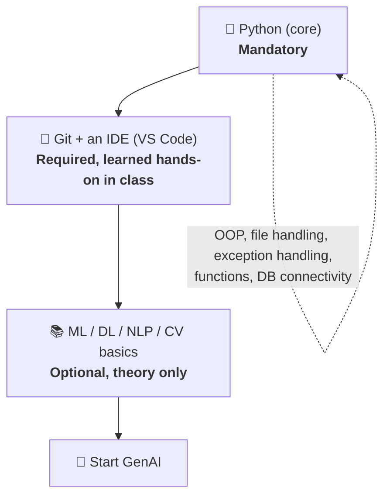
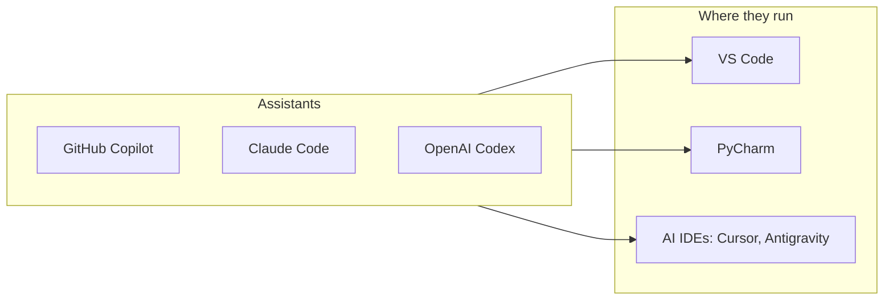
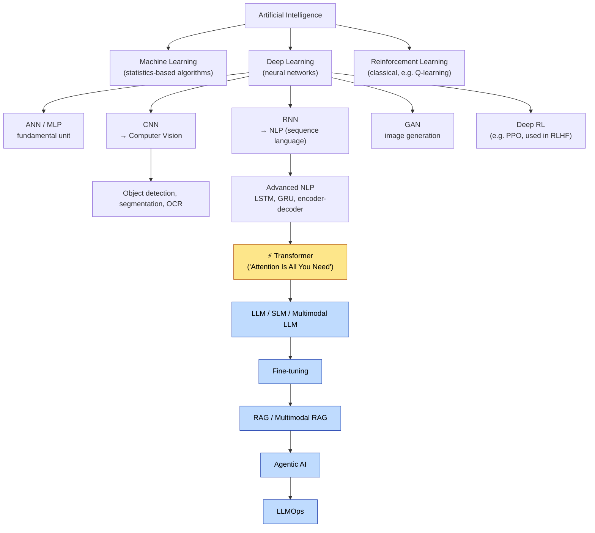
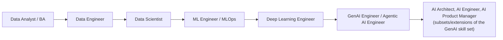
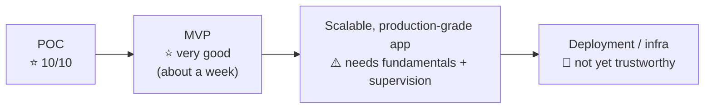

# 🧭 Class 2: Orientation, AI Coding Assistants & the "Modern Route" to Generative AI
### 📋 Full Stack GenAI Bootcamp | Krish Naik Academy

**🎙️ Mentor:** Sunny Savita
**⏱️ Duration:** ~2 hrs 15 min of teaching + ~2 hrs 45 min open doubt session | **📅 Session:** Day 2 (28 March 2026, 8 PM IST onward)

---

## 📰 Quick Updates

- This was Sunny's first full-fledged session with the batch (the first class was the induction; the second was a Sunday system-setup session by Monal). Many attendees joined for the first time, so the class was deliberately kept light: **logistics, tooling, roadmap, and the agenda for Module 1**. Real technical content starts **from the next class**.
- **Timing:** 8 PM to ~11 PM IST. A 5-minute break roughly every hour, plus a **15-minute dinner break around 9 PM** every session.
- **Recording and notes:** every session is recorded and appears under *Live Session* in the course. Notes are posted in the resource section of each class *and* in a central GitHub repo.
- **Referrals:** Sunny mentioned a fresh requirement from EY for AI engineers and said he would float a Google Form the next day. He referred around 70-80 people from earlier batches this way. His advice: prepare first, then interview.

---

## 🗂️ Where Everything Lives (Course Navigation)

Sunny opened with a walkthrough of the learning platform, since many questions in the group were about access.

| Resource | What it holds |
|---|---|
| **Course dashboard** (learn.krishnaik.academy → *Courses*) | Two courses appear: the **Full Stack GenAI Bootcamp** (current) and the complimentary **Advanced NLP GenAI Bootcamp** (the previous batch, usable to fast-track topics) |
| **Live Session** tab | Recordings of every class, with per-class resources and transcripts |
| **Prerequisite** tab | Python, ML and DL crash-course videos |
| **Community chat** (*Messages*) | Doubts outside class hours; Sunny monitors it |
| **Google Sheet "notice board"** | Calendar, next topics, holidays |
| **GitHub repo** (Full Stack GenAI 1.0) | Class-wise notes, code, handwritten notes, all in one place |
| **Notion page** | Live links, commands, and things shared *during* class (e.g. basic `uv` commands) |
| **Syllabus link** | The course is taught according to it |

Doubt-resolution ladder, as Sunny described it: (1) the live chat during class, (2) the live doubt session right after class, (3) the community chat, (4) email to Sunny directly. For *basic* doubts (installation errors, concept lookups), he asked everyone to first try an AI assistant.

> Practical tips from the session: if a link can't be copied from the Zoom chat (restricted deliberately for webinars), just click it. If the course doesn't appear, log out and back in. If the YouTube prerequisite playlist shows an "unusual traffic" block, try incognito mode or a VPN.

---

## ✅ Prerequisites, Ranked

Sunny wrote the requirements on the board in priority order:

- **Python is the bare minimum.** Core Python means if/else, functions, OOP, file handling, exception handling and database connectivity. Libraries are picked up in class.
- **Git and VS Code basics** are needed, but anyone who doesn't know them will absorb them through the live hands-on work. Any IDE works (Cursor, Antigravity, PyCharm); VS Code is what the class uses.
- **ML / DL / NLP / CV is optional.** Those who skip it can still start GenAI directly. The useful minimum is the **artificial neural network and the multi-layer perceptron**, understood at the theory level, not the coding level. Terms like supervised/unsupervised learning, training, testing, inference and prediction will resurface when LLMs and transformers are discussed.
- **Python version:** use **3.12** (stable). 3.11 also works. Python 3.13 and 3.14 can produce dependency problems, so Sunny avoids them in his own projects. Check what's installed with `uv python list`; multiple virtual environments can coexist.

---

## 🤖 The Case for AI Coding Assistants

A large part of the first hour went to a mindset shift, which Sunny framed as the single most important habit for the course.

**His argument:** a 400-line program that takes 2-3 days by hand can be produced in minutes with an assistant. In industry, developers who refuse to use AI will be outpaced by those who do. The developer's job shifts toward **supervising**: understanding concepts, verifying output, and directing the AI. Within a year, he expects at least half of routine tasks and most boilerplate code to be automated.

**Assistants named in class:**

- **GitHub Copilot** is the one set up today because it has a free tier.
- **Claude Code** gets its own dedicated chapter later in the course.
- **OpenAI Codex** was mentioned as another good option; Sunny hasn't used it extensively himself.

**Teaching stance:** in class, Sunny will write code from scratch to explain concepts, but students should build the habit of using an assistant to write and *learn* code.

### 🛠️ Setting Up GitHub Copilot in VS Code

1. Open **Extensions** (left sidebar) and search for **GitHub Copilot** (installing *Copilot Chat* also works).
2. Install it. A Copilot chat icon appears.
3. Click it. If you're not signed in, you'll be prompted to **log in with GitHub**. If VS Code already uses your Git account, it may sign in automatically (this happened to a student, Anil, during the demo).
4. Type any message ("hi") to confirm it replies. Also install the **Python extension**.

**Modes:** *Ask* answers or generates code without touching your files; *Agent* edits files directly.

Sunny's live demo, in his own words condensed into prompts:

- Prompt 1 (Agent mode, on a small existing calculator file): add multiplication, division and subtraction. Copilot produced the whole updated file and offered to run tests, which he declined. He could *keep* or *undo* the changes.
- Prompt 2 (Ask mode): "create a class and object for this code." Copilot rewrote the procedural code into a class and object.

**Free vs paid Copilot:** the free tier gives access to basic models (he cited GPT-4.1/4o-class and GPT-5); the paid tier unlocks premium models such as the Opus family and newer GPT versions. (The monthly price was mentioned but is not clearly audible in the recording; check GitHub's pricing page.)

### 🧠 Make AI Your First Stop for Basic Doubts

Sunny asked students to use ChatGPT, Claude, Gemini, or Microsoft 365 Copilot for installation errors, debugging and concept questions *before* asking him. Reasons: it builds self-learning capacity, and asking trivial questions on the job can backfire. Genuine class-related and critical doubts are still very welcome.

---

## 🗺️ The "Modern Route": How GenAI Fits Into AI

Sunny drew the whole landscape on a whiteboard (he promised the PDF in the resources). Here it is, rebuilt:

**The blue chain, from the transformer onward, is what Sunny calls the "modern route."** The transformer was the breakthrough inside advanced NLP, and everything in GenAI is built on it. The course is designed along this chain.

### What we will *skip* from the classical route

| Classical topic | Decision |
|---|---|
| LSTM and GRU | Not covered (not necessary for the course) |
| Classic encoder-decoder architecture | Not covered; go straight to the transformer |
| Pandas, NumPy, scikit-learn, Keras, TensorFlow | Not a focus |
| **Encoding and embedding** | **Covered**, since RAG, retrieval systems and understanding how transformers/LLMs work depend on it |

### Where data roles sit

Sunny placed the data-science side of the map as well: EDA, feature engineering, statistics and ML algorithms belong to **data science**, and everything is fed by **data engineering**, which he called a crucial part of every industry AI project.

- **GenAI Engineer** and **Agentic AI Engineer** are the two target profiles of this course.
- **AI Architect** and **AI Engineer** are, in his view, essentially the same body of work; both are reachable once you have delivered AI projects.
- **AI Product Manager** is techno-functional: partly technical, partly business-facing. It is a mid-to-senior role.

---

## 🧰 The Framework Landscape for Gen AI Development

Instead of core ML libraries, the stack that "dominates GenAI development" is:

**PyTorch → Hugging Face → Unsloth → LangChain → LlamaIndex → LangGraph**, plus categories for:

- data parsing (e.g. Docling, Google Document AI, Tesseract, PyMuPDF, Unstructured)
- vector databases (FAISS, Chroma, Qdrant, Supabase, pgvector)
- cloud (AWS, Azure)
- OpenAI SDK
- guardrails
- MCP (FastMCP)
- agent frameworks (Google ADK, AutoGen, Deep Agents, LangGraph)

Sunny also showed a much longer, categorised master list (LLM foundations, fine-tuning, RAG/vector DBs, storage, applications, guardrails, local LLMs, experiment tracking, MCP, document AI, parsing, agentic frameworks, cloud, evaluation/observability, prompt engineering, deployment, testing, orchestration). He put it on the Notion page and made a YouTube video about it.

**Important framing:** not every framework will be covered, only the *important one or two per category*. His advice: **master at least one framework deeply**; the rest become easy. Python dominates the entire stack.

---

## 🎯 Module 1 Agenda (Starts Next Class)

Starting from tomorrow, Sunny will jump straight into content, with no repeat of the setup tour. The first module's planned order:

1. Encoding (several methods; they are still used widely)
2. Embeddings
3. Semantic search
4. Keyword search vs semantic (vector) search
5. Encoding vs embedding
6. Vectors
7. Applications of encoding and embeddings
8. Embedding models, with practicals in Python

Tokenization was intentionally *not* on the board; he said it belongs to the next module and promised to explain why.

**Why this theory when assistants can write code?** It builds your base, it is commonly asked in interviews, and it is required to understand how LLMs actually work. After Module 1 the course moves to fine-tuning, RAG, agentic AI, LLMOps, guardrails and MCP, building POCs and MVPs along the way. Cloud (Bedrock, Azure Foundry) setup and architecture come in later sessions.

---

## 🚦 How Far Can AI Coding Assistants Go?

A question Sunny hears constantly: *will Copilot replace the developer?* His answer, by project stage:

- **POCs and MVPs:** excellent. Work that would take 10-15 days can be done in a day or a week.
- **Large codebases:** help is still real, but you need fundamentals and architecture knowledge, or "it's going to be a tragedy."
- **Testing:** partly assisted, with manual work remaining.
- **Deployment and infrastructure:** don't give an assistant full access to cloud infra; mistakes directly cost money. Supervision by an expert is needed.
- He expects this human-in-the-loop requirement to persist for roughly the next 3-5 years.

**Definitions covered along the way:** POC = proof of concept, MVP = minimal viable product, MCP = Model Context Protocol, SDK = software development kit, FT = fine-tuning, LLMOps = deploying and operating LLM applications.

---

## 💬 Live Q&A Highlights

### During the main session

| Question | Answer |
|---|---|
| Which Python version? | 3.12 (or 3.11). Avoid 3.13/3.14 for now due to dependency issues. |
| Will recordings be available? | Yes, under *Live Session*. Notes are also uploaded to the resource section and GitHub. |
| Why spend time on logistics? | First class in full-fledged mode; setting the agenda and structure now avoids repeated questions later. |
| Will we cover Claude, Bedrock, AWS, architecture, tokenization, FastAPI, deployment, safety/guardrails? | All yes, in the relevant modules. Claude has its own chapter; cloud setup comes in later sessions. |
| Any books to read? | No. Focus on the centralised class material, notes, GitHub and recordings. |
| Where do data analysts fit? | Before data engineering: DA/BA → DE → DS → MLE/MLOps → DL engineer → GenAI engineer. |
| Is the batch timing changing for some groups? | No; it stays 8-11 PM IST. |

### Open doubt session (grouped by theme)

**Environment and tooling**

| Question | Answer |
|---|---|
| (Karthik) A script runs from terminal with `python main.py` but the VS Code Run button / Code Runner fails to import NumPy. | The Run button was using a different interpreter than the `uv` environment. Use **Command Palette → Select Python Interpreter** to pick the right one, run via the *Python* run dropdown (not Code Runner), and install packages with `uv pip install numpy` in the right terminal (CMD worked where PowerShell had friction). |
| (Prince) `uv` errors on Windows; Python not found. | Python itself wasn't installed. Install it from the Microsoft Store or python.org, confirm with `python` in CMD, then `pip install uv` (pip ships with Python). Sunny will re-demo `uv` setup in the next 2-3 classes. |
| (Anjibabu) `pip install uv` fails on a Mac. | Use **`pip3 install uv`** on macOS; plain `pip` doesn't resolve there. |
| (Yogeshwar) VS Code on Mac keeps prompting for a command-line developer tool. | Install it; the backend needs it to execute commands. |
| (Ridham) Copilot chat replies "your response got filtered," even after signing out/in, a new GitHub account, extension reinstall and window reload. | Unresolved in class. Suspected account or connectivity issue; Sunny suggested updating or reinstalling VS Code, waiting some hours, and re-testing in the next class. |
| (Vijayanand) Copilot chat window not visible after install. | It was working. The chat opens in the side panel; typing a test message confirms setup. |
| Do we need Colab? My laptop has 8 GB RAM (Ryzen 5 5500U) / desktop 8 GB + 250 GB SSD. | Fine for basics and project work. Use Google Colab only for heavy training. Colab sessions don't persist, so you reconnect, choose a runtime (CPU/GPU) and rerun setup each time. |
| (Christopher) Buying a laptop: need GPU/VRAM, or a MacBook? | Not needed for this course; LLM loading and training will be done on Colab. A good GPU is worthwhile only for gaming/editing. MacBook is fine; Sunny develops on one. |
| (Sandeep) To run models locally, what GPU? | GPU is needed for fast inference; check the cloud provider's GPU guidance. Roughly **24 GB VRAM** minimum, so 16 GB is unlikely to be enough. |

**Deployment, security and production**

| Question | Answer |
|---|---|
| (Nitin) One deployed LLM instance and many concurrent users? | Plan for scalability: at higher traffic you'll need multiple instances/deployment architecture and must manage concurrency, rate limits and latency. |
| (Nitin) Hugging Face Enterprise security? | Enterprise plans offer private hosting (e.g. VPC). Alternatively, download weights and host on your own infrastructure; Ollama is another local option. Avoid calling the public Hugging Face API with sensitive data. |
| (Nitin) Monitoring an internal chatbot without LangSmith/OpenTelemetry? | Elasticsearch plus **Logstash and Kibana** can track API logs, model responses, latency, errors and token usage. |
| (Nitin) How to know if a chatbot satisfies the customer? | Very situation-specific; Sunny couldn't answer without the real scenario. |
| (Sivaram) Public LLM APIs leak sensitive data in production; how is that handled? | Use managed private endpoints such as **AWS Bedrock** or **Azure AI Foundry**; setup is straightforward and will be shown. |
| (Sivaram) Front-end/back-end? | Yes, FastAPI served via Uvicorn; test with Postman, Swagger UI or a Streamlit front end. |
| (Sandeep) Where do real-world models get deployed? | Managed services (Bedrock, Azure Foundry) are the most practical and in demand: you consume models through an SDK. Self-hosting needs your own infrastructure. |
| (Sushil) Can an agent create tasks in SAP (e.g. GRC)? | Yes. Agents work through tools; expose the SAP service as a tool, possibly via MCP. |
| (Venkat) Do we need REST/FastAPI skills? | Only to *build* APIs. Using an LLM or service needs just the SDK and an API key. Building APIs for agents will appear in the course project. |
| (Roy) What subscriptions (OpenAI, AWS, Azure) are needed? | Decide later. Sunny will explain costs after a few weeks; some billing can be waived or is small. |

**Course scope**

| Question | Answer |
|---|---|
| (Sankar) Will evals be covered? | Yes, as part of application development. |
| (Deepak) Can we build/fine-tune SLMs and deploy them? | We use existing base models and fine-tune, starting with SLMs since they're easier to train. Deployment is possible; Sunny has a YouTube video. The transformer architecture's components will be explained. |
| (Venkat) Will PyTorch, Unsloth etc. be covered fully? | Only as needed, not exhaustively. Encoder-decoder (classic) will not be covered; refer to the previous course or Krish's channel, or email Sunny for resources. |
| (Ram) Domain-specific LLMs? | Yes, under fine-tuning. |
| (Ram) Which agent framework? | Start with **LangGraph**, then the **OpenAI SDK**. UIs via Streamlit, plain HTML or React. |
| (Ram) JSON data for RAG and chunking trouble? | JSON is just a way of organising data, and fine to use; wait for the RAG/chunking topic. |
| (Ram) Interview prep? | Questions will be shared later; a YouTube video already has 200-300 incl. transformer questions. |
| (Surendhar) Will we build agents? | Yes, as a project. |
| (Kumar) Can't find recordings. | He was opening the previous course; recordings are in the Full Stack GenAI Bootcamp → Live Session. |
| (Amol) Can I ask about recorded lessons from other courses? | Yes, via community chat or email; concept-level questions about those courses are fine. |
| (Vijayanand) Other courses for ML or Python? | Check the AI Pro subscription (which includes the data-science bootcamp); the counseling team can share links. |
| (Amol) TensorFlow vs PyTorch? | TensorFlow (Google) is more complex; PyTorch (Meta) is simpler and most development happens there. |

**Learning path and prerequisites**

| Question | Answer |
|---|---|
| (Ramya) Is ML engineering required? | No. Learn only terms like supervised/unsupervised learning, training and inference if you have time. |
| (Ramya) Is Copilot a CI/CD tool? | No. It's a coding assistant; CI/CD, GitHub Actions and Terraform are separate deployment topics. Claude models need a paid plan for good output. |
| (Atish) Theory or coding for NLP/DL basics? | Theory only (ANN, MLP, NLP basics). |
| (Krish S) Python depth and prerequisites? | Fundamentals suffice; learn packages in class. LangChain/LangGraph are part of the main course, not prerequisites. ML/DL crash course is mainly for interviews and deeper intuition. |
| (Vijayanand) How much Python? | Core Python (control flow, functions, OOP, file/exception handling, DB connectivity). |
| (Vijayanand) Is traditional ML still relevant? | Not for building applications directly; useful as theory. |
| (Amol) JavaScript vs Python? | AI-focused: Python mandatory, JavaScript optional. Web-development-focused: the reverse. |
| (Amol) Skills for top companies? | Freshers: data structures. Experienced: data structures plus system design. |
| (Krishna) Python depth for a manager? | Basics only; analyse generated code and depth follows. DSA only matters for top-tier company interviews. |

**Career guidance**

| Background | Advice |
|---|---|
| DB developer, 9+ yrs (Kamlesh) | Follow the live classes; add DL/NLP fundamentals from prerequisites. ML can be skipped. |
| Senior data engineer (Sankar) | Evergreen field, but growth is flatter and parts may be automated. Add AI on top; DE plus AI gives full architecture knowledge. |
| SQL developer, no plans to leave (Surendhar) | Learn to *use* AI effectively (assistants, no/low-code flows). Keep the development side light. Fine-tuning/hosting is perhaps 5% of typical work. |
| QA/testing (Nagesh) | Target GenAI Engineer, then AI Architect after real project experience. LLMOps/MLOps are mostly DevOps-style deployment. Take internal AI opportunities. |
| Cloud/DevOps, 9+ and 16 yrs (Kiran, Anjibabu) | DevOps and data engineering remain stable. Choose: learn development, or stay in DevOps and add AI (AI infra, cost optimisation, scaling, understanding RAG/agents). |
| Mainframe, 17 yrs (Satish) | Possible. Learn, build 1-2 projects, present yourself as a senior engineer building enterprise AI systems. Referrals will be shared. |
| .NET, 10+ yrs (Ram) | Experience counts, not "fresher". Become a GenAI Engineer first; Architect after 1-2 AI projects. Pay depends on role and company. |
| Product/program managers (Krish S, Sandeep, Yogeshwar, Krishna) | You don't need deep coding; know RAG, agents, multi-agent design and how AI creates business value. Use Copilot/Claude for hands-on work. Deployment isn't required. Interview coding depends on the role. |
| Storage/cloud, 23 yrs (Revansiddha) | Long experience is a strength. Go for GenAI Engineer, then Solution Architect after a couple of projects. Master one framework. |
| SAP/Salesforce side (Sushil, Sandeep) | Learn both Salesforce agents and LangChain; use APIs inside agentic apps. |

---

## 🔑 Key Pointers to Remember

- Python is the one hard prerequisite. Git and VS Code are learned along the way.
- ML/DL are optional theory; know the ANN/MLP at least.
- The **modern route**: Transformer → LLM/SLM/multimodal → fine-tuning → RAG → agentic AI → LLMOps.
- Encoding and embeddings come first because RAG and LLMs depend on them.
- Install **GitHub Copilot** in VS Code, and make AI the first stop for basic doubts.
- AI assistants are superb for POCs and MVPs; production scale and deployment still need human expertise.
- Frameworks to focus on: PyTorch, Hugging Face, Unsloth, LangChain, LlamaIndex, LangGraph (plus MCP, OpenAI SDK, vector DBs, guardrails). Master at least one deeply.
- Use Python 3.12 and `uv`; on macOS, use `pip3 install uv`.
- Online or local, you don't need a GPU laptop. Colab covers training.
- Targets: GenAI Engineer and Agentic AI Engineer; AI Architect follows project experience.

---

## 🗺️ What's Next

- **Next class:** straight into Module 1: encoding, embeddings, semantic vs keyword search, vectors and Python practicals. Tokenization comes in the following module.
- `uv` environment setup will be re-demonstrated over the next 2-3 classes.
- Claude Code configuration gets a dedicated chapter later.
- Cloud (Bedrock / Azure Foundry), deployment, evals, fine-tuning, RAG, agents and MCP follow.
- Sunny will share: the whiteboard PDF, his VS Code theme/extension, interview questions, and the EY referral form.

---

## ✅ Action Items After Class 2

- [ ] Open the course dashboard and confirm both courses and the *Live Session* tab are visible
- [ ] Bookmark the notice-board sheet, GitHub repo, Notion page and syllabus
- [ ] Install Python 3.12 and `uv` (macOS: `pip3 install uv`)
- [ ] Install VS Code, the Python extension and GitHub Copilot; sign in to GitHub and send a test chat message
- [ ] Complete the Python prerequisite videos; skim the ANN/MLP theory
- [ ] Download Class 2 notes and the whiteboard PDF from the GitHub repo
- [ ] Read the framework list on Notion; note the "master one framework" advice
- [ ] Email or community-chat any unresolved setup issue (e.g. Copilot "filtered" error, interpreter selection)

---

*📝 Notes compiled from the full Class 2 session transcript (main session and open doubt session), "Orientation, AI Coding Assistants & the Modern Route," Full Stack GenAI Bootcamp, Krish Naik Academy.*
