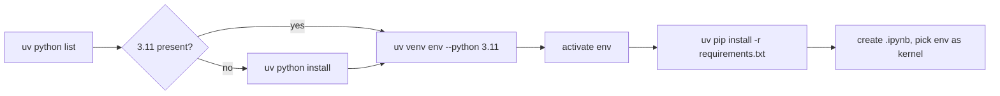
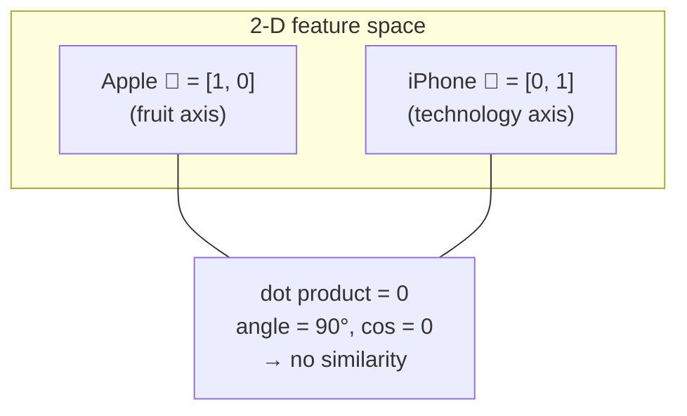
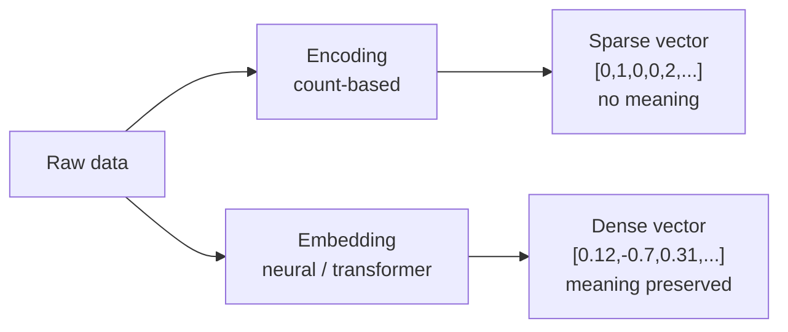
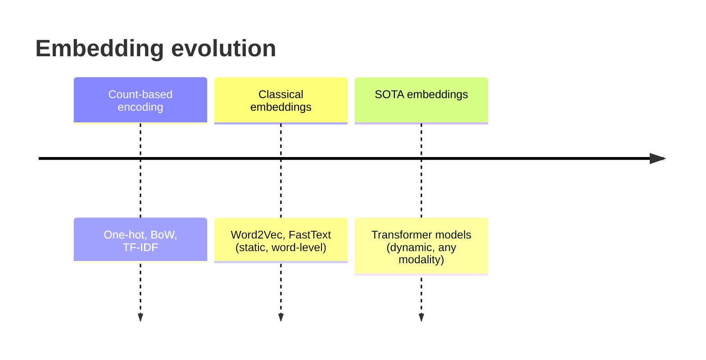
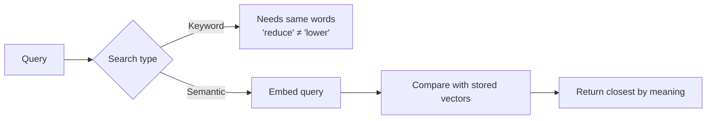

# 🧮 Class 3: Encoding vs Embedding — Vectors, Similarity & Semantic Search
### 📋 Full-Stack GenAI Bootcamp 1.0 | Krish AI Academy

**🎙️ Mentor:** Sunny Savita
**⏱️ Duration:** ~2.5 hours of teaching + ~2.5 hours of open doubt session | **📅 Session:** Day 3 (29 March)

---

## 📰 Quick Updates

- **Notice board:** Sunny re-shared the Google Sheet that holds upcoming class details and the holiday calendar. Keep it bookmarked.
- **GitHub repo:** All resources live in the class repository (requirements file, notebook, PDFs of notes). He pushes to it during class, so `git pull` or refresh to get new files.
- **Recordings:** They appear on the dashboard (Course → Live Class → Resources) within **12–24 hours**. The delay comes from Zoom processing the recording, not from the academy, so there is no point asking repeatedly in the community chat.
- **Why start with VS Code and environments?** Some students asked why the course began with setup instead of a full project. Sunny's answer: the batch includes freshers and career-switchers, and settling the fundamentals first avoids endless "which link? which command?" interruptions later.
- **Notes shared today:** a new Notion page for Class 03 (commands), plus PDF exports of the Notion theory notes and the handwritten blackboard notes, all pushed to GitHub.
- **Coming up:** the encoding/embedding chapter should wrap by Monday at the latest, then the Transformer chapter begins. The next class is the following Saturday.

---

## 🛠️ Environment Setup (uv + Python 3.11)

Sunny set up a fresh environment on screen before any theory, so the practical could run alongside it.

**Why Python 3.11 (or 3.12)?** These are the most stable versions for the libraries in today's `requirements.txt`. He advised against 3.13/3.14 because some libraries break there. He also said he hit install errors himself an hour before class, and pinning 3.11 fixed them. Always use the **CPython** interpreter, not PyPy or GraalPy.

You can have Python 3.14 installed system-wide and still create a virtual environment from 3.11. `uv` downloads whichever interpreter you ask for.

```bash
# 1. See which Python versions uv knows about
uv python list

# 2. Install a missing version (copy the exact CPython name from the list)
uv python install <cpython-3.11.x-name>

# 3. Create a virtual environment with that interpreter
#    ("env" is just a folder name — call it anything)
uv venv env --python <cpython-3.11.x-name>

# 4. Activate (copy the path from env/Scripts/activate on Windows)
#    Mac/Linux:  source env/bin/activate

# 5. Install the class requirements
uv pip install -r requirements.txt
```

Then he created `encoding_embedding.ipynb`, selected the environment as the kernel, and ran `print("all")` as a smoke test.



> 💡 Keep `requirements.txt` **outside** the environment folder. The env folder is only a container for installed packages.

---

## 📐 Vectors: The Foundation

Before touching encoding, Sunny built up the mathematics, because everything later (embeddings, similarity, RAG) rests on it.

| Term | What it is | Example |
|---|---|---|
| **Scalar** | A single number | `5` |
| **Vector** | A list of numbers (a point/direction in n-dimensional space) | `[5, 10]`, `[4, 5, 7, 2]` |
| **Matrix** | A grid of numbers, i.e. a collection of vectors | 2×2, 3×2 (rows × columns) |

- The **dimension** of a vector is simply how many numbers it holds. `[5, 10]` is 2-D; a vector with 6 numbers is 6-D. Humans cannot visualise beyond 3-D, but the maths works for any n.
- In **physics and mathematics**, a vector means **magnitude + direction**. His analogy: "travel 10 km south-east" is a vector. In **NLP and AI**, the same object is called an **embedding** when its numbers carry meaning.
- A real embedding model might output 3072 numbers for any sentence you give it, so each sentence becomes a point in a 3072-dimensional space.

### Locating a point and measuring its distance

For a point P = (4, 5) on an x–y plane, the vector is `[4, 5]`. Its distance from the origin comes from Pythagoras:

```
magnitude = √(4² + 5²) = √41 ≈ 6.4
```

This straight-line distance is the **Euclidean distance**, one of the measures used later in similarity search.

---

## 🍎 Meaning as Coordinates: The iPhone vs Apple Example

This was the session's key intuition builder. Sunny gave two words the same two "feature" axes: **Fruit** and **Technology**.

| Word | Fruit | Technology | Vector |
|---|---|---|---|
| Apple (fruit) | 1 | 0 | `[1, 0]` |
| iPhone | 0 | 1 | `[0, 1]` |

**Dot product** = x₁·x₂ + y₁·y₂ = (1×0) + (0×1) = **0**

A dot product of 0 means no similarity. Geometrically the two vectors sit at **90°** to each other, and cos 90° = 0. (In the live explanation he described the angle as "0", but the correct statement is a right angle, whose cosine is 0.) Real embeddings do the same thing with hundreds or thousands of learned axes instead of two hand-picked ones.



---

## 🔢 Encoding vs Embedding

Sunny's one-line summary: **encoding is a numerical representation; embedding is a *meaningful* numerical representation.**

### Encoding
- Converts raw data (mostly text) into numbers, usually a **sparse vector**, where most entries are 0.
- It is a **count/frequency-based** method and does **not** preserve semantic meaning or context.
- The three techniques to learn (derivations promised next class):
  1. **One-hot encoding**
  2. **Bag of Words (BoW)**
  3. **TF-IDF** (term frequency × inverse document frequency)
- **BM25** is a ranking function in the TF-IDF family. It will show up in practical form later for retrieval in RAG. **GloVe** was mentioned as a count/matrix-factorisation approach that is rarely used now. Neither is required to understand encoding.

### Embedding
- Converts text, images, audio and video into a **dense, high-dimensional** vector (typically hundreds to thousands of numbers), with few or no zeros.
- Produced by **neural networks** (older) or **transformer-based models** (today).
- Preserves **semantic meaning and context**.

| | Encoding | Embedding |
|---|---|---|
| Method | Count / frequency | Neural network or transformer |
| Vector type | Sparse (many zeros) | Dense |
| Semantic meaning | Not preserved | Preserved |
| Context-aware | No | Yes (modern models) |
| Examples | One-hot, BoW, TF-IDF | Word2Vec, FastText → BERT, MPNet, BGE, OpenAI, Gemini, Cohere |



---

## 🧱 Text Terminology Ladder

Sunny cleared up vocabulary that gets muddled constantly:

**Character → word/token → sentence → paragraph → document → corpus**

For this course, treat word and token as the same thing. A token is simply the unit a model takes as input.

---

## ⏳ Classical vs State-of-the-Art (SOTA) Embeddings

| | Classical (≈2018–2020) | SOTA (today) |
|---|---|---|
| Models | Word2Vec, FastText | BERT, MPNet, BGE, OpenAI, Gemini, Cohere, etc. |
| Built on | Neural networks | Transformers ("Attention Is All You Need") |
| Input they handle | Single **words** only | Words, sentences, documents, whole books, plus images, audio, video |
| Embedding type | **Static**: one fixed vector per word | **Dynamic**: depends on context |

**The "bank" example.** Compare "I sat on the river **bank**" with "I deposited money in the **bank**".
- A static model like Word2Vec gives "bank" the **same** vector in both sentences.
- A transformer-based model produces **different** vectors because it reads the surrounding context.



---

## 🔍 Measuring Similarity

Three ways to compare two vectors:

1. **Dot product:** x₁x₂ + y₁y₂ (+ …). It is **unbounded**, so a larger-magnitude vector scores higher.
2. **Cosine similarity:** the dot product **normalised** by the vectors' lengths, i.e. cos θ. It is bounded to **[−1, +1]** and looks only at direction.
3. **Euclidean distance:** the straight-line distance between points. It ranges from 0 upward, and **smaller means more similar**.

In the doubt session a student asked what separates dot product from cosine. Sunny's answer was that cosine is "just a normalised value". He briefly misquoted the ranges and then corrected himself live: dot product spans −∞ to +∞, cosine −1 to +1, Euclidean 0 to ∞.

---

## 🧠 Semantic Search vs Keyword Search

**Semantic (similarity) search:** convert the data to embeddings, then use dot product, cosine or Euclidean distance to find the vectors closest to the query vector. It matches **meaning**.

**Keyword search** matches the **literal words**.

| Query / Sentence A | Sentence B | Keyword | Semantic |
|---|---|---|---|
| Eating fiber reduces heart risk | Eating fruit and vegetables lowers cardiovascular disease | ❌ weak | ✅ strong |
| How to lose weight fast | Quick fat-loss strategy | ❌ weak | ✅ strong |
| Eating fiber reduces heart risk | Buying a new car improves driving comfort | ❌ | ❌ (genuinely dissimilar) |



### Where embeddings are used
Semantic search itself, Google-style search engines and image search, Pinterest visual matches, Netflix movie suggestions, Amazon similar products, Spotify similar songs, and above all **RAG (Retrieval-Augmented Generation)**, whose retrieval step is a similarity search.

---

## 🏆 Finding and Choosing Embedding Models

- **Closed-source:** OpenAI, Google, Anthropic, Cohere, AWS. Open-source options come from Hugging Face's **Sentence Transformers** hub.
- **MTEB** (Massive Text Embedding Benchmark) leaderboard ranks models and shows which are open-source.
- **BEIR** is another benchmark (zero-shot evaluation of retrieval models).
- Beyond benchmarks, Sunny's practical criteria: **dimensionality** (lightweight vs high-quality), **cost**, and **domain suitability**.
- Prep for next class: browse the Sentence Transformers repo and docs on Hugging Face.

---

## 🧪 Practical Preview (done next class)

Sunny walked through the draft notebook but deferred live coding. The planned flow:

1. Encoding: one-hot → bag of words → TF-IDF
2. SOTA embeddings via Sentence Transformers, Google Gemini (LangChain) and OpenAI
3. Cosine / dot / Euclidean comparison across models
4. Classical Word2Vec
5. Evaluating embedding models with MTEB
6. Keyword vs semantic search comparison

He showed sparse (zeros everywhere) versus dense vectors side by side. **Generate your OpenAI and Google API keys beforehand**, since he will show how next class.

---

## 🗺️ What's Next

- **Next class:** hands-on derivations of one-hot, BoW and TF-IDF, then Word2Vec (needs neural-network basics), then how transformers create embeddings, then the practical notebook.
- **Promised after the doubt session:** a step-by-step `uv` document (when to use `uv init`, what `pyproject.toml` is, `uv pip` vs `uv add`), a short environment/GitHub/editor primer, and (on request) a session on model distillation within the fine-tuning chapter.
- **Chapter order:** Embeddings → Transformers → RAG and vector databases.

---

## 💬 Live Q&A Highlights

| Question | Answer |
|---|---|
| `uv` not recognised on Windows / `pip` not found | Python probably isn't on the PATH. Workaround: `python -m pip install uv`, then `python -m uv --version`. Proper fix: add Python to the environment variable PATH and restart. Use CMD rather than PowerShell. |
| What does "count-based" mean? | Show each document as counts of each vocabulary word, e.g. a word appearing twice gets 2. That is frequency/count-based encoding. Embeddings instead learn the numbers via neural network weights. |
| Early embeddings and encodings seem similar, so why the shift? | Encoding keeps no semantic meaning. Word2Vec adds some meaning but is static (same vector for "bank" in every context). Transformers give context-aware embeddings. |
| Dot product vs cosine? | Cosine is the dot product normalised. Dot product is unbounded; cosine lies in [−1, 1]. |
| Why was Word2Vec introduced if BoW already existed? | Deferred to next class. Short answer: Word2Vec learns dense vectors with a neural network, but they are still static. |
| What's the difference between "dimension" and "parameters"? | Dimension = how many numbers in a vector (or layer output). Parameters = the weights and biases of a model. In a tiny network, 17 parameters can coexist with a 2- or 3-number output. |
| Are "vector" and "embedding" the same? | Yes. "Vector" is the mathematical term; "embedding" is the AI/NLP term for a vector that carries meaning. |
| Is MTEB the only benchmark? | No. BEIR is another, and you can add custom criteria: dimensionality, cost, domain fit. |
| Embed words, sentences or paragraphs? | Use **sentence-level** embeddings from transformer models. Chunk large paragraphs into smaller pieces first. Word embeddings are used internally by the model, not directly by you. |
| `uv add` vs `uv pip install`? | `uv pip install` just installs into the current virtual env. `uv add` is uv-native: it also records the package in `pyproject.toml`/`uv.lock` for reproducible, portable projects. For this class, stick with `uv pip install -r requirements.txt`. |
| `uv add` created a separate `.venv`, not my `env` | Right. uv-native commands make their own `.venv`. Don't mix them. Use `uv pip` inside the activated `env`. |
| Working in a team repo that already uses uv | If the project already has a `pyproject.toml`, following its uv workflow is fine. Otherwise keep to `uv pip`. |
| Terminal shows one Python, editor another | The terminal's activated environment and the editor's selected interpreter/kernel are **separate**. Select the kernel manually for each notebook (Command Palette → Select Interpreter). |
| Notebook asks to install ipykernel / kernel won't load | Run `uv pip install ipykernel`, then Ctrl+Shift+P → "Reload Window". If it still hangs, restart the machine. |
| `3.11` missing from `uv python list` | Upgrade pip (`python -m pip install --upgrade pip`), reinstall uv (`python -m pip install uv`), list again, then `uv python install` the 3.11 build. |
| "Python 3.12 not found" error | `uv python install` the 3.11 interpreter first, then create the env with it. |
| Venv shows Python 3.14 / 3.10 or a library fails to install | Create a new environment from 3.11. Delete the old env and recreate. A pinned lock file (`uv.lock`/`pyproject.toml`) may still say 3.14; ignore or remove it for now. |
| Should `requirements.txt` go inside the env folder? | No. Keep it outside (project root). Inside works but isn't good practice. |
| Warnings (e.g. gensim) while installing | Version-mismatch warnings are fine as long as there is no install error. |
| Mac: activate fails with "permission denied" | Use `source env/bin/activate`. Also check the environment name for typos. |
| `git` not recognised | Install Git first from the official site, then clone the repo. |
| Python extension in VS Code | Install Microsoft's Python extension so VS Code can use the interpreter. |
| Where to store lots of embeddings? | Vector databases, covered in the RAG chapter. |
| TF-IDF/Word2Vec still used in regulated domains (finance, healthcare)? | Yes, classical encodings are still used where simplicity/explainability matter, and are still asked in interviews. A trade-off guide is promised. |
| Who picks LangChain vs LangGraph etc.? | Usually the architect. Aim for broad framework knowledge as you grow. Kubernetes comes in for scalable microservice deployments. |
| Can this prepare me for an AWS GenAI exam? | Partly. Extra AWS-specific services need separate study. |
| Can't join/rejoin Zoom after 3 hours; can't copy from Zoom chat | Sunny will check with his team. Copy-paste is disabled for webinars, so resources are shared on GitHub/Notion instead. |
| Zoom/work-laptop "access denied" on installs | Likely admin or VPN restrictions on a company machine. Check with IT. |

---

## 🔑 Key Pointers to Remember

- Encoding = numbers, no meaning. Embedding = numbers **with meaning**.
- A vector is a list of numbers. Its length is its **dimension**. Embedding = vector with meaning.
- Matrix = grid of numbers = collection of vectors.
- Distance from origin for (4, 5) is √41 ≈ 6.4 (Euclidean).
- Dot product = 0 means dissimilar (vectors at 90°, cos = 0).
- Cosine is a normalised dot product, range −1 to 1.
- Static (Word2Vec) vs dynamic/contextual (transformer) embeddings: the "bank" example.
- Embed **sentences/chunks**, not whole giant paragraphs.
- Semantic search finds meaning; keyword search only literal words. RAG retrieval depends on semantic search.
- Dimension ≠ parameters (parameters are weights and biases).
- Use Python **3.11**, CPython, and `uv pip install -r requirements.txt` for this course.
- Terminal activation and editor kernel are separate. Select both.

---

## ✅ Action Items After Class 3

- [ ] Create a Python 3.11 virtual environment with `uv` and install `requirements.txt`
- [ ] Create the notebook, select the right kernel, and run the smoke test
- [ ] Add Python to PATH if `uv`/`pip` are not recognised; install Git if needed
- [ ] Re-read the Notion notes and handwritten-notes PDFs from GitHub
- [ ] Browse the Hugging Face Sentence Transformers hub and MTEB leaderboard
- [ ] Generate OpenAI and Google API keys
- [ ] Revise vector, dot product, cosine, Euclidean distance
- [ ] Post unresolved setup problems in the community chat, or email the mentor

---

*📝 Notes compiled from the full Class 3 transcript — "Encoding vs Embedding," Full-Stack GenAI Bootcamp 1.0, Krish AI Academy.*
