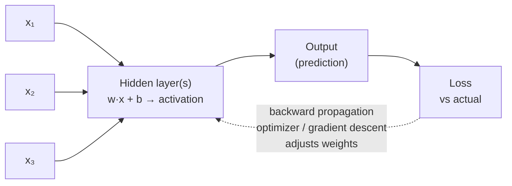
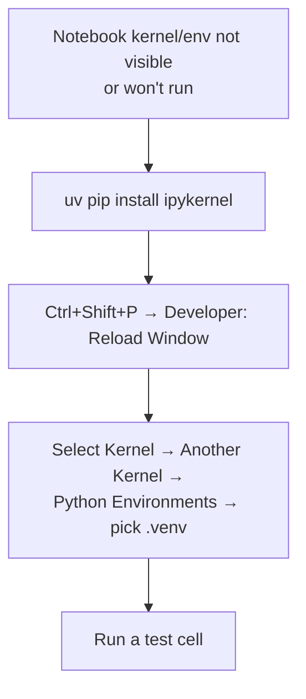

# 🔢 Class 3: TF-IDF, Classical Word Embeddings & the Word2Vec Idea
### 📋 Generative AI Bootcamp | Krish Naik Academy

**🎙️ Mentor:** Sunny Savita
**⏱️ Duration:** ~4.5 hours (incl. dinner break and a long doubt session) | **📅 Session:** Sunday, 5 April 2026

---

## 📰 Quick Updates

- Live-class recordings are uploaded within a day. Notes and code are on the course GitHub; a new folder for today's session was created (notes were re-pushed after class).
- The platform dashboard has three areas worth knowing: **Live Classes**, **Prerequisites** (ML / DL / NLP basics, roughly 33 hours of video in total), and **Resources**.
- Doubts: Sunny's post-class doubt session continues, and a second mentor (Yash) will also run a Google Meet doubt room so queries get cleared faster.
- Whether there is a Wednesday class will be confirmed on Tuesday.
- Scope reminder: N-grams are **not** taught. Fundamentals only, then the real focus: transformers → APIs/fine-tuning → RAG → agents → MCP → guardrails → end-to-end projects. LangChain starts from Module 3.

---

## 🧭 Where We Are in the Story

Sunny opened with a recap: last class covered **one-hot encoding** and **bag of words (BoW)**. Today finishes the "classic encoding" chapter with **TF-IDF**, then starts the **embedding** chapter with **Word2Vec**.


Sunny's framing: the first three (red) are **encoding** techniques, the last two (blue/green) are **embedding** techniques. Why learn the older ones at all? To get the fundamentals right, to survive interviews (TF-IDF is a classic question), and because the same ideas reappear inside transformers.

**Recap of the first two techniques:**
- **One-hot encoding** only checks *presence* of a word (1 = present, 0 = absent).
- **Bag of Words** is count/frequency based.
- Both can be shown at word level or document level.

> ⚠️ In the live recap Sunny said "0 means present, 1 means absent", which was a slip. The standard convention is 1 = present.

---

## 🧱 Why Every Technique Starts with a Vocabulary

Sunny spent time on this because everything else sits on it. Text is **unstructured**, and sentences have different lengths, so you can't turn them into vectors of one fixed size directly. The fix:

1. Build a **vocabulary**: the set of unique words/tokens across the whole dataset.
2. Use the vocabulary size as the **dimension** of every vector.

So for sparse methods (one-hot, BoW, TF-IDF): **vector size = number of features = vocabulary size**. A 1,000-word vocabulary means every document becomes a 1,000-dimensional vector. Related points from the class:

- A word that occurs twice in a sentence still appears **once** in the vocabulary.
- Keep it alphabetical for readability.
- Real vocabularies reach 10K, 50K, or 100K+, which is why these vectors become huge and mostly zeros.

---

## 📐 TF-IDF: Term Frequency × Inverse Document Frequency

TF-IDF counts words *and* judges how important each word is. Sunny noted it was the workhorse before the neural-network era, and **BM25** is its more advanced cousin (to be revisited in the RAG chapter).

### The two formulas

| Part | Formula | Level | Answers |
|---|---|---|---|
| **TF** | (times the word appears in the sentence) ÷ (total words in the sentence) | Single sentence/document | "How important is this word *here*?" |
| **IDF** | log( total documents ÷ documents containing the word ) | Entire corpus | "How rare/informative is this word *overall*?" |
| **TF-IDF** | TF × IDF | Both | Final weight |

Quick TF warm-up from class: in "my name is Sunny and Sunny teaches AI" the word *Sunny* appears 2 times out of 7 words, so TF = 2/7.

Quick IDF warm-up: with 3 sentences, a word that appears in 2 of them has IDF = log(3/2).

### Why TF? Why IDF? Why log?

- **TF**: more occurrences usually means more importance inside that document. Sunny's demo was "AI is important / AI is future / AI is dangerous". AI shows up 3 times in 9 words, so it dominates (TF = 3/9 = 0.333).
- **IDF**: common words (the, is, a) carry little information; rare words are often the important ones. IDF **down-weights common words and up-weights rare ones**.
- **Multiply them** because TF is local importance and IDF is global importance.
- **Why log?** Without it, IDF explodes. With 1,000 documents, a word found in 1 document gets IDF = 1000, one in 10 documents gets 100, one in 500 gets 2. That 2-to-1000 spread is too extreme. Log compresses the range. For a value of 10,000: base 10 gives about 4, base e (natural log) about 9.21, base 2 about 13.3.

### Worked example (4 documents)

| Doc | Text |
|---|---|
| D1 | people watch cricket |
| D2 | watch cricket cricket |
| D3 | people give comment |
| D4 | cricket give comment |

Vocabulary (alphabetical): `comment, cricket, give, people, watch`

Sunny filled in the table word by word. For example, *cricket* in D1: TF = 1/3, and cricket appears in 3 of 4 documents so IDF = log(4/3) ≈ 0.288, giving 1/3 × 0.288 ≈ **0.096**. *People* in D1: TF = 1/3, IDF = log(4/2) ≈ 0.693, giving ≈ **0.231**. A word absent from a document has TF = 0, so its whole value is 0.

| Doc | comment | cricket | give | people | watch |
|---|---|---|---|---|---|
| D1 | 0 | 0.096 | 0 | 0.231 | 0.231 |
| D2 | 0 | 0.191 | 0 | 0 | 0.231 |
| D3 | 0.231 | 0 | 0.231 | 0.231 | 0 |
| D4 | 0.231 | 0.096 | 0.231 | 0 | 0 |

Each row is that document's TF-IDF vector. Note how *cricket* (common) scores lower than *people* or *comment* (rarer).

### Practical with scikit-learn

The notebook wasn't attached, so this is reconstructed from the steps Sunny typed live. Code is on the course GitHub.

```python
from sklearn.feature_extraction.text import TfidfVectorizer

data = [
    "people watch cricket",
    "watch cricket cricket",
    "people give comment",
    "cricket give comment",
]

tfidf_vectorizer = TfidfVectorizer()
tfidf_vector = tfidf_vectorizer.fit_transform(data)   # sparse matrix object

print(tfidf_vector.toarray())                         # 4 vectors, one per document
for vector in tfidf_vector.toarray():
    print(vector)

print(tfidf_vectorizer.get_feature_names_out())       # the vocabulary
```

- `fit_transform` builds the vocabulary and the vectors in one call; `.toarray()` converts the sparse result to numbers.
- `get_feature_names_out()` is called on the **vectorizer object**, not on the result.
- 💡 scikit-learn's defaults (smoothed IDF and L2 normalization) mean its numbers will **not exactly match** the hand-computed 0.096 / 0.231 above. The idea is identical; the formula is slightly adjusted. You can tune the behavior through `TfidfVectorizer` parameters.

### ✅ Pros vs ❌ Cons

| ✅ Pros | ❌ Cons |
|---|---|
| Captures importance, not just counts | Ignores word order ("dog bites man" = "man bites dog") |
| Rare words get higher weight, common words lower | No semantic understanding (*car* ≠ *automobile*, *love* ≠ *like*) |
| Beats plain BoW | Sparse, high-dimensional vectors as vocabulary grows |
| Useful for search, information retrieval, document ranking | No context ("river bank" = "financial bank") |
| No training needed: simple calculation | Out-of-vocabulary words can't be handled |
| Simple and interpretable | Largely superseded by LLM-based embeddings today |

**On the Google/search-engine story:** Sunny said TF-IDF was used in search-engine indexing and ranking, with pages ranked by similarity to the query vector. The accurate background is that TF-IDF comes from classic information-retrieval research (decades before Google), and was widely used for retrieval and ranking. The similarity-search mechanics get full treatment in the RAG chapter.

### Encoding vs Embedding (Sunny's rule of thumb)

> OHE, BoW, TF-IDF, BM25 are **encoding** techniques: a plain calculation, **no training**.
> When a **neural network / transformer** produces the numbers, we call them an **embedding**. The name is used because those numbers carry **semantic meaning**.

---

## 🧠 Why We Need Embeddings

Sunny's motivating example:

- "I **like** this **movie**"
- "I **love** this **flick**"

Humans see the same meaning. To one-hot/BoW/TF-IDF, *like ≠ love* and *movie ≠ flick*, so no similarity is found. An embedding model learns that they are **partially similar**, capturing context and semantic meaning.

Embeddings can be obtained two ways:

| | Classical | SOTA (state of the art) |
|---|---|---|
| Example | **Word2Vec** (Google, 2013) | Transformer-based models |
| Architecture | Shallow neural network | Transformer |
| Examples in the wild | Google's pretrained Word2Vec | Hugging Face / Sentence-Transformers, OpenAI embeddings, Google (Gemini) embeddings |

Sunny's honest take: we **won't use Word2Vec directly** in real applications; we're learning it to understand embedding fundamentals and to be able to explain them in interviews. The same idea (token → learned vector) is also at the start of transformer pipelines. (Strictly, transformers learn their own embedding layer rather than plugging in Word2Vec, but the concept is the same.)

Word2Vec can be used two ways:
1. **Pre-trained** model: Google already trained it, and you just use it. This is the main path in the course.
2. **Custom** model: train on your own data. A ready-made notebook will be shared (students asked for it; Sunny estimated 30–60 minutes to follow).

---

## 🔁 Quick Neural-Network Recap (needed for Word2Vec)

Sunny gave a fast refresher and repeatedly pointed to the prerequisite videos for depth.



- **Perceptron** = a single neuron: input × weight + bias, through an activation function.
- **Multi-layer perceptron** = multiple neurons and hidden layers.
- **Forward propagation**: compute the output. **Backward propagation**: use an optimizer such as gradient descent to adjust weights.
- **One epoch** = one forward + one backward pass.
- Weights start **random**, then are learned over many epochs to minimize loss.
- A "feature" is just an input column. Example: predicting whether to buy a house from size, location, bedrooms. Word2Vec represents a **word** in terms of features the same way.

---

## 🎯 Word2Vec: The Core Idea

Published by Google in **2013**: *"Efficient Estimation of Word Representations in Vector Space."* Goal: represent each **word** as a **vector of numbers** (features), where the features are **learned from data by a neural network**, not hand-designed.

- Google's pretrained model uses **300 dimensions = 300 features** per word.
- Those 300 features are a **black box**: you cannot inspect what each one means.

### Analogy 1: Rating a word on features (0 to 1)

Sunny rated "Sunny" vs "Tiger" on made-up features:

| Word | King | Speak | Run | Rich | Teacher |
|---|---|---|---|---|---|
| Sunny | 0 | 1 | 0.6 | 0.3 | 1 |
| Tiger | 0 | 0 | 0.9 | 0 | 0 |

"Sunny" becomes the 5-dimensional vector `[0, 1, 0.6, 0.3, 1]`. (Pure analogy, since the real model does this itself with 300 features.)

### Analogy 2: Man / Woman / Child in 3D

Features: *strong*, *human*, *hard-working*. Man = `[5, 6, 4]`, Woman = `[6, 6, 6]`, Child = `[2, 6, 3]`. Each word is a point in 3D space, and similar words sit near each other.

### Analogy 3: The famous King − Man + Woman = Queen

Features: gender, wealth, power, weight, speak.

| Word | gender | wealth | power | weight | speak |
|---|---|---|---|---|---|
| King | 1 | 1 | 0.99 | 0.7 | 1 |
| Man | 1 | 0.5 | 0.4 | 0.7 | 1 |
| Woman | 1 | 0.4 | 0.3 | 0.8 | 1 |
| Monkey | (low across wealth/power/weight/speak) | | | | |

Working it out (values above): King − Man + Woman = `[1, 0.9, 0.89, 0.8, 1]`, which lands very close to the Queen vector.

The intuition Sunny gave: *remove the "man" essence from king, add the "woman" essence, and you land at queen.* This is the classic demonstration that embeddings support meaningful **vector arithmetic**.


> All of this was a **manual illustration**. In reality the neural network learns the features by training. How it does that (CBOW and Skip-gram) is the **next class**.

---

## 📝 Assignment: Text Pre-processing Pipeline + Mini Use Case

Build a pipeline for real user-generated text (reviews/comments) and convert it to numeric features.

**Requirements:**
1. **Collect real data** from Flipkart or Amazon (Selenium, Beautiful Soup, or any reliable scraper), store as CSV. Don't scrape restricted/sensitive data.
2. Clean/pre-process the text.
3. Build the vocabulary.
4. Implement **one-hot encoding, bag of words, and TF-IDF**.
5. **Mini use case**: train a **classifier (Naive Bayes / Logistic Regression)** on the vectors, e.g. positive vs negative sentiment, and make predictions.

**Working style Sunny wants (reverse learning):** use an AI coding assistant (Copilot, ChatGPT, Claude). Have it build the solution, then **verify and understand it yourself**, and fill fundamentals gaps via classes, the AI, or the prerequisites. He demonstrated pasting the assignment into Claude live. His message: AI-assisted coding is now the industry norm and those who don't adopt it risk falling behind. Submission details will be announced in the group, and a solution will be provided but not walked through.

---

## 🛠️ Environment & Setup Troubleshooting (from the doubt session)

Several students hit local-setup problems; the fixes are reusable:



- **Missing kernel**: install `ipykernel` in the environment, reload the window, re-select the kernel.
- **Gensim build errors / version conflicts**: use the **provided `requirements.txt`** with **Python 3.11** in a fresh virtual environment; install with `uv pip install -r requirements.txt` (temporarily commenting out `gensim` helped one student get the rest installed).
- **`python` not recognized**: the machine had Python only via `uv`, not a system Python. Install Python on the system, restart the terminal/VS Code, then create the env.
- **Sunny's view on `uv add`**: he doesn't prefer it for local development. The first setup class used a different approach, which explains some of the mismatches students hit.
- **Disk-space errors**: each environment folder can be 2–3 GB, so free up space.
- **Slow or empty kernel list on low-spec machines**: clean up the system and restart.
- **Scikit-learn install failures**: pin to the versions in `requirements.txt`.

---

## 🗺️ What's Next

- **Next class**: finish Word2Vec. How the neural network actually *learns* the features (**CBOW** and **Skip-gram**), how data is prepared, a simple practical (including **average Word2Vec**), and how to **train a custom model**. **FastText** was mentioned as an improved version of Word2Vec.
- Then the **SOTA methods** (BERT demo in practical, API-based embeddings) and the **Transformer** architecture and embeddings.
- After transformers: APIs and fine-tuning with different LLMs.

---

## 💬 Live Q&A Highlights

### In-flow questions

| Question | Answer |
|---|---|
| Will N-grams be taught? | No. Only basics of classical NLP; the course focus is fine-tuning, RAG, agents, MCP, guardrails and projects. |
| If a word appears twice in a sentence, how often is it in the vocabulary? | Once. The vocabulary holds unique words only. |
| Is the vocabulary case-sensitive? | Yes by default concept; you can lowercase it. Don't overthink it. |
| What does 4/2 mean for "people" in D1? | 4 = total documents, 2 = documents containing "people" (D1 and D3). |
| Is TF at sentence level and IDF at corpus level? | Yes. TF is per document; IDF is across all documents. |
| Is TF-IDF still important? | It was. Today LLM-based embeddings are used instead, but it's still asked in interviews. |
| Why log in IDF? | To compress the huge range of raw ratios (e.g. 2 to 1000) so values stay manageable. |
| What are FP and BP? | Forward propagation and backward propagation; one of each is one epoch. |
| Is Word2Vec a transformer? | No. It's a (shallow) neural network. A transformer is an advanced neural network. |
| Is TF-IDF an encoding or an embedding? | An encoding: no training involved. "Embedding" is used when a neural/transformer model produces semantically meaningful numbers. |
| Will BERT / SOTA models be covered? | Yes, in practicals. |

### Open-floor doubt session

| Who / Topic | Question | Answer |
|---|---|---|
| Pooja | Are Word2Vec's 300 dimensions the same as "features"? Are there other models? What if my feature isn't in there? | Yes, dimensions = features. Google's pretrained model is the one to use; for custom needs you train your own. The 300 features are a **black box**, so you can't see what they are. A missing concept may give errors or just poor results. |
| Nabi | One-hot representation at word level vs sentence level? | Both exist. Word level is used in RNN/LSTM/deep learning; document level is for classical ML (e.g. logistic regression) and you can write custom logic for it. |
| Nabi | What's "vector size" vs "dimension"? | For sparse encodings, vocabulary size = vector size = dimension = number of features. A matrix of 2 docs × 1000 words is "2 rows, 1000-dim vectors". |
| Nabi | Do interviews ask for syntax? | Some good companies ask DSA or basic coding; most focus on concepts and logic. Day-to-day work uses coding assistants. RAG interviews usually ask about project concepts, not memorized syntax. |
| Charles Fon / Narendra | VS Code environment not showing as a kernel | Install `ipykernel` in the env, reload window, re-pick the kernel. |
| Arijit Mitra | Is feature selection / dimensionality reduction done in NLP? | Yes, possible, including with DL models in supervised settings (chi-squared, PCA, custom logic). Fewer irrelevant features gives a leaner, better-performing model. |
| Sankar | Why encodings if we have embeddings? Can't PEFT/LoRA do dimensionality reduction? | Encodings are legacy (2015–17); kept to teach fundamentals and for interviews. Feature selection applies when training from scratch, not to pre-trained models. Fine-tuning (also covered on Sunny's YouTube) is a separate topic. |
| Sankar | Will this course cover what GenAI engineer roles need? | Fundamentals are covered; new frameworks can be picked up afterwards. Fine-tuning is included. |
| Amol Jamkar | How does Word2Vec find the best 300 features among millions of words? | By learning from data, tied to the vocabulary; explained next class. |
| Amol Jamkar | `uv pip install` keeps failing | Root cause: no core/system Python installed (only uv-managed). Install Python locally, reload VS Code, recreate the venv with 3.11, then reinstall requirements. |
| Bala | Scraping Flipkart/Amazon gives a 403. Is a CSV of random reviews OK? | Check the assignment PDF; using Beautiful Soup without Selenium is fine. |
| Bala | How does a "machine" know King is gender, wealth etc.? | The **model** learns it from training on text; features come from learning, not manual labels. |
| Bala | How to add intelligence (auto-scheduling, auto error correction) to a large Java scheduler/orchestrator? | Wrap existing functionality as tools, expose via **MCP**, orchestrate with an agent framework (LangGraph is his pick over AutoGen/CrewAI). Note agent frameworks are Python-first, so the agentic layer would be Python on top of the existing system. |
| Vishal Srivastava | Can agentic apps be built in Java (Spring Boot)? | Yes, using plain Java plus LLM API SDKs, or **LangChain4j** or **Spring AI**, but framework/community support is stronger in Python. |
| Sandeep Saboo | Install failures on Windows (scikit-learn, kernel) | Use the course `requirements.txt` with Python 3.11 in a fresh venv; the setup differences came from the earlier session using another method. |
| DELL (participant) | Are ML, DL and NLP prerequisites all needed? How does the older NLP/GenAI course relate? | About 33 hours total; complete them within a week. The current bootcamp is an updated version of last year's course, whose lectures remain available. |
| Sauvik Chattopadhyay | Synthetic 500-review dataset gives 100% accuracy | Suspect **data leakage/overfitting**: split train/test first, `fit_transform` on train only, `transform` on test, then evaluate. Words unseen in training are simply ignored at test time. |
| Surendhar | Does the TF-sentence / IDF-document "grain" change as data grows? | No. The same TF×IDF logic applies to any data; scikit-learn's `TfidfVectorizer` handles it, with tunable parameters. |
| Surendhar | Why start from words, not letters? | Letters carry no meaning on their own (26 symbols); words, and later whole sentences, carry meaning. |
| Surendhar | Do we have to use scikit-learn? Who vets open-source contributions? | No, other libraries or your own code work; scikit-learn is open source and widely used. Contributors raise pull requests, which maintainers review and merge into a future release. |
| Surendhar | Disk/memory errors | System was full; free space (envs can be 2–3 GB each). |
| Pokhraj Chaudhuri | Knowledge-management system: unstructured data → vector store, nested JSON → knowledge graph? Where does MCP fit? | Reasonable; look at GraphRAG / Neo4j (Sunny has a video). Use MCP to expose the retrieval functionality as tools for an agent flow. |
| Pokhraj | Normalization, validation, confidence/traceability, observability? | Modern embedding models already give normalized vectors; use an **LLM as reviewer** for gaps/conflicts; for tracing and observability use **LangSmith, Langfuse, OpenTelemetry, Arize or MLflow**. |
| Pokhraj | Human-in-the-loop, feedback loops, failure handling? | Orchestrate with LangGraph; but build an **MVP first**, observe real ambiguity and conflicts, then add handling. Bring an architecture for a deeper discussion. |
| Anil Kumar Meher | Kernel list empty in VS Code | System-level (likely low RAM/space). Delete `.venv`, reload, restart, clean up; follow up by email/meeting if it persists. |
| Sai | Where do Word2Vec features come from, given they aren't the words themselves? | Learned from the data; **CBOW and Skip-gram** next class. |
| Chunchu Balarama Krishna | Career path (PhD, professor, now data science)? | Already on the right track: finish fundamentals, build **end-to-end projects**, put them on your resume, apply. Keep GitHub and LinkedIn strong permanently. GenAI/agentic engineers are in demand. |
| Cloud SRE | Roadmap from DevOps/SRE into AI? | DevOps skills stay central. MLOps/LLMOps roles are mostly DevOps plus some AI infra (servers, vector DBs, tracing). If you want to *build* AI apps, take the GenAI developer path. This course helps both. |

---

## 🔑 Key Pointers to Remember

- **Vocabulary = unique tokens.** It fixes the vector dimension for OHE / BoW / TF-IDF.
- **OHE = presence (1/0). BoW = counts. TF-IDF = counts + importance.**
- **TF** = occurrences ÷ total words in the sentence (local). **IDF** = log(N ÷ docs containing the word) (global).
- **TF-IDF = TF × IDF.** Common words get low weight, rare words get high weight.
- **Log compresses** IDF so rare words don't blow up.
- TF-IDF cons: no word order, no semantics, no context, sparse, OOV problem.
- **Encoding = no training. Embedding = learned (neural/transformer), carries semantic meaning.**
- **Word2Vec** (Google, 2013): words → dense vectors; Google's pretrained model is **300-dim**; the features are a **black box**.
- **King − Man + Woman ≈ Queen** shows embeddings capture meaning via vector arithmetic.
- **Fit on train, transform on test** to avoid data leakage; 100% accuracy is a red flag.
- Use AI coding assistants, but **verify what they write**.

---

## ✅ Action Items After Class 3

- [ ] Pull the latest notes, code, and the Word2Vec paper from the course GitHub.
- [ ] Re-run the TF-IDF practical and compare it with the hand calculation.
- [ ] Finish the **assignment**: collect review data, then OHE, BoW and TF-IDF, then a Naive Bayes / Logistic Regression classifier with a proper train/test split.
- [ ] Fix your local environment (Python 3.11, provided `requirements.txt`, `ipykernel`).
- [ ] Work through the ML / DL / NLP prerequisite videos, especially neural-network basics.
- [ ] Optional: try TF-IDF on text chunked from a PDF (e.g. the Word2Vec paper).
- [ ] Watch for the Tuesday announcement about the next class and assignment submission.

---

*📝 Notes compiled from the full Class 3 transcript (session of 5 April 2026) — "TF-IDF, Classical Word Embeddings & the Word2Vec Idea," Generative AI Bootcamp, Krish Naik Academy.*
