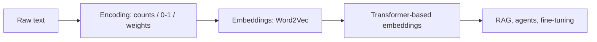
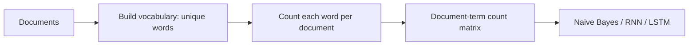

# 🔢 Class 4: Text Encoding — One-Hot Encoding & Bag of Words
### 📋 Full Stack Generative AI Bootcamp 1.0 | Krish Naik Academy

**🎙️ Mentor:** Sunny Savita
**⏱️ Duration:** ~2 hrs 40 min live class + ~2 hr 40 min open doubt session | **📅 Session:** 4 April 2026

---

## 📰 Quick Updates

- **Two things to keep handy for the whole bootcamp:** the shared Google Sheet (the "notice board" with every class topic, date, holiday and notes link) and the GitHub repo **Full Stack GenAI Bootcamp 1.0**, which holds class-wise folders (Class 1–4 so far).
- **Assignments start today.** Sunny will post an industry-style assignment after each module, and the intent is that you solve it *with* an AI coding assistant (GitHub Copilot, Claude Code, etc.). Today's assignment covers the whole embedding pipeline: data collection, preprocessing, vocabulary creation, one-hot, Bag of Words and TF-IDF. It's already on GitHub; it gets walked through next class.
- **Previous class notes:** the 29 March folder has handwritten PDF notes. Today's code and handwritten notes were pushed to the repo during the session.
- **Environment-setup help session** planned for mid-week (tentatively Wednesday, 2 hrs, confirmation by email on Tuesday).
- **Recordings** appear in the Live section of the course dashboard within ~24 hours; the doubt session is included in the recording.
- **Doubts:** ask in the Zoom *chat* (not the Q&A tab), or raise your hand in the post-class doubt session. Chat questions are only sampled, so the hand-raise route is the guaranteed one.

---

## 🧭 Where This Fits in the Course

Sunny laid out the road ahead: encoding and embedding (today and tomorrow) → transformers → **Module 3, the "real" Gen AI** (LLM APIs, fine-tuning, RAG, multimodal RAG, agents / agentic AI, MCP, LangChain/LangGraph, cloud ecosystems, end-to-end projects) over roughly the next 5–6 months.

His teaching loop for the course: **concept first → industry-grade assignment → solve it with an AI assistant.** His argument: AI can write the code, but you still need the fundamentals to understand the problem and decide *whether* a technique is even the right one.



Today's three "classical" techniques: **One-Hot Encoding → Bag of Words → TF-IDF**. TF-IDF and embeddings were pushed to the next class.

---

## 🧠 Why Encode Text at All?

Models can't read words, only numbers. Converting text to numbers is **text representation** (also called **feature engineering** in classic ML). Once text is numeric you can feed it into:

- classical ML models like **Naive Bayes** / logistic regression (text classification, spam detection, sentiment analysis), or
- deep-learning models like **RNN / LSTM / GRU** for NLP tasks such as NER or POS tagging.

Sunny stressed these are *classical* methods, dominant roughly 2012–2019 (he used TF-IDF heavily in his own early data-science work). Today you'd reach for embeddings, but they're asked about in Gen AI interviews, and the cons of each method are the part interviewers love.

> **Vocabulary** = the set of **unique words** in your data. **Vocabulary size = vector dimension.** 5 unique words → 5-dimensional vector; 10,000 → 10,000-dimensional.

A **vector** is just a collection (list) of numbers.

---

## 1️⃣ One-Hot Encoding (OHE)

**Idea:** only record whether a word is *present* (1) or *absent* (0).

### The running example

Four tiny documents (document ≡ sentence, interchangeably):

| ID | Text |
|---|---|
| D1 | people watch movie |
| D2 | people watch cricket |
| D3 | people like movie |
| D4 | people like cricket |

Vocabulary (5 words): **people, watch, like, movie, cricket**

### Representation A — document-level (one vector per sentence)

| Doc | people | watch | like | movie | cricket |
|---|:-:|:-:|:-:|:-:|:-:|
| D1 | 1 | 1 | 0 | 1 | 0 |
| D2 | 1 | 1 | 0 | 0 | 1 |
| D3 | 1 | 0 | 1 | 1 | 0 |

Dimension of one sentence: **1 × 5**. This is the form used with logistic regression / Naive Bayes for text classification.

### Representation B — word-level (one vector per word)

Each word becomes its own one-hot row, so "people watch movie" becomes three rows:

```
people → [1, 0, 0, 0, 0]
watch  → [0, 1, 0, 0, 0]
movie  → [0, 0, 0, 1, 0]      →  matrix shape 3 × 5
```

This is the form used in deep learning (RNN / LSTM / GRU), where the model consumes a sequence of word vectors.

> Sunny noted that on the whiteboard the vocabulary order was by appearance (people, watch, like, movie, cricket), but sklearn sorts it **alphabetically** (cricket, like, movie, people, watch). The numbers in code therefore look different from the board; the concept is identical.

### ✅ Pros
- Very easy to implement and explain
- Simple binary representation
- No training needed: it's a direct mapping

### ❌ Cons
1. **Sparse matrices**: with a 10,000-word vocabulary, "people watch movie" is a 10,000-long vector with only 3 ones (~9,997 zeros carrying no information).
2. **High dimensionality**: vocabulary grows → vectors grow (50,000 or 1 lakh words → huge vectors).
3. **No semantic understanding**: 0s and 1s say nothing about meaning or similarity.
4. **Out-of-vocabulary (OOV) problem**: if a new sentence "people **enjoy** movie" arrives and *enjoy* wasn't in the vocabulary, there's no slot for it. You'd have to fill with 0 or a special value (e.g. −1). Sunny called this one *especially* worth explaining in interviews.
5. **Repeated words can't be shown**: if "watch" appears twice, OHE still just says 1. (This is what Bag of Words fixes.)

### 💻 Practical: OHE with scikit-learn

Sunny's flow in the notebook (`encoding.ipynb`):

1. **Tokenize**: lowercase and split each sentence into words (list comprehension).
2. **Reshape to the format the class demands**: a 2-D structure where each word sits in its own row (`[[word], [word], ...]`). The class won't accept a flat list.
3. Create the encoder with `OneHotEncoder(sparse_output=False)`: this just makes `transform` return a normal dense NumPy array instead of a SciPy sparse matrix, which is easier to read.
4. `fit` on all words → the encoder learns the vocabulary.
5. Inspect the vocabulary with `encoder.categories_` (an array; index `[0]` gives the list).
6. Loop over sentences and `transform` each sentence's words → the one-hot vectors.

```python
from sklearn.preprocessing import OneHotEncoder
import numpy as np

documents = [
    "people watch movie",
    "people watch cricket",
    "people like movie",
    "people like cricket",
]

# 1) tokenize (lowercase to avoid ambiguity)
tokens = [sentence.lower().split() for sentence in documents]

# 2) 2-D structure: one word per row
all_words = np.array([[word] for sentence in tokens for word in sentence])

# 3) create + fit
encoder = OneHotEncoder(sparse_output=False)
encoder.fit(all_words)

# 4) vocabulary
print(encoder.categories_[0])      # ['cricket' 'like' 'movie' 'people' 'watch']

# 5) encode every sentence word-by-word
for sentence in tokens:
    encoded = encoder.transform([[word] for word in sentence])
    print(sentence, "\n", encoded)
```

> *Reconstructed from the steps Sunny demonstrated; the exact version is in the class GitHub repo.*

He also ran the same pipeline on a made-up sentence ("My name is Sunny, and I love AI") to show it works on any text, and asked Copilot for a one-hot snippet to show how AI assistants help once the concept is clear.

### 🔧 `fit` vs `transform` vs `fit_transform`

This was a recurring question, so Sunny explained it carefully:

- Every scikit-learn class exposes these methods (and **each class has its own implementation**, so `OneHotEncoder.fit` ≠ `CountVectorizer.fit`).
- **`fit`**: takes your data and *learns from it*. For these text encoders, that means **building the vocabulary of unique words** (plus validating the input).
- **`transform`**: applies the learned logic to convert data into vectors.
- **`fit_transform`**: does both in a single call.
- The library's source is open on GitHub, and each class's documentation page lists its parameters and methods. Search the import path (e.g. `sklearn.preprocessing.OneHotEncoder`) to land on it.

> 📎 *Worth knowing:* `OneHotEncoder` by default **raises an error** if `transform` sees a category it never saw in `fit`. To tolerate OOV words you'd pass `handle_unknown="ignore"`, which encodes the unknown word as an all-zero row, which is exactly the "OOV becomes 0" behaviour Sunny described conceptually.

---

## 2️⃣ Bag of Words (BoW)

**Idea:** instead of just present/absent, **count how many times each word occurs.** More occurrences ⇒ assumed more important.

### Example

New corpus with *and, cricket, like, lot, movie, people, watch* in the vocabulary (the single-letter "a" is treated as a stop word and ignored). Vector dimension = vocabulary size (8 in the board example).

Key contrast Sunny drew with a sentence like **"people watch cricket people"**:

| Method | people | watch | cricket |
|---|:-:|:-:|:-:|
| One-Hot | 1 | 1 | 1 |
| Bag of Words | **2** | 1 | 1 |

> You **cannot** write a 2 in a one-hot vector. One-hot cares only about *appearance*; BoW cares about *occurrence*.



### ✅ Pros
- Easy to understand and implement
- Very simple logic: just counting, no complex maths
- Captures word frequency (more occurrence ⇒ higher importance, e.g. "AI" repeated in an AI-themed sentence)
- Worked well for classical NLP before embeddings: text classification, spam detection, sentiment analysis, NER/POS (with Naive Bayes in ML, RNN/LSTM in DL)
- No training required: direct text → number conversion

### ❌ Cons
1. **Ignores word order**: "Dog bites man" and "Man bites dog" produce the *identical* vector `[1, 1, 1]` despite opposite meanings.
2. **No semantic understanding**: *like* and *love* are treated as completely unrelated.
3. **High dimensionality** and **sparsity**: still a big mostly-zero vector for large vocabularies (it is a sparse, not dense, vector).
4. **Out-of-vocabulary words**: a new word like "lion" (when the vocabulary was built on "dog/bites/man") has no column and contributes nothing. If *every* word is unseen, the whole vector is zeros. To handle new words you'd have to refit and rebuild the vocabulary.
5. **Over-emphasizes frequent words**: "movie movie movie" scores a big 3 though it means nothing. Stop words like "a", "the" can be repeated 15–20 times and dominate without adding meaning.

### 💻 Practical: `CountVectorizer`

A key difference from the OHE class: **`CountVectorizer` takes the raw documents directly**, with no manual tokenizing or reshaping needed. Why? "Because the library was designed that way": each class defines its own input contract, so you follow its documentation.

```python
from sklearn.feature_extraction.text import CountVectorizer

documents = [
    "people watch movie",
    "people watch cricket",
    "people like movie",
    "people like cricket",
]

bow = CountVectorizer()
bow_matrix = bow.fit_transform(documents)    # sparse matrix

print(bow_matrix.toarray())                  # bag-of-words matrix
print(bow.get_feature_names_out())           # the vocabulary (alphabetical)
```

- Output is a **sparse (SciPy) matrix**, so call `.toarray()` to view it.
- `get_feature_names_out()` gives the vocabulary.
- Anything passed to `transform` later that isn't in the learned vocabulary becomes zeros. To include new words, **call `fit` again** with the new data.
- Stop-word removal and text cleaning belong to **text pre-processing**. Sunny skipped them deliberately because modern LLMs cope with raw text, but pointed to **NLTK** for anyone wanting to learn it. (Handy detail: `CountVectorizer`'s default tokenizer already drops single-character tokens like "a".)

---

## 🆚 One-Hot vs Bag of Words at a Glance

| | One-Hot Encoding | Bag of Words |
|---|---|---|
| Records | Presence (0/1) | Count (0,1,2,…) |
| Repeated word | Still 1 | Counts up |
| Order / meaning | Lost | Lost |
| OOV | Problem | Problem |
| Sparse / high-dim | Yes | Yes |
| Training needed | No | No |
| sklearn class | `OneHotEncoder` | `CountVectorizer` |

**Shared weaknesses:** no context, no semantics, high dimensionality, OOV. These motivate TF-IDF (importance weighting) and then embeddings (meaningful dense vectors).

---

## 🗺️ What's Next

- **TF-IDF** (Term Frequency × Inverse Document Frequency): reduces the weight of common words and increases the weight of informative ones. A guaranteed interview question; Sunny mentioned it came up in a recent interview he gave.
- **Embeddings**: Word2Vec first (the fundamentals), then **transformer-based** embedding models (the state of the art), with the cosine-similarity maths and sentence-embedding practicals. Details of Word2Vec/Gensim will lean on Python **3.11**.
- **The embedding assignment walkthrough** (real-world data, e.g. scraping reviews from Flipkart, cleaning, then encoding/embedding for something like sentiment analysis).
- Then **transformers**, then **Module 3**: LLM APIs, fine-tuning (knowledge-tuning, preference-tuning), RAG, agents, MCP, cloud (Azure, AWS Bedrock, GCP Vertex AI).
- Coming soon: how to generate an **OpenAI API key** (next class), using Claude Code for free, and the environment-setup session.

---

## 💬 Live Q&A Highlights

| Question | Answer |
|---|---|
| Where should I post doubts? | Zoom **chat** (not the Q&A tab) or raise a hand in the doubt session; chat gets sampled, not fully answered |
| What are encoding techniques actually used for? | Convert text to numbers for model training; also document similarity/search and RAG |
| Don't we need to update the vocabulary when new documents arrive? | You can, e.g. refit weekly/monthly in a controlled environment, but you can never guarantee full coverage in an open, real-world setting. This is an inherent weakness of old techniques (even huge LLMs still hallucinate on unseen material) |
| Why does BoW take raw documents but OHE needs tokens? | Library design: each class defines its own input format; use the docs |
| Why did my one-hot vectors differ from the board? | sklearn sorts the vocabulary alphabetically; same concept, different column order |
| What does "order of words" mean as a BoW disadvantage? | Word sequence: "is Sunny my name" vs "my name is Sunny" give the same BoW |
| If stop words like "a/the" appear often, does that hurt? | If frequency is very high but meaning is low, drop them; that's what stop-word removal is for |
| Is lowercasing good practice? | Yes: lowercase everything to avoid case ambiguity |
| Why use encoding when it loses context? Why not use embeddings directly? | These are the classical predecessors; learning them builds the fundamentals before embeddings |
| How is embedding different from encoding? | Embeddings are also numeric vectors, but produced by neural networks, not direct 0/1 mapping or counting |
| Is cosine similarity related to encoding? | No: it belongs to the embedding topic, coming in a session or two |
| What does `fit` actually do? | Builds the vocabulary of unique words (and validates input); each class has its own `fit` |
| Can fit handle numeric (non-text) data? | Try it; Sunny wasn't sure and suggested checking the docs / experimenting |
| How does the machine "decode" vectors back to text/numbers? | Models do it with mathematical calculations; we feed vectors to models to learn (Transformer training coming up) |
| Is there a UI tool to visualise embeddings internally? | Not sure; Sunny will check and revert |
| Our RAG system hits 70% success after fine-tuning: failure? | Subjective; depends on the business use case and the accuracy the business requires |
| Can I use React/Angular instead of Streamlit for LangGraph human-in-the-loop UIs? | Yes, any UI framework; project guidance comes ~2–3 months in |
| Can I build a SQL agent without an LLM (finance data can't leave the company)? | An LLM is needed for a real agent; otherwise it's a rule-based system. Alternatives: self-hosted open-source LLM, or managed services (Azure AI Foundry, AWS Bedrock, GCP Vertex AI) that keep data private, obtained via your cloud admin |
| How can I run my own LLM instead of paying API costs? | You'd pay for infra, maintenance and engineering. Rough local spec: RTX 5070 Ti / 6000 Ada-class GPU, 24–48 GB, ~10–20 B parameter model; or rent GPUs (RunPod, cloud). Serve it as an API and track tokens yourself |
| How much depth should a manager/infra person go into? | Fine-tuning (knowledge-tuning, preference-tuning), RAG and multimodal RAG with lots of project work, then agentic AI + AI coding assistants (Claude Code, skills, plugins) |
| Will this course move me from data engineer / GCP engineer / manager to Gen AI roles? | Yes, it's a transition course: Gen AI engineer, AI engineer, later AI architect; knowledge can also be used to automate data-engineering work with agents |
| Can I keep using Jupyter instead of VS Code? | Use **VS Code with the Jupyter extension**: everything stays in one place |
| `.py` vs `.ipynb`? | `.ipynb` is interactive, run cell by cell; `.py` is a script run end to end |
| Is the Git repo's environment folder pushed? | Add it to `.gitignore` so env folders aren't pushed |
| Can one environment serve multiple folders? | Yes: a virtual environment is just a folder; point any kernel/notebook at it |
| I'm new / slow / from a non-AI background and the pace is fast | Sunny's guidance: be patient, expect 1–2 months to adapt, and learn in sequence (Python → ML → DL → NLP → Gen AI). Write to him directly rather than posting disruptive comments; you have ~2 years of access. His approach: explain fast, share code, then do a recap |
| Why does this course follow "code-then-explain"? | He writes quickly, shares the code, then revises it; don't code in parallel, observe first and practise after class |
| Is the doubt session part of the recording? | Yes |

---

## 🛠️ Environment Troubleshooting Seen in the Doubt Session

Most live debugging was environment setup. The recurring fixes:

| Symptom | Fix |
|---|---|
| `No module named sklearn` even with a venv | Activate the correct venv and run `uv pip install -r requirements.txt` inside it; select that env as the notebook **kernel** |
| `gensim` fails to install | Gensim doesn't yet support Python 3.12 here: create the venv with **Python 3.11** (`uv python list`, then `uv venv env --python <3.11 name>`). Alternative: install Microsoft C++ Build Tools (heavier) |
| Version pins in `requirements.txt` fail (e.g. torch / torchvision) | Loosen or remove pins and let the resolver pick compatible versions |
| `uv` not found | `pip3 install uv` (with `--break-system-packages` on macOS if required) |
| Kernel doesn't list the new env | Reload the VS Code window (Command Palette → *Reload Window*); restart the machine if still stuck; or paste the venv's `python.exe` path via *Select Another Kernel → Python Environments* |
| Project in OneDrive causes install errors (e.g. `jsonpatch`) | Keep project and venv **outside OneDrive** |
| Permission denied on `git clone` | Clone into a different folder (not a protected one) |
| `git add` errors | Install Git (git-scm.com), restart, retry |
| Don't mix repos | Keep the instructor's cloned repo in one folder and your own practice work in another |
| Delete stray `.venv` folders; use one env consistently | Sunny's advice: keep it simple, no UV `pyproject`/lock complexity for this course |

---

## 🔑 Key Pointers to Remember

- **Vocabulary = unique words; vocabulary size = vector dimension.**
- **One-Hot = presence (0/1). BoW = count. TF-IDF = count × importance.**
- OHE has two shapes: **document-level (1 × V)** for classical ML and **word-level (n_words × V)** for deep learning.
- Shared cons: sparse, high-dimensional, no semantics, no word order, **OOV**.
- "Dog bites man" vs "Man bites dog" → same BoW. *Know this example for interviews.*
- `fit` learns the vocabulary, `transform` builds vectors, `fit_transform` does both; every sklearn class has its own.
- `OneHotEncoder(sparse_output=False)` returns a dense array; `CountVectorizer` returns a sparse matrix, so use `.toarray()`.
- Each library defines its own input format; read the docs.
- sklearn orders vocabulary **alphabetically**, so numbers can differ from hand-drawn examples.
- Lowercase text and drop stop words when they'd dominate frequency.
- Embeddings are *also* numbers, but learned by neural networks, so they capture meaning.
- Use **Python 3.11** for this course because of Gensim.
- Fundamentals first, then AI coding assistants; the assistant can write code, but you must know *what* to ask for.

---

## ✅ Action Items After Class 4

- [ ] `git pull` / clone the course repo into a **separate folder** from your own practice work
- [ ] Create a **Python 3.11** venv and `uv pip install -r requirements.txt`; select it as the kernel
- [ ] Re-run the One-Hot and Bag-of-Words notebooks with your own sentences
- [ ] Try `handle_unknown="ignore"` on `OneHotEncoder` and an unseen word in `CountVectorizer.transform`
- [ ] Download and skim the **embedding assignment** from the repo
- [ ] Read the sklearn docs for `OneHotEncoder` and `CountVectorizer` (parameters and methods)
- [ ] Revise the handwritten notes (4 April folder)
- [ ] Look up the full form of TF-IDF and think about *why* weighting words helps
- [ ] If stuck on setup, email Sunny or join the mid-week setup session

---

*📝 Notes compiled from the full Class 4 transcript (live session and doubt session), "Text Encoding — One-Hot Encoding & Bag of Words," Full Stack Generative AI Bootcamp 1.0, Krish Naik Academy.*
