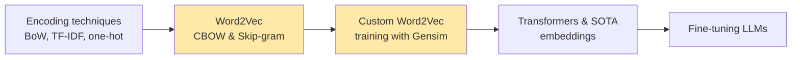
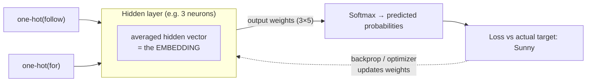
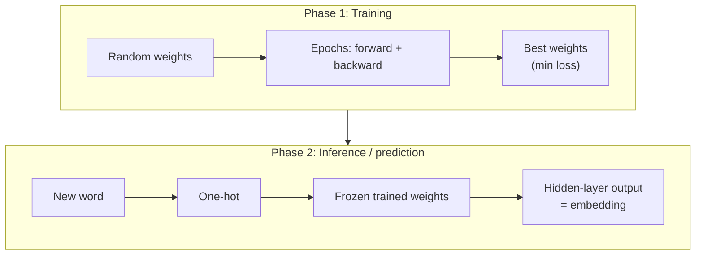
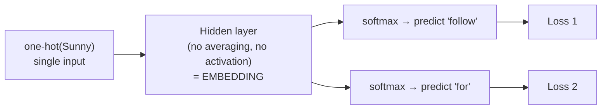

# 🧠 Class 7: Word2Vec Revision, CBOW vs Skip-Gram & Custom Word2Vec Training
### 📋 Generative AI Live Course | Embedding Module

**🎙️ Mentor:** Sunny Savita
**⏱️ Duration:** ~4 hours (≈2.5 hr class + ≈1.5 hr doubt session) | **📅 Session:** Class 7 (12 April)

---

## 📰 Quick Updates

- All of today's code lives in the GitHub folder for **Classes 6 & 7 (11–12 April, Word2Vec with practical)**. It contains a new notebook, `custom_word2vec_training.ipynb`, plus a `data/` folder with `story1.txt` and `story2.txt`.
- **Add `nltk` to `requirements.txt`** (or install it directly in your virtual environment).
- Handwritten/slide notes for the session are also pushed to GitHub. Recordings go on the course dashboard under the live-class section.
- **No new formal assignment this week.** Finish the previous assignment (you may add Word2Vec to it) and treat today's "extend the custom model" task as your homework. A proper assignment follows after the Transformer module.
- **Solution to Assignment 1** will be uploaded to the dashboard the next day, and announced in the community chat. Submissions still go through the Google Form (link is in the Notion notes from Class 2).
- A **"Mega Challenge"** (end-to-end fine-tuning project with prizes) will be announced after the fine-tuning module.
- A doubt session follows every class. Ask in the chat, in the doubt session, or by email (replies typically Tuesday–Thursday).
- Housekeeping: the instructor does not monitor the chat while explaining; he checks it every ~20–30 minutes.

---

## 🗺️ Where We Are in the Syllabus

Module 1 is **Embeddings & Encoding**. Today closes it out by finishing Word2Vec (theory + custom training). From the next class the course moves into the **Transformer / SOTA** world.



---

## 🔁 Quick Recap: What Word2Vec Actually Is

Sunny opened by stressing a point many students blur: **Word2Vec is not a lookup table, it is a neural-network training procedure.** There are two ways to implement it: **CBOW** and **Skip-gram**.

The pipeline from the previous class, using the toy sentence *"follow Sunny for Gen AI"*:

1. Build a **vocabulary** (the unique words).
2. Create a **one-hot encoded vector** for every word.
3. Prepare training data using a **window size** (a hyperparameter, not a fixed value).
4. Feed it to a neural network with an **input layer → one hidden layer → output layer**.

---

## 🏗️ CBOW: Architecture and Training

In CBOW the **context words go in and the target word comes out**. With window size 1 on the toy sentence, the pairs look like context `(follow, for)` → target `Sunny`.



How Sunny walked through it:

- **Input layer:** as many context words as the window allows can be passed in parallel. A larger window means more words per training example.
- **Hidden layer:** just **one**, as in the original paper. The number of neurons is a **hyperparameter** (3 on the slide for illustration; 30, 100, 300, 500 all possible). Google's pre-trained model has **300-dimensional** vectors, so it presumably used 300 hidden neurons.
- **Weight matrix:** with 5 input neurons and 3 hidden neurons you have 5 × 3 = **15 weights** in a fully connected network. The matrix form (5×3 for input→hidden, 3×5 for hidden→output) is just a way of writing them. Weights are initialised randomly.
- **Training loop:** forward propagation → predicted probabilities (softmax) → loss between predicted and actual → backpropagation with an optimizer such as gradient descent → repeat for each **epoch** (forward + backward pass). The goal is **minimum loss**, i.e. the best possible weights (the "global minimum" on the loss curve).
- **No activation function** on the hidden layer, as stated in the paper. Softmax is used only on the output layer.

### 🎯 Where does the embedding come from?

Sunny corrected his own wording on the slide live. The precise statement is:

> The **output of the hidden layer** is the embedding. (Equivalently, the input→hidden weights act as the lookup table for each word.)

So an embedding is an **intermediate output of the model**, not the final prediction. It is meaningful because the weights that produce it were *learned* by training on a prediction task.

### 🧊 Two phases of every model



After training the model is **frozen**. At inference you pass a word, it is one-hot encoded internally (the library hides this), multiplied through the trained weights, and the hidden-layer output is returned as the embedding. You are *not* predicting a next word at this stage. The prediction task was only the training trick.

---

## ⏭️ Skip-gram: Data Preparation and Architecture

Skip-gram **flips CBOW**: one input word, several output words.

With window size 1 on *follow Sunny for Gen AI*:

| Input (centre word) | Output (surrounding words) |
|---|---|
| Sunny | follow, for |
| for | Sunny, Gen |
| Gen | for, AI |

(Sunny kept only these three rows for clarity; in real data every word, including *follow* and *AI* at the edges, also becomes an input.)

Equivalent view used in many blogs: *Sunny is the context, follow and for are its targets.* The terminology differs across sources, but the data is the same.



Because one word is tied to several targets, the model gets **a separate prediction and a separate loss for each pair**. The word is learned from several angles, giving a richer signal. In practice, libraries vectorise and batch these on a GPU, so they are not literally sequential. It is still more computation overall because there are more training samples.

---

## ⚖️ CBOW vs Skip-gram: The Full Comparison

| Aspect | CBOW | Skip-gram |
|---|---|---|
| Prediction task | Context → one target word | One word → many context words |
| Input vectors | Multiple (hidden layer takes the **average**) | Single vector (direct multiplication, no averaging) |
| Outputs / losses per example | One | Several (one loss per context word) |
| Speed | ⚡ Faster | 🐢 Slower |
| Accuracy | Medium | High (on larger data) |
| Rare words | Weak | Strong |
| Data requirement | Works with less data | Wants more data |

**Interview-ready paragraph (as Sunny phrased it):** CBOW and Skip-gram differ not only in data preparation but in objective function, training dynamics and learning behaviour. CBOW predicts a target from the *average* embedding of its context, which makes it faster but less effective for rare words. Skip-gram predicts multiple context words from a single target, giving better representations, especially for rare words, at higher computational cost.

### 🐢 Why Skip-gram is slower: the counting argument

In the toy data, *Sunny* is paired with 2 words and so is *for*. In CBOW each context window is one training step; in Skip-gram each pair is a step with its own loss. For a word tied to three neighbours, that is **three predictions and three loss calculations** versus one.

### 👑 Why Skip-gram handles rare words better

Take the sentence *"the king drank wine"* and treat *king* as rare:

- **CBOW:** *king* appears only as the output once, and its embedding is updated only **indirectly**.
- **Skip-gram:** *king* is the input and is trained **directly** against *the*, *drank* and *wine*, giving a stronger embedding from the same sentence.

### 📝 A second worked example

*"My name is Sunny and AI is my favourite subject"* with window = 2:

- **CBOW:** context `(name, is, AI, is)` → one target `Sunny` → **1 loss**.
- **Skip-gram:** `Sunny` → each of `name`, `is`, `AI`, `is` → **several losses**, so the weights are corrected more often per sentence.

This also explains why Skip-gram has more learning signal ("more learnable updates") than CBOW on the same text.

> 🎤 *A point he made about authority:* the speed/accuracy/rare-word claims come from the original Google research paper. He is relaying that research, not asserting it independently.

### 🤔 Which one should I use?

There is **no hard threshold**. As a rule of thumb: small corpus → CBOW (fast and stable); large corpus → Skip-gram. Sunny's rough illustration: 50 sentences of 5–10 words (~500–1000 words total) → CBOW is fine; 50 documents of ~1000 words each (~50,000 words) → Skip-gram becomes viable. In the end, **experiment**.

---

## 💻 Practical: Training a Custom Word2Vec Model with Gensim

The aim: train our own Word2Vec model on two short stories (a boy named **Arjun** who becomes an AI engineer) instead of using Google's pre-trained vectors.

### Setup

```python
import pandas as pd
import numpy as np
import os
import gensim
import nltk

nltk.download('all')   # tokenizers, stopwords, WordNet, POS tags, etc.

from nltk import sent_tokenize
from gensim.utils import simple_preprocess
```

> *Reconstructed from the class walkthrough; the exact notebook is in the instructor's GitHub folder.* Use the Python version from the Class 2 setup notes (3.11). A student's `requirements.txt` install failed on a newer Python, because Gensim may need C++ build tools on Windows for unsupported versions. If that happens, recreate the virtual environment on 3.11 rather than installing build tools.

### Load and pre-process the corpus

```python
folder_path = "./data"
print(os.listdir(folder_path))            # ['story1.txt', 'story2.txt']

story = []
for filename in os.listdir(folder_path):
    if filename.endswith(".txt"):
        file_path = os.path.join(folder_path, filename)
        with open(file_path, "r", encoding="unicode_escape") as f:
            corpus = f.read()
        for sent in sent_tokenize(corpus):           # text → sentences (splits on full stops)
            story.append(simple_preprocess(sent))    # sentence → list of word tokens
```

Things Sunny pointed out:

- `f.read()` consumes the file pointer. Calling it a second time on the same open file returns an **empty string** (he hit this live).
- The `unicode_escape` encoding is a fix for read errors, mainly on Windows.
- The end goal of pre-processing is a **list of tokenised sentences** (list of lists of words). `len(story)` was **44** sentences.
- This is *only tokenisation*, not a vocabulary yet.
- `simple_preprocess` lowercases and drops very short tokens. When he first looked up "AI", the model reported the key as missing — a hint to query lowercase tokens.

### Build, train, inspect

```python
custom_model = gensim.models.Word2Vec(
    window=10,        # context window (hyperparameter)
    min_count=1,      # ignore words rarer than this (default is 5)
    vector_size=150,  # embedding dimension = hidden-layer neurons
    # sg=1            # 1 = Skip-gram; 0 (default) = CBOW
)

custom_model.build_vocab(story)
custom_model.train(story,
                   total_examples=custom_model.corpus_count,   # = number of sentences (44)
                   epochs=10)

custom_model.wv['arjun'].shape      # (150,)  ← our dimension, vs Google's 300
len(custom_model.wv.index_to_key)   # vocabulary size (257 in class)
```

### 🔧 Parameter cheat-sheet

| Parameter | Meaning |
|---|---|
| `window` | How many neighbours on each side count as context. Hyperparameter. |
| `min_count` | Ignore words appearing fewer times than this. Reduces noise on huge corpora. **Default is 5.** |
| `vector_size` | Embedding dimension. Equals the **number of hidden neurons**. |
| `sg` | **0 = CBOW (default)**, **1 = Skip-gram**. |
| `epochs` | Passes over the data. Hyperparameter. |
| `total_examples` | Required so the learning rate can decay properly; `corpus_count` = number of sentences. |

Gensim refuses to train without `total_examples` or `total_words` ("you must specify either total_examples or total_words…").

> ⚠️ During the class Sunny briefly said the default "performs Skip-gram", then corrected it: **the default `sg=0` is CBOW**. Set `sg=1` for Skip-gram.

### 🐞 The live debugging moment: "AI is not present in the vocabulary"

With `min_count=5` the lookups for `ai`, `farmer`, `engineer` and `model` all failed (the vocabulary lookup raises a not-found error). Sunny first suspected over-processing, then checked and found that the **default `min_count` is 5**: on such a tiny corpus, many words occur fewer than 5 times and are silently dropped. Setting `min_count=1` (and training for 10 epochs) fixed it, and `farmer` and `AI` then returned vectors.

**Lesson:** `min_count` is meant for very large datasets. On small data, keep it low or you will drop most of your vocabulary. A word that never made it into the vocabulary is simply out-of-vocabulary (OOV): it has no vector.

### 🔍 Evaluating the embeddings (by hand)

```python
wv = custom_model.wv
wv.most_similar('arjun')                      # nearest words
wv.most_similar('ai')                         # computer, decision, prediction …
wv.doesnt_match(['arjun', 'engineer', 'programming', 'farmer'])   # → farmer ✅
wv.similarity('ai', 'technology')             # cosine similarity in [-1, 1]
```

What the class saw:

- `most_similar('ai')` returned sensible neighbours (computer, decision, prediction…), and `doesnt_match` correctly flagged *farmer* among Arjun-related words. **Good.**
- Other odd-one-out tests (e.g. `data, model, system, river` and `weather, crop, farmer, technology`) gave **wrong answers**, and some similarity scores were **negative** (e.g. AI vs technology, Arjun vs engineer).
- **Why:** the corpus is tiny. Google trained on massive news data (millions of articles). Neural networks and LLMs are **data-hungry**.

Other evaluation ideas mentioned afterwards: **analogy testing** (`most_similar(positive=…, negative=…)`), comparing similarity scores across different hyperparameter settings, plotting loss/accuracy curves, and, for sentence-level embeddings, the **MTEB benchmark** (Massive Text Embedding Benchmark), to be shown in a later class. There is **no direct benchmark for Word2Vec**, so evaluating it is "a tricky part".

> 💡 **Good to know (not stated in class):** Gensim's default training does not compute a full softmax over the whole vocabulary. It uses **negative sampling** (`negative=5`), an efficient approximation of it. The conceptual picture above still holds.

### 🧪 Hands-on task for this week

- Add **more data** and train for more epochs.
- Re-check the embeddings and similarity results, and compare how the results change.
- Experiment with window size, vector size, `min_count` and `sg`.
- Submit through the same assignment form; this extension is not a full assignment.

---

## 🔬 Static vs Contextual Embeddings: A Preview of Transformers

Raised during the doubt session, and a nice bridge into the next module:

- **Word2Vec embeddings are static.** Once trained, the same word (e.g. "bank") always gets the **same vector**, regardless of the sentence. It learns from the data once; it does not re-read context at inference time.
- **Transformers use self-attention**, which weighs how each word relates to the other words in the *same sentence*. In *"The cat is sitting on the river bank"*, attention helps the model decide that "bank" means riverbank, so the **same word gets different embeddings in different contexts**.
- Transformers also process tokens **in parallel** (with positional encoding to keep order) and scale to huge datasets, which Word2Vec-style networks do not.
- Sunny's example was the sentence from the *Attention Is All You Need* paper's attention visualisation ("making … more difficult"), showing which words attend to which.

Industry note: Word2Vec is still used in a few from-scratch projects, and Sunny had used it for downstream tasks such as **text classification**, but today most embedding work is done by **transformer-based (SOTA) models**.

---

## 🗺️ What's Next

- **Next class:** embeddings with SOTA/Transformer models, and the start of the Transformer architecture.
- The Transformer theory should take about **3–4 sessions**, going faster with pre-written notes now that the base is built.
- Then the course jumps to **fine-tuning of LLMs**, RAG, agentic flows and MCP, and then end-to-end projects (three are planned in the syllabus).
- After about 4–5 classes the pace shifts to **more practical, less theory**.
- Low-level PyTorch is not required, but Hugging Face will be explored in depth.

---

## 💬 Live Q&A Highlights

| Question | Answer |
|---|---|
| Google's model has "3 million" dimensions per word? | No: **300 dimensions** (the 3 million is the vocabulary size of that model). |
| Why are weights 5×3 and 3×5? | It's matrix notation. 5 inputs × 3 hidden neurons = 15 weights; the shape depends on neuron counts. |
| Why use one-hot encoding? | Text has to become numbers before it can be fed to the network; the paper used one-hot vectors. |
| How are weights decided? | Initialised **randomly**, then learned via training. Neural-network basics are in the prerequisites. |
| How is softmax calculated? Can we skip it? | An activation on the output layer: exponentials normalised so outputs sum to 1 (probabilities). Without it you can't compute prediction loss and train this way. |
| Why do we need `corpus_count` / `total_examples`? | Gensim needs it for the learning-rate schedule; it equals the number of sentences. |
| Why does `corpus_count` (44) differ from the number returned by `train()` (e.g. 119)? | They are different counts: `corpus_count` is sentences; `train()` returns internal training counts. Don't rely on them; they also change with epochs. |
| Does the number from `train()` equal the vocabulary size? | No. The real vocabulary size is `len(model.wv.index_to_key)` (257 here). |
| Does SIBO's averaging reduce accuracy? | It makes CBOW faster but weaker on rare words; it is a trade-off, not a flaw. |
| Does `min_count` filter noise / prevent overfitting? | Yes, it filters very rare words (noise). On a tiny corpus it throws away real vocabulary. |
| Does increasing `vector_size` always help? | No. Very high dimensions on a small vocabulary can add noise, making words equidistant and weakening cosine similarity. Treat it as a hyperparameter and tune it. |
| Is embedding dimension a hyperparameter? | Yes: tune by experiment (e.g. grid/random search), not fixed by theory. |
| Can we see what the 150 features mean (gender, royalty…)? | No. The dimensions are a black box. The king/queen/gender story was only an explanation aid. |
| Can I check the context→target prediction in Gensim? | Not directly; the library hides it. The goal is the embedding, not the prediction. |
| How do I know a vector is "right"? | There's no direct metric for Word2Vec. Use similarity, odd-one-out and analogy checks; MTEB exists for sentence embeddings. |
| How do I compare two trained models? | Run the same similarity / odd-one-out / analogy tests on both and see which behaves more sensibly. |
| What model name do I give? | Any name; it is just a variable (or a file name when saving). |
| Which encoding does Gensim use internally? | One-hot (via the vocabulary index). Changing that means writing your own model from scratch. |
| Can I use BoW/TF-IDF instead of one-hot? | Yes if you code it yourself; the paper used one-hot. |
| How many hidden neurons? | A hyperparameter, so experiment. |
| Is this prediction or embedding? | Training uses prediction; inference only returns the hidden-layer **embedding**. |
| Are OOV words handled? | A word not in the vocabulary has no vector (it counts as out-of-vocabulary). |
| Does Skip-gram produce two embeddings for "Sunny" (follow and for)? | No: one embedding per word. Both pairs update the same weights, batched together. |
| Does Skip-gram update weights in parallel? | The framework vectorises and batches on GPU, but it still has more samples and is slower than CBOW. |
| More epochs = better? | Often a bit, within reason; watch loss/accuracy curves and over/underfitting. Number of epochs is experimental. |
| Does the same word always give the same embedding? | Yes, after training Word2Vec is static. |
| Do CBOW/Skip-gram belong to the transformer family? | No, they are neural-network techniques. Transformers come next. |
| Can I train a transformer / use this for a new language? | The transformer also works on numbers; vectors come from embeddings, then self-attention processes them. |
| Should embedding models be retrained for new data? | Yes. Embedding models are trained like any model for the specific use case. |
| Can I mix Google's pre-trained vectors with my domain data? | Possible in principle (that idea underlies fine-tuning/LoRA), but Word2Vec doesn't scale to that; real LLM-based models are used in industry. |
| How should I choose CBOW vs Skip-gram with 50 documents? | Judge by total word count, not document count; experiment. |
| Which loss functions apply? | Regression: MSE/MAE; classification: (binary) cross-entropy. |
| What is `wv`? | Just the Gensim attribute holding the word vectors (word-vector store). |
| Is `total_examples` the "end line"? | No, it is the sentence count. Sentence splitting defaults to full stops (can be customised). |
| Why was `requirements.txt` failing to install for one student? | Wrong Python version in the environment. Delete the old env/venv and recreate it with Python 3.11 per the Class 2 notes. |
| Can I keep up if I joined late? | Yes: watch Class 1–2 (setup) and the prerequisites, then recordings. |
| Where do I submit the assignment? | Via the Google Form linked in the Notion notes (Class 2). |
| Project help for a job project (agentic frameworks)? | Ask in the doubt session or email the instructor. |

---

## 🔑 Key Pointers to Remember

- Word2Vec = a **shallow neural network trained as a prediction task**; the *by-product* is the embedding.
- **Embedding = hidden-layer output** (intermediate representation, no activation).
- **CBOW:** context → target (average, fast, less data). **Skip-gram:** word → context (more losses, slower, better for rare words, bigger data).
- Window size, `vector_size`, `min_count`, epochs, and `sg` are **hyperparameters**: you can't derive them, you experiment.
- `sg=0` (default) is CBOW; `sg=1` is Skip-gram.
- On tiny corpora, a high `min_count` silently deletes your words. Default is 5.
- **Word2Vec embeddings are static**; transformers (self-attention) give contextual ones.
- Training and inference are **two separate phases**; after training the model is frozen.
- Evaluating Word2Vec is hard: use `most_similar`, `similarity`, `doesnt_match`, and analogy tests.
- Embedding models are **data-hungry**: Google trained on huge news data.

---

## ✅ Action Items After Class 7

- [ ] Pull the latest GitHub folder (Classes 6 & 7) and add `nltk` to `requirements.txt`.
- [ ] Confirm your environment is on **Python 3.11** (recreate it if installs fail).
- [ ] Re-run `custom_word2vec_training.ipynb` and try `sg=1`.
- [ ] Add more data, increase epochs, and compare similarity / odd-one-out results.
- [ ] Review the neural-network, softmax and gradient-descent prerequisites if the maths felt fast.
- [ ] Finish the previous assignment and submit through the Google Form.
- [ ] Watch for the Assignment 1 solution on the dashboard.

---

*📝 Notes compiled from the full Class 7 transcript (class + doubt session) — "Word2Vec: CBOW, Skip-gram & Custom Training," Generative AI Live Course.*
