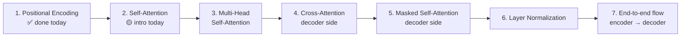
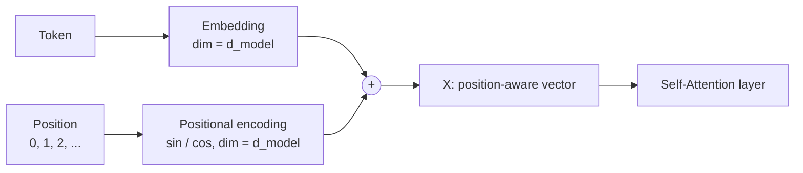
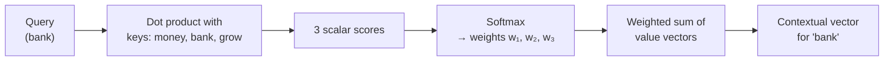

# 🧭 Transformer Deep-Dive: Positional Encoding & First Look at Self-Attention
### 📋 Gen AI Course | Transformer Architecture Module

**🎙️ Mentor:** Sunny
**⏱️ Duration:** ~4.5 hours (including two breaks and a long doubt session) | **📅 Session:** 25 April 2026

---

## 📰 Quick Updates

- Sunny keeps a 5-10 minute buffer at the start of every class so everyone can join. A few students reported an "expired link"; the link was fine. **Join from a laptop/desktop, not a phone.**
- Pace: the theory-heavy transformer block is slow on purpose. Once the course reaches coding, the pace picks up, so keep your Python sharp and use the previous batch's exercises.
- **Notes** for this class are on the course GitHub (in a dated folder) and in the Resources section as a PDF.
- A job opportunity (Walmart) mentioned earlier is for this batch only.

---

## 🗺️ Where the Transformer Module Stands

The previous class finished the **encoder**. This class and the next 2-3 classes cover the remaining pieces, in this order:



Residual connections and the feed-forward neural network were already covered last class. Why go this deep? There are hundreds of LLMs and no course can cover each one. The transformer is the common foundation, so understanding its components lets you read any LLM paper and follow how it works.

---

## 📍 Positional Encoding: Why It Exists

A transformer feeds all tokens into self-attention **in parallel**, not one after another. That creates a problem: with no built-in sense of order, "I love AI" and "AI love I" look identical to the model. The same applies to "dogs bite men" vs "men bite dogs", which have the same words and opposite meanings.

**Positional encoding** is a technique that injects information about each token's position into its embedding so the model can recover the sequence order.

### 🚫 The naive approach (and why it fails)

The first idea is to stamp each embedding with its position number (1, 2, 3, ...). Sunny showed why this breaks down:

1. **Unbounded numbers.** Real sentences can have 400, 1 lakh, or more tokens, so the position value can grow without limit.
2. **Discrete values.** Raw integers are discrete jumps, and neural networks train poorly on such inputs, which can make training unstable.
3. **Concatenation grows the vector.** Appending the number to the embedding increases the dimension (see below).

### ➕ Add, don't concatenate

Sunny made a second design point: the positional vector is **added element-wise** to the embedding, never concatenated.

- Concatenating a 5-dim embedding with a 5-dim position vector gives a 10-dim vector, which makes everything downstream (self-attention, feed-forward layers) more expensive.
- Adding keeps the dimension unchanged, so the **positional vector must have exactly the same dimension as the embedding**.

Questions came up later about whether concatenation would be better or worse. Sunny's answer: don't overthink it. He was only using it to explain the design logic, and the research paper doesn't discuss the alternative.



---

## 🌊 The Sine/Cosine Solution (from the Original Paper)

Sunny opened the *Attention Is All You Need* paper and went through its positional encoding paragraph. The paper notes the model has no recurrence or convolution, so order must be injected explicitly, and the positional encoding has the same dimension as the embedding so the two can be summed. Because that paragraph alone is hard to digest, he built the idea up from scratch.

**Why sine and cosine?**
- Their values are **continuous** (not discrete jumps).
- They are **bounded between -1 and +1**, so values never blow up however long the sentence is.
- They follow a smooth, ordered pattern, so each position gets a distinctive, sequence-consistent signature.

For each position, a **sine and cosine pair** is computed, and many such pairs (at different frequencies) fill out the vector.

### 📐 The formula

For position `pos`, dimension index pair `i`, and embedding size `d_model`:

```
PE(pos, 2i)   = sin( pos / 10000^(2i / d_model) )
PE(pos, 2i+1) = cos( pos / 10000^(2i / d_model) )
```

| Symbol | Meaning |
|---|---|
| `pos` | Position of the token in the sentence, **starting from 0** |
| `d_model` | Dimension of the embedding (the paper used 512) |
| `i` | Pair index, ranging from `0` to `d_model/2 - 1` |
| `2i`, `2i+1` | Even index gets **sin**, odd index gets **cos** |

Each `i` produces one sine/cosine pair, so a `d_model`-dimensional embedding needs exactly `d_model / 2` pairs. With `d_model = 6` there are 3 pairs (`i = 0, 1, 2`). With `d_model = 500` there would be 250 pairs.

> 💡 The subscripts in the paper's notation (such as `P₀,₀`, `P₀,₁`) are just **index positions**: which token (position) and which slot in its vector.

### 🧮 Worked example: "Great India" with d_model = 6

Great is at position 0 and India is at position 1.

**Position 0 (Great):** sin(0) = 0 and cos(0) = 1 for every pair, so the vector is:

`[0, 1, 0, 1, 0, 1]`

**Position 1 (India):**

| i | Divisor `10000^(2i/6)` | sin slot | cos slot |
|---|---|---|---|
| 0 | 1 | sin(1) ≈ **0.84** | cos(1) ≈ **0.54** |
| 1 | 10000^(1/3) ≈ 21.5 | sin(1/21.5) ≈ **0.05** | cos(1/21.5) ≈ **1.00** |
| 2 | 10000^(2/3) ≈ 464 | sin(1/464) ≈ **0.00** | cos(1/464) ≈ **1.00** |

So India's positional vector is roughly `[0.84, 0.54, 0.05, 1.00, 0.00, 1.00]`.

> 📝 In class Sunny used rounded values (0.04, 0.99, 0.01, 0.98) for the later slots while computing quickly on a calculator. The values above are the more precise ones. The pattern is what matters: **early dimensions oscillate fast, later ones change slowly**.

Sunny stressed the key checks of this example: the positional vector has the **same dimension (6) as the embedding**, it is **added** to the embedding to produce the final input vector (X₁, X₂), and that is what flows into self-attention.

### 🔑 Properties worth remembering

- **Computed once, at the input.** Positional encoding is added only at the start, before the first attention layer.
- **Not learned.** It comes from a fixed formula and is not part of the trained weights. Sunny described it as part of preprocessing.
- **Depends only on position, not on word meaning.** Two different sentences of the same length get identical positional vectors, and the position counter **restarts at 0 for every sentence**. Word identity and context come from the embeddings and self-attention.
- **Doesn't distort meaning.** The positional values are small relative to the embedding, so adding them doesn't shift the meaning of a word dramatically. It just tags the vector with order.
- **Needs an even `d_model`.** Since the range of `i` is `0 … d_model/2 - 1`, an odd dimension (7, 11) gives a non-whole-number range and doesn't fit the formula, so embedding sizes are kept even.
- **The sine-first, cosine-second order** is simply how the paper defines it.
- **Applies to the whole prompt.** When you send a long prompt to ChatGPT or Claude, the entire prompt is tokenized, embedded, and position-encoded together.

> ⚠️ **Correction to the class slide:** the second formula line on one slide showed sin twice. The second must be **cos**, as in the table above (a student caught it and Sunny will fix the notes).

### 🤔 Interview angle

Sunny's advice: if asked about positional encoding, open the paper, explain what each symbol means, and walk through a small example like Great/India. Knowing the *intuition and derivation* matters more than memorizing the formula.

---

## 👁️ Self-Attention: First Look (High-Level Only)

Sunny gave a first-phase overview and said the full explanation, with examples, comes next class. Most of the class had not seen self-attention before.

### The idea: a contextual vector

Take the sentence **"money bank grow"**. The word *bank* alone is ambiguous. Self-attention rebuilds the vector for *bank* as a **weighted mix of every word in the sentence**:

```
bank_new = w₁·e_money + w₂·e_bank + w₃·e_grow
```

The weights come from two steps:

1. **Similarity (dot product)** between the embedding of *bank* and each word's embedding gives a **scalar** score. For example [1, 2] · [3, 4] = 1·3 + 2·4 = **11**.
2. **Softmax** turns the three scores into normalized weights that sum to 1.

The resulting vector is the **contextual vector** for *bank*. This is why modern embeddings are *dynamic*: the same word gets a different vector depending on its neighbours, unlike static embeddings such as Word2Vec.



### Query, Key, Value

- The vectors used to compute similarity play the roles of **Query (Q)** and **Key (K)**.
- The vectors that get weighted and summed are the **Values (V)**.
- Q, K, and V are not the raw embeddings. They are **linear transformations** of the same embedding: the embedding is multiplied by learnable weight matrices **W_Q, W_K, W_V**. Sunny called this "stretching the knowledge" of the word in three different directions. The matrices are learnable parameters of the self-attention layer.

**Dictionary analogy:** In a Python dict `{A: 1, B: 2, C: 3}`, you use a *query* ("A") to match a *key* and retrieve its *value* (1). Attention is a soft, differentiable version of that lookup.

### The formula from the paper

```
Attention(Q, K, V) = softmax( Q · Kᵀ / √d_k ) · V
```

Q and K are multiplied (Kᵀ is the transpose, rows turned into columns), scaled by a constant, passed through softmax, then multiplied with V. Sunny said the scaling term and the exact meaning of Q/K/V come in the next class.

### 🚧 Deliberately deferred

Several student questions were answered with "give me one more class":
- Exactly how Q, K and V are formed from the embeddings (the linear transformation).
- What makes a token play the "main query" role. Sunny said one student's guess (the highest-weight token is the query) was **not correct** and promised to clarify with a worked example.
- The yellow/blue "E_money" boxes on the slide are the same embedding multiplied by different weight matrices.

---

## 🗺️ What's Next

**Next class (4 concepts):**
1. Self-attention in full, with a worked example
2. Multi-head self-attention (multiple weight sets applied to capture more information)
3. Cross-attention
4. Masked self-attention

**After that:** layer normalization, then the end-to-end encoder → decoder flow (including how parallel matrix operations map to PyTorch). That wraps up the transformer in roughly 2-3 more classes.

**Longer term (about 10-15 classes out):**
- Fine-tuning with Hugging Face and Unsloth, including RLHF code
- A notebook on accessing different LLMs through APIs, for use in projects
- RAG with LangChain (LangChain begins around the RAG module, roughly 8-9 classes away)
- RAG over images and tables is also in scope. The focus stays on **open-source** tooling rather than paid cloud services.

---

## 💬 Live Q&A Highlights

| Question | Answer |
|---|---|
| **(Shiva)** `str expected, not NoneType` when loading an API key | The environment variable isn't being read. Create a `.env` file in the project folder (not inside the virtual-env folder), add the keys, and restart the kernel. Comment out the OpenAI key line if you don't have a paid key. |
| **(Shiva)** DLL initialization error importing `sentence_transformers` / "torch is not defined" | Likely a Python/package version mismatch or a corrupted environment. Create a fresh folder **without spaces in the path** on another drive, make a new virtual env with **Python 3.12**, and install `requirements.txt`. Microsoft C++ build tools may be needed for torch. Google Colab is a fallback. |
| **(Charles Fon)** "API key not valid" error with Google key | The `.env` variable name was in the wrong case. Names should match exactly (all caps, e.g. `GOOGLE_API_KEY`). Also, OpenAI keys require paid credit. |
| **(Aravind)** How are the Q and K vectors formed from E_bank / E_money? | They come from a linear transformation of the embeddings. Deferred to the next class with a full example. |
| **(Anil)** What do the `P₀,₀`, `P₀,₁`… subscripts mean? | Position of the token, then the index within its vector. `0,0` is the first slot of the first word's vector, and so on. |
| **(Ashish)** Is the highest-weight token the "main query"? | No, that understanding is wrong. Will be clarified next class. |
| **(Tilak)** How do two values per position (sin, cos) fill a whole vector? | Each `i` gives one sin/cos pair, so `d_model/2` pairs cover the full `d_model` dimension. Size 6 gives 3 pairs; size 500 gives 250. |
| **(Vivek)** What if the embedding dimension is odd? | Not allowed, because the range `0…d_model/2 − 1` wouldn't be whole numbers. Embedding sizes are even. |
| **(Yash Shukla)** Does the numeric pattern really preserve word order? | Yes. Positions map to a smooth sine/cosine sequence, the result is added to the embedding, and self-attention uses it downstream. |
| **(Yash Shukla)** Do repeated words/sentences confuse the context? | No. Self-attention builds each word's context from its own neighbours, so repeats are handled dynamically. |
| **(Yash Shukla)** Position numbering for a second sentence: continue or restart? | It restarts at 0 for every sentence. The positional encoding only tells where a token sits within its own sequence. |
| **(Yash Shukla)** Is Claude a "decoder-only" or a full transformer? | Decoder-only transformer (full encoder-decoder is the original paper's design). Sunny will check a paper the student shares. |
| **(Yash Shukla)** How does RLHF affect attention / positional encoding? | Classic RLHF (PPO) updates the attention and feed-forward weights. Newer methods like DPO/ORPO with LoRA leave the original attention weights frozen and train small adapter weights that are merged with them. Positional encoding is a fixed formula and isn't updated. Covered in the fine-tuning classes. |
| **(Sandeep)** How do the 6 sin/cos values per word reach self-attention? | They're added to the word's embedding, and the sum goes into self-attention. |
| **(Ruchi)** Why is the first vector 1×3 and the second 3×1? Why sin before cos? | The shapes were just illustrative (one row, one column, so the dot product works). Sin-then-cos follows the paper. |
| **(Vishnuvardhan)** Why 6 dimensions? Does document length or chunking change it? | 6 was only for demonstration (the paper used 512). Embedding dimension is set by the trained embedding model, not by how many words you have. Don't mix this with RAG chunking. To change dimension you must change the model architecture and train from scratch. |
| **(Vishnuvardhan)** Use slides instead of typing on the whiteboard? | Slides will be used where needed. Sunny writes on the board to explain step by step. |
| **(Manish)** Doesn't adding positional vectors change the embedding's meaning? | The positional values are small, so there's no major shift. Order information is added without altering meaning much. |
| **(Manish)** Is a 10-20 line prompt to ChatGPT or Claude processed as one sequence? | Yes. The full prompt is tokenized and embedded, and positional encoding is applied to the whole prompt. |
| **(Krishna)** Is the positional vector the same for any two sentences of equal length? | Yes. It depends only on position, not on the words. It isn't trained, and is part of preprocessing. (Also flagged the sin/cos typo on the slide.) |
| **(Utkarsh)** Where do embeddings come from if the model is untrained? | The embedding layer starts with random weights and learns as the transformer trains. It isn't a pre-trained lookup. After self-attention and the feed-forward network, you get contextual embeddings. |
| **(Utkarsh)** Does self-attention work across sentences? | It works across all tokens in the context window, so two sentences in the same context are related by the same process. Splitting text into separate batches loses that link. Modern LLMs train differently (pre-training on next-token prediction, then supervised tuning). |
| **(Lakshmi)** Does parallel token processing depend on hardware or on the architecture? | Each model has a context length (e.g. 128K for GPT) and tokens up to that length are processed in parallel. Context length is separate from "memory". |
| **(Lakshmi)** Cloud usage in practicals? | Not mandatory. The course focuses on open source. Cloud-heavy parts are 1.5 months or more away. |
| **(Lakshmi)** Will RAG cover images and tables? | Yes, it's straightforward and will be covered. |
| **(Tej)** How does the sin/cos graph relate to a 4- or 150-dimensional vector? | It isn't a multi-dimensional graph. The graph just shows how a sine or cosine value is read at each position. The formula produces one pair per two dimensions, and the full vector can be visualized as a heatmap. Tej was also advised to revisit the prerequisites (neural networks, vector/matrix ops, supervised learning), since transformers build on them. |
| **(Rajesh)** Does parallelism begin only after positional encoding? | No, it applies from the very first stage. The step-by-step explanation is for teaching. In code (PyTorch) everything is matrix operations. |

---

## 🔑 Key Pointers to Remember

- Transformers read all tokens **in parallel**, so they have no sense of order without positional encoding.
- Positional encoding = a vector of the **same dimension** as the embedding, **added** (never concatenated) to it.
- It is built from **sine and cosine** values: continuous, bounded in [-1, 1], and not trained.
- Formula: `sin(pos / 10000^(2i/d_model))` for even slots, `cos(...)` for odd slots; `i` runs from 0 to `d_model/2 − 1`.
- Positions start at **0** and **restart for each sentence**, and two same-length sentences share identical positional vectors.
- `d_model` must be **even**. The paper used **512**; 6 in class was just a demo size.
- Self-attention turns a word's embedding into a **contextual vector**: a softmax-weighted mix of every word's value vector.
- Attention weights come from **Q · Kᵀ → scale → softmax → × V**, with Q, K, V made by multiplying embeddings with learnable matrices.
- Embeddings give meaning, positional encoding gives order, and self-attention gives context.
- For the transformer part, fundamentals (neural networks, vectors/matrices, training vs prediction) matter more than any single formula.

---

## ✅ Action Items After Class

- [ ] Redo the Great/India positional-encoding calculation by hand with `d_model = 6`, then try `d_model = 8`.
- [ ] Re-watch the recording at 1.5x and review the key derivation sections.
- [ ] Read the positional encoding paragraph in *Attention Is All You Need* and map each symbol to the table above.
- [ ] Pull the class notes PDF from the GitHub folder / Resources section.
- [ ] Fix environment issues now (fresh venv with Python 3.12, folder path with no spaces, `.env` set up) so practicals don't block you later.
- [ ] Revise prerequisites (neural networks, supervised learning, vector/matrix operations) if they feel shaky.
- [ ] Bring your Q/K/V doubts to the next class, where self-attention is explained in full.

---

*📝 Notes compiled from the full class transcript, "Transformer: Positional Encoding & Self-Attention Intro," Gen AI Course.*
