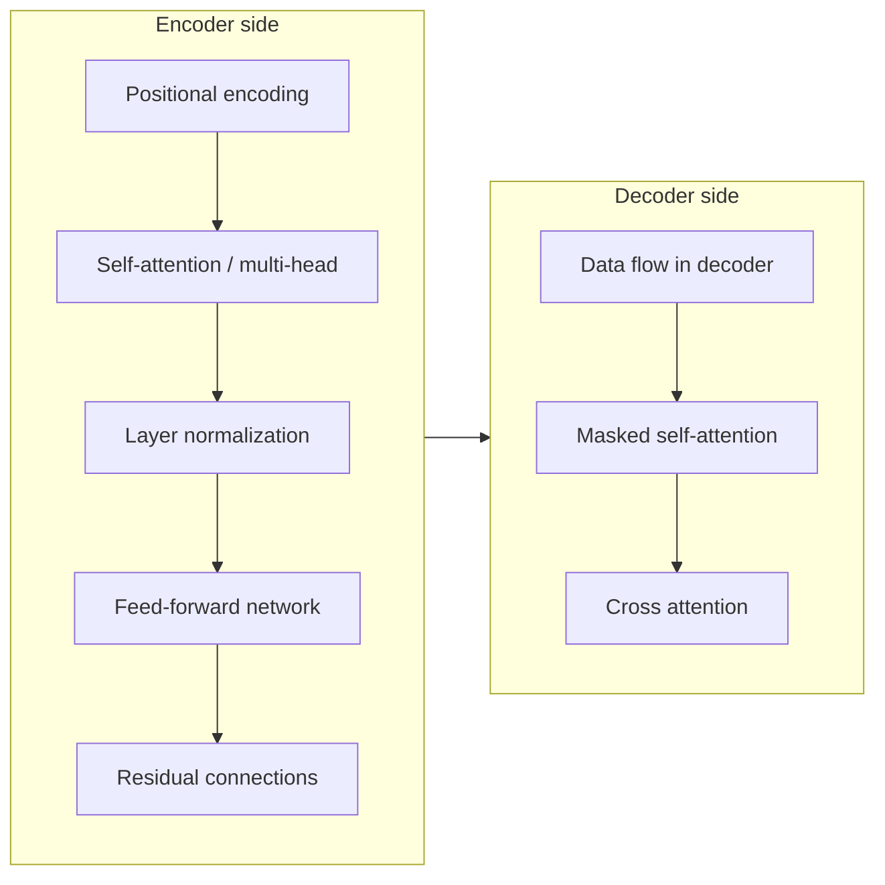
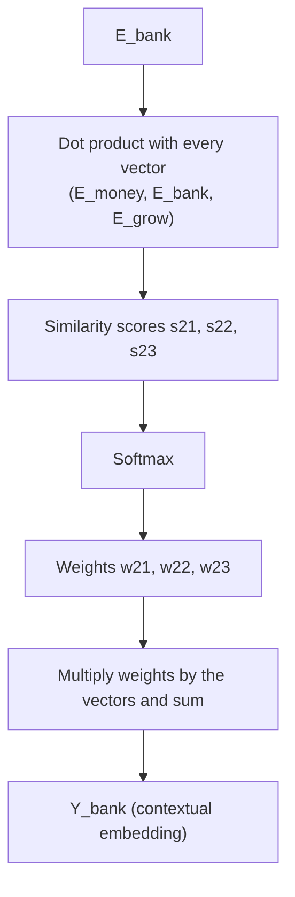
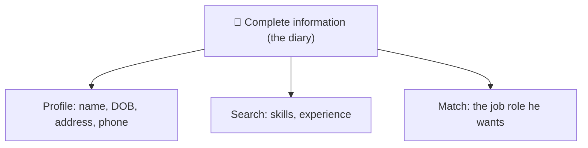
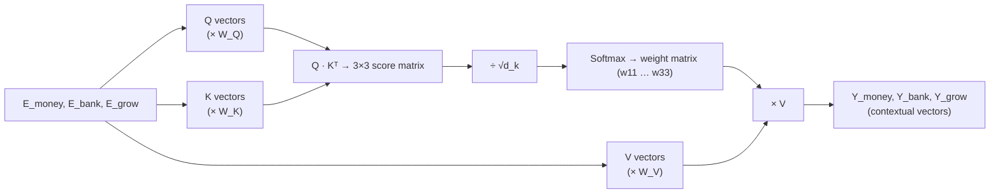
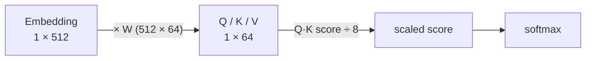

# 🧠 Transformer Intuition 4: Self-Attention, Q/K/V & Scaled Dot-Product
### 📋 Generative AI Course | Live Session (2 May 2026)

**🎙️ Mentor:** Sunny Savita
**⏱️ Duration:** ~2 hrs 19 min | **📅 Session:** ~Session 12 (2 May 2026)

---

## 📰 Quick Updates

- All class resources (recordings, handwritten notes) live on the course dashboard and in a GitHub repository maintained by Sunny. New joiners should start from the dashboard.
- If the handwritten notes show a "render block"/error when opened on GitHub, **clone the repo or download the file**. The failure is the GitHub web viewer, not the file.
- Diffusion models are out of scope for this course.
- Today's **doubt session was skipped** (the mentor had been travelling all day); it resumes tomorrow. The class itself ran in full.
- A consolidated **transformer summary document** will be shared next class.

---

## 🗺️ Where We Are in the Transformer

Sunny framed the transformer as a handful of building blocks. The aim of this chapter is interview-level fundamentals: all modern LLM architectures are variations on the transformer, so there is no need to study each LLM separately.



| Status | Topics |
|---|---|
| ✅ Done | Positional encoding, feed-forward network, residual connection (conceptual) |
| 🔄 Today | **Self-attention**: how it works, Q/K/V, scaled dot-product |
| ⏭️ Tomorrow | Multi-head attention, cross-attention, masked self-attention, layer normalization, end-to-end encoder → decoder flow |

---

## 🔁 Recap: How Data Enters Self-Attention

Using the toy sentence **"money bank grow"**, Sunny walked through the pipeline up to the attention layer:

1. **Tokenize** → `money`, `bank`, `grow`
2. **Embed** each token (a simple word-to-vector lookup, not a trained model; its dimension depends on the embedding method)
3. **Add the positional-encoding vector** (same dimension), which preserves word order
4. Result: three vectors `E_money`, `E_bank`, `E_grow`. Everything in a transformer flows as vectors.
5. These enter the **self-attention layer**, which outputs three **contextual embeddings** (context vectors): `Y_money`, `Y_bank`, `Y_grow`. The tokens are processed in parallel.

> **Core idea of self-attention:** produce a *contextual embedding* for every word by expressing it in terms of its relationship with every other word in the sentence.

The word "bank" illustrates why this matters: its raw embedding is the same in any sentence, but its contextual embedding changes depending on whether "money" or "river" is nearby.

---

## 🧮 Self-Attention, First Without Q/K/V

Sunny built the mechanism in its simplest form first.

**Step 1: weighted sum.** Each output is a weighted combination of all input vectors:

```
Y_money = w11·E_money + w12·E_bank + w13·E_grow
Y_bank  = w21·E_money + w22·E_bank + w23·E_grow
Y_grow  = w31·E_money + w32·E_bank + w33·E_grow
```

**Step 2: where do the weights come from?** Each `w` is a **similarity score** between two words, computed with a **dot product**. For "bank":

```
s21 = E_bank · E_money
s22 = E_bank · E_bank
s23 = E_bank · E_grow
```

**Step 3: normalize with softmax**, so the weights are positive and sum to 1:

```
w_i = exp(s_i) / (exp(s_1) + exp(s_2) + exp(s_3))
```

**Step 4:** multiply each weight by its vector and add them up → the contextual vector (`Y_bank`).



The same procedure is repeated for "money" and "grow".

### 🤔 The problem Sunny pointed out

Look at the equations: the *same* vector `E_money` is used in three different roles. It is used to ask the question (as the word whose context we want), to be compared against (when scoring other words), and to be blended into the output. Using one vector for all three jobs is rigid, and no learning can happen, since nothing is trainable. That is where **Query, Key and Value** come in.

---

## 🔑 Query, Key, Value (Q/K/V)

Instead of reusing `E_money` as-is, each embedding is **transformed three ways** by multiplying it by three weight matrices:

```
Q = E · W_Q      (Query)
K = E · W_K      (Key)
V = E · W_V      (Value)
```

- `W_Q`, `W_K`, `W_V` are **learnable parameters**. They start with random values and are adjusted over many epochs of forward and backward propagation (supervised training).
- The *shape* of these matrices is a **hyperparameter**. The *values* inside them are learned.
- This is the part of the transformer that is **trainable** inside attention.

### 🪪 Sunny's analogy: one person, many profiles

Sunny (the person) keeps a detailed diary: name, date of birth, address, phone, skills, experience, desired job. To look for a job on LinkedIn, he does not paste the whole diary everywhere. He pulls out **different transformed slices** of it:



Same source information, three transformed views, each suited to a different purpose. Likewise, one embedding such as `E_money` yields three views:

| Role | Name | Purpose |
|---|---|---|
| The word asking "who is relevant to me?" | **Query (Q)** | Used to search |
| The word being compared against | **Key (K)** | Used to match against queries |
| The information passed along | **Value (V)** | Content that gets blended into the output |

### The full computation, in parallel

For the whole sentence at once:



The scores form a 3×3 matrix (`s11 … s33`); softmax gives the weight matrix (`w11 … w33`); multiplying by the value vectors gives the contextual vectors.

---

## 📐 The Attention Formula

Sunny derived the formula in front of the class from the pieces above, then showed it in the original *Attention Is All You Need* paper:

```
Attention(Q, K, V) = softmax( Q · Kᵀ / √d_k ) · V
```

- **Q·Kᵀ** is the similarity (dot-product) score. For a dot product one vector must be a row and the other a column; the transpose just flips a row vector into a column vector. Sunny advised not to get stuck here: think "dot product" and leave matrix-transpose details for later.
- **√d_k** scales the scores.
- **softmax** normalizes them into weights.
- **× V** blends the value vectors by those weights.

> 📝 **Accuracy note:** in class this scaling step was sometimes described loosely as "dividing by the dimension." The formula, and the paper, divide by the **square root** of the key dimension, √d_k. The motivation: for large d_k, raw dot products grow large, which pushes softmax into saturated regions where gradients become tiny. Scaling keeps the scores in a range where training stays stable.

---

## 📏 Dimensions, Worked Through (Original Paper Values)

Sunny used the original paper's numbers to show that the "8" in the formula is not magic:

| Quantity | Value | Where it comes from |
|---|---|---|
| Embedding size (d_model) | **512** | Input vector, shape 1 × 512 |
| Weight matrices W_Q, W_K, W_V | **512 × 64** | Chosen by the authors (a hyperparameter) |
| Q, K, V vectors | **1 × 64** | (1×512) · (512×64) = 1×64 |
| d_k = d_v | **64** | Dimension of key/query/value vectors |
| √d_k | **8** | √64 |



Key points from this discussion:

- It is basic matrix multiplication: the output size is determined by the **column count of the weight matrix**. Had you chosen 512 × 100, your Q/K/V vectors would be 1 × 100.
- The weight-matrix *size* is a hyperparameter; the matrix *contents* are learnable parameters.
- The paper's numbers (6 encoder layers, 512 model dimension, 8 heads, d_k = d_v = 64) appear in the model-architecture section, and "8" shows up where the paper discusses scaled dot-product attention.
- The paper calls it **scaled dot-product attention**: a plain dot product, made well-behaved by (1) scaling and (2) softmax, so that training is stable.

---

## 📚 Reading Companion: Illustrated-Transformer-style Blog

Sunny also walked the class through a well-known illustrated blog explaining the same pipeline with the two-word sentence "Thinking Machines":

1. Embed each word (x₁, x₂)
2. Multiply by W_Q, W_K, W_V → q₁, q₂, k₁, k₂, v₁, v₂
3. Score = q·k (dot product)
4. Divide by √d_k (8 in the paper)
5. Softmax
6. Multiply by values and sum → z₁, z₂ (the contextual vectors)

He recommended reading it step by step alongside the recording as a revision aid.

---

## 💬 Live Q&A Highlights

| Question | Answer |
|---|---|
| GitHub notes won't open / "render block" error | Download or clone the repo; the web viewer is the issue, not the file. |
| Will diffusion models be covered? | No, out of scope for this course. |
| Why does the same vector (E_money, etc.) appear in so many places in the calculation? | It doesn't stay the same. Each embedding is transformed into three different vectors (Q, K, V) via learned weight matrices. |
| What is "transpose"? | Converting a row vector into a column vector, needed for the dot product. For now, just think "dot product." |
| What is d_k? | The dimension of the key (and query) vectors, not a hyperparameter itself. 64 in the paper, so √d_k = 8. |
| How did the researchers come up with this approach? | It is the result of research, with iteration and tweaking of values; for deeper "why", ask the authors (Google Brain). |
| Can there be a diagram to make this easier? | Yes. A ready diagram and a consolidated document come next class; the blog also has a good end-to-end diagram. |
| What is a learnable/trainable parameter? | A value adjusted during training (here, the W_Q/W_K/W_V matrices). Hyperparameters are different: they are set beforehand. |
| Why divide by 8, and where does 8 come from? | d_k = 64 → √64 = 8. It comes from the 512 × 64 weight-matrix size. |
| Is the dimension fixed per model? How is it decided? | It follows from the weight-matrix shape, which you choose (a hyperparameter). The class uses the paper's values as an example. |
| Can the size of the weight matrices be anything? | Yes; the size is a hyperparameter, while the matrices themselves are learned. |
| What are Q, K and V (interview-style)? | Transformed versions of the embedding, obtained by multiplying with learned weight matrices. |

---

## 🔑 Key Pointers to Remember

- Self-attention = compute a **contextual embedding** for each word from its relationship to all other words.
- Weights = **similarity scores** (dot products) → **softmax** → weights that sum to 1.
- Output = weighted sum of **value** vectors.
- Q, K, V = three learned **linear transformations** of the same embedding; the weight matrices are the trainable parameters.
- Attention formula: `softmax(QKᵀ / √d_k) · V`.
- Paper values: d_model = 512, d_k = d_v = 64, √d_k = 8.
- Scaling + softmax keep training **stable**.
- Matrix **size** = hyperparameter; matrix **values** = learnable parameters.
- All tokens are processed **in parallel**.

---

## 🗺️ What's Next

- **Tomorrow:** multi-head attention (basic idea), cross-attention, masked self-attention, layer normalization (~15 min), end-to-end encoder–decoder flow, then the final transformer summary document. Doubt session resumes.
- **From next week:** APIs for accessing models, fine-tuning, RAG, agents, MCP, guardrails, evaluation, a project, and cloud AI.

---

## ✅ Action Items After Today's Class

- [ ] Re-watch the self-attention portion and redo the "money bank grow" example by hand
- [ ] Read the illustrated blog end to end
- [ ] Locate the scaled dot-product section and the model-architecture values (512, 64, 8) in the original paper
- [ ] Clone or download the GitHub notes folder
- [ ] Write down your doubts for tomorrow's session

---

*📝 Notes compiled from the full "Transformer Intuition 4" transcript (2 May 2026), Generative AI course, mentor Sunny Savita.*
