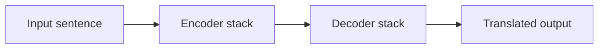
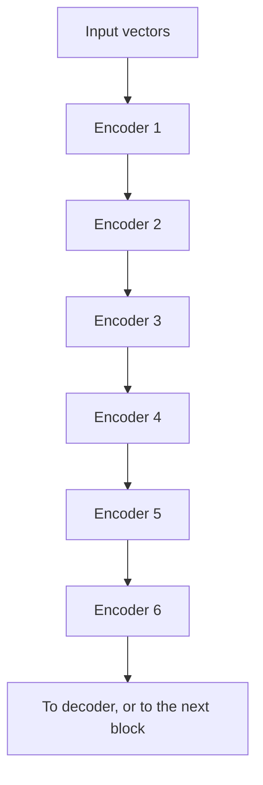
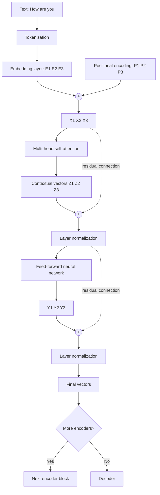
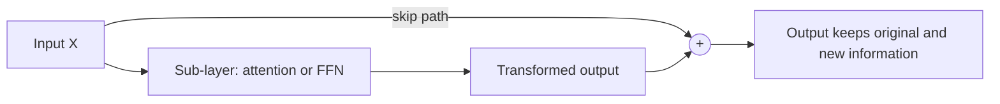
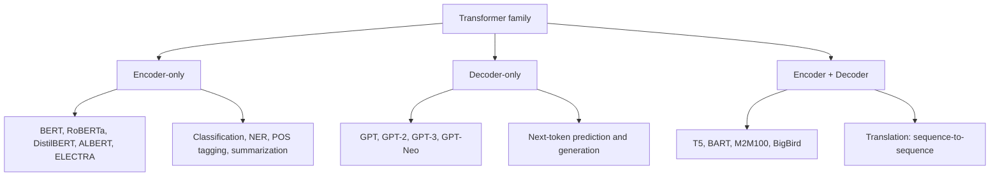

# 🧠 Class: Transformer Deep Dive, Session 2 (The Encoder, End to End)
### 📋 Generative AI Bootcamp 1.0

**🎙️ Mentor:** Sunny
**⏱️ Duration:** ~4 hours (including a ~19-minute break and a long open-floor doubt session) | **📅 Session:** Second class on the Transformer

---

## 📰 Quick Updates

- **Job opening via the academy:** The ops team announced a hiring drive from Walmart (Bangalore, **on-site, not remote**). Interested students fill in a Google Form, then get a callback if shortlisted. Sunny summarised the JD: strong coding, SQL, Python, exposure to AI, and good analytical skills. Roles named were *Data Science Manager*, *Manager – Analytics* (a techno-functional "bridge between business and dev team" role) and *Advanced Analytics*. His advice: put prior experience **and** the new AI skills on your resume, and expect more drives like this by the end of the course.
- **Resources:** Recordings, handwritten notes and the previous assignment's solution all live on the dashboard and in the course GitHub repository (the one dedicated to the bootcamp's class resources). If GitHub fails to render a notebook, download the file instead.
- **Mesh API (course collaborator):** A hosted gateway for calling many LLMs (some free, the stronger reasoning models paid). Students get free credits via a coupon documented in a shared doc, and a feedback form was shared in the community chat. It will be used later when the course builds RAG and agent applications.
- **Sessions so far:** About 9-10 classes on encoding, embeddings and the first transformer session. Embeddings were taught in depth because they play a crucial role in RAG later.

---

## 🗺️ Where the Transformer Fits

Sunny framed the transformer as the **base architecture of every modern LLM**, and as a favourite interview topic. Today's goal was the *flow* of data through the encoder, plus the *why* behind each part. The mathematics is deferred to the next session.

The original paper (*Attention Is All You Need*) trained the architecture for **machine translation**, which is why it has two halves:

---

## 🧱 Stacks of Encoders and Decoders (the "Nx" in the Diagram)

In the paper's figure, the **Nx** label beside each block means "this block is repeated N times". Sunny drew it out in his notes: the original paper used **6 identical encoders** stacked vertically, and **6 identical decoders**. "Identical" means the same architecture, though each layer learns its own weights.

**Why 6? It is a hyperparameter**, an experimental value chosen by trial. Sunny stressed this several times because it is a classic interview question, and gave real-world numbers to quote:

| Model | Depth (as given in class) |
|---|---|
| Original Transformer | 6 encoder + 6 decoder layers |
| BERT-base / BERT-large | 12 / 24 encoder layers |
| GPT family | 12 up to 96 decoder layers |
| Llama, Mistral, other modern LLMs | Deep stacks (tens to 100+) |

**Why stack at all?** The reasoning he gave for interviews:
1. **Capture deeper relationships** in the data.
2. **Understand longer context.** A 1,000-word input will not be well represented by one block.
3. **Build hierarchical meaning.** His illustration: early layers learn relationships between words, middle layers learn phrases, later layers learn whole-sentence meaning, and deeper layers still give richer contextual understanding.

GPT uses only the decoder half, so its "stack" is a stack of decoders (GPT-1 used 12; the largest GPT variants use up to 96).

---

## 🔬 The Encoder, End to End

This was the centrepiece of the class. Sunny walked one sentence ("How are you") through a **single** encoder block, giving the vectors names so the flow could be followed.

### Inside one encoder block

At a high level, an encoder has just two sub-parts: **self-attention** and a **feed-forward neural network**. Around each sits a *residual connection* and a *layer normalization*.

Step by step:

1. **Tokenization.** The sentence is split into tokens. Sunny noted a token is usually *less than a word* (roughly three-quarters of a word on average), and every model family trains its own tokenizer. Hugging Face tokenizers will be covered in a later class.
2. **Embedding layer.** Each token becomes a vector (512 dimensions in the paper, though any size is allowed). The layer behaves like a Word2Vec-style model but is **not pre-trained**. It is just a lookup that produces embeddings, and it is learned as part of the transformer's own training.
3. **Positional encoding** is added to each embedding (see the next section).
4. **Multi-head self-attention** produces *contextual* vectors, one per token.
5. **Residual connection and layer normalization** follow ("Add & Norm" in the paper).
6. **Feed-forward network** then processes each token vector.
7. A second **residual connection and layer normalization** follow.
8. The result goes to the **next encoder** if the stack has more, or to the **decoder** otherwise.

An important clarification from the doubt session: X1, X2, X3, Z1… and Y1… are **the same information being transformed** at different stages. They are renamed only so each stage can be tracked. Likewise, showing three separate vectors versus one matrix is just a presentation choice. Internally the tokens are processed **in parallel as a single matrix**.

### Addition vs concatenation (a prerequisite idea)

Sunny paused for a quick refresher because the paper *adds* vectors rather than concatenating them:

| Operation | What it does | Example with `[5,6,7]` and `[1,2,3]` |
|---|---|---|
| **Concatenation** | Appends one vector after the other (longer vector) | `[5,6,7,1,2,3]` |
| **Addition** | Adds element by element (same length) | `[6,8,10]` |

The encoder diagram in the paper uses **addition** for both positional encoding and the residual connections.

---

## 📍 Positional Encoding: Why It Exists

Sunny's argument was built on a sentence-scrambling example. "Sunny is taking GenAI class and teaching transformer" is meaningful, but the same words in a shuffled order are not. **Word order matters.**

- **LSTMs** process words one after another, so order is preserved automatically. The drawbacks were slowness and the inability to train on huge amounts of data, which is why the community moved on.
- **Transformers** feed all tokens in **parallel**, which is fast and scalable, but parallel input loses the sequence information.
- **Positional encoding** is the fix. A position vector is **added** to each token's embedding, so every word carries a signal for where it sits in the sentence.

Key points from the class:
- The positional vector has the **same dimension as the embedding vector** (confirmed in the doubt session).
- The paper generates these vectors from a formula (sinusoidal functions). The derivation is scheduled for the next class.

---

## 🎯 Self-Attention: The High-Level Idea

Self-attention finds **which words in a sentence relate to which other words**. Sunny used his earlier examples to show it:

- In *"The animal didn't cross the street because **it** was too tired"*, the word **it** should be represented mostly by *animal*. Self-attention gives "it" a weighted mix of all the words, and the weight on "animal" is the largest.
- A word like **bank** is represented as a weighted combination of every word in the sentence (`w1·money + w2·bank + w3·grow` in the *money bank grow* example). Those weights are **not fixed**: they change with the context. In *"river bank flows"* the weights for "bank" are completely different, so the same word gets a different contextual vector.

The weights are computed using the attention formula built on **Q, K and V** (Query, Key, Value). Next session covers the formula and the maths. **Multi-head attention** simply means running this mechanism several times in parallel.

The output is a set of **contextual embeddings** (Z1, Z2, Z3 in his notes). Sunny also pointed out that the state-of-the-art embedding models mentioned in earlier classes come from the *full encoder's* output, not from the attention layer alone.

---

## 🔁 Residual Connection ("Skip Connection")

**Origin:** The idea comes from **ResNet** (*Deep Residual Learning for Image Recognition*, 2015, a CNN architecture). The transformer paper, about two years later, borrowed it.

**What it does:** The original input vector (X) is carried around the attention layer and **added back** to the attention output (Z). The same is done around the feed-forward network.

**Sunny's analogy:** Start with the word *sunny*. Transform it to *sunlight*, then to *bright*. The meaning is preserved, but the original word is lost. Writing **"sunny + bright"** keeps both, and "sunny is bright" is clearer than "bright" alone. The residual connection does the same thing mathematically, by keeping the original information alongside the transformed one.

**Why it matters (from his slide):**
- Deep networks suffer from **vanishing gradients**: weights barely update and information gets lost.
- With a residual path, each layer only has to learn a *small improvement* over its input rather than a whole new transformation.
- Result: **better gradient flow, faster and more stable training, no information loss, and the ability to stack many layers.** This is a large part of why deep stacks (dozens of layers) are possible.

---

## ⚙️ Why a Feed-Forward Neural Network?

- **Self-attention** works *across* tokens (word-to-word relationships).
- The **feed-forward network (FFN)** processes **each token's vector independently**, to extract more complex patterns.
- In the paper the dimensions are **512 → 2048 → 512** (input, hidden, output).
- The reason to include it is **non-linearity**. A linear model (like linear regression) can only fit a straight line, while a neural network can capture curved, complex patterns in the data.

Sunny was candid that this is partly empirical: researchers likely tried attention alone, found accuracy improved when a neural network was added, and kept it in the architecture.

---

## 📏 Layer Normalization (Preview)

Only briefly mentioned today. A normalized vector means the values are scaled/suppressed into a stable range. The concept was deferred to the next class, where the "why" will be covered conceptually (no heavy maths needed).

---

## 🏷️ Encoder-Only vs Decoder-Only vs Encoder-Decoder

Several students asked variants of this, and Sunny's answer built a clear picture:

- **Encoder + decoder** was designed for translation: the encoder reads the source language, the decoder produces the target language (sequence-to-sequence).
- **BERT-style** models (2017-18 era) targeted tasks like text classification and summarization, which only needed the encoder.
- **GPT** targets next-token prediction, which fits the decoder (with *masked* self-attention so a position cannot see future tokens).
- The early models were **problem-specific**. The shift to **general-purpose** LLMs came from the training pipeline: **pre-training, then supervised fine-tuning, then preference alignment**, applied at massive scale. Most modern LLMs are decoder-based.
- **Cross-attention** (the decoder attending to the encoder's output) is the extra component in the decoder. It is a common interview question and will be taught with the decoder.

---

## 🧪 How Translation Training Works (Preview)

Answering a student, Sunny sketched the supervised setup: the **source sentence** goes into the encoder, and the **target sentence** goes into the decoder as the expected output. The model predicts, the **loss** is computed, and **back-propagation** updates the weights. Training repeats until the translations are good. At inference time, only the input is supplied and the model generates the output. The details of how the two sides connect (cross-attention) come with the decoder session.

---

## 🗺️ What's Next

- **Tomorrow:** mathematical treatment of **positional encoding**, **self-attention** (the Q/K/V formula), and **layer normalization**. The maths is for deeper understanding; interviews usually probe the concepts.
- **Next-to-next class:** the **decoder** (including masked attention and **cross-attention**), followed by code (building/using a transformer and Hugging Face).
- The transformer module should wrap up in about **4-5 classes total**, followed by an assignment.
- After that: **fine-tuning**, **loading models via different APIs** (Groq, OpenAI, Gemini, OpenRouter, Mesh API), then **RAG** and **agents**.

---

## 💬 Live Q&A Highlights

| Question | Answer |
|---|---|
| Is the positional encoding vector the same size as the embedding vector? | Yes, they must match since they are added element-wise. |
| The embedding layer looks like Word2Vec. Don't transformers give better embeddings? | Here the layer is only there to turn tokens into numbers. Later, transformer-based models were indeed used to produce much better embeddings (the embedding models seen earlier). |
| Why are multiple vectors/embeddings created in the encoder? | They are not. It is the **same information** being transformed at each stage; the names (E, X, Z, Y) just track the stages. |
| What guarantees the FFN won't corrupt the self-attention output? | No formal guarantee. Quality is judged by training and final accuracy over many epochs, like any model. (Chat models also carry disclaimers for the same reason.) |
| Do we need to memorise all the dimensions? | No. Interviewers ask how self-attention works, how the encoder works, what layer norm and the FFN do, and why multiple encoder blocks. Understand the flow. |
| Some diagrams put normalization *before* attention. Which is right? | The class followed the original paper (Add & Norm after each sub-layer). Other models tweak the placement, which is acceptable because these are experimental design choices. |
| Why did BERT use only the encoder and GPT only the decoder? | Their tasks only needed one side: classification/summarization for BERT, next-token prediction for GPT. Seq2seq models (T5, BART) use both. GPT's generality came from pre-training + SFT + preference alignment. |
| Why is a neural network used inside the encoder? | To learn extra non-linear patterns after attention (supervised training). It was found empirically to improve accuracy. |
| How do we build this architecture ourselves? | Code it from scratch in PyTorch, or use libraries like Hugging Face that already implement it. |
| Is N = 6 for both sides mandatory? | No. The paper used 6/6, but you can choose different numbers, and decoder-only models like GPT-1 used 12 decoder layers. |
| (Jyotsna) Ollama models time out on a 16 GB machine with sensitive Excel data. What can be done? | Local LLMs need enough RAM. Use a much smaller model (TinyLlama or something under ~1.5B parameters), or move to ~32 GB RAM, or host Ollama on a private server and call it as an API. A GPU isn't required for inference. Hugging Face local models have the same memory limits. |
| (Marina) Legal-contract pipeline: the LLM-based router gets confused and times out. | LLM routing is probabilistic. Make the flow **deterministic** (you control the steps) and use the LLM only for generation. |
| (Karthik) What is encoder-only good for? | Text classification, entity tagging, POS tagging, summarization-type tasks (BERT, RoBERTa, DistilBERT). Adding the decoder makes it a translation architecture. |
| (Narasaiah) Why so many transformations in the encoder? | Each stage refines the representation. The decoder later combines it with its own stream via cross-attention. More clarity will come in the decoder session. |
| (Lakshmi) How do we choose an embedding model? | Try several and compare (as in class), or use leaderboards and the MTEB benchmark. Use cases will come later in the course. Enterprises keep data in warehouses, data lakes, SharePoint and cloud databases. |
| (Niv) How many encoders should I say I used in a project? | Explain it's a hyperparameter, give examples (6, 12, 24, 96) and frame the answer clearly rather than reciting a number. |
| (Ramesh) How is massive data fed during training? | Same as for a short sentence: everything is processed as matrices, in parallel. |
| (Ashish) Why switch from vectors to a matrix? | No real switch. Embeddings are matrices underneath; the vector view is for understanding. |
| (Ashish) How are FFN hyperparameters chosen? | By search (grid search, random search, tuning libraries) and experimentation. |
| (Ashish) What do extra stacked encoders add? | The same information is processed again at greater depth, which sustains context for long inputs. The best depth is found by experiment. |
| (Bharathi) Medical-assistant hackathon: fine-tune or RAG? | Start with RAG; if answers are weak, fine-tune and then combine (fine-tuning + RAG). |
| (Bharathi) Where to get medical sample data? | Generate dummy data with an LLM, or look in Hugging Face datasets. Transform it to fit your platform (e.g. Azure/Fabric). For appointment booking, build an agentic system (his multi-agent YouTube project). |
| (Dwipal) How can RAG answer about news newer than the model's training? | The new information is supplied **in the prompt as context**. The model uses that context to answer, like setting a rule at the start of a chat. |
| (Charles) API key not loading in the notebook. | Keep the `.env` file outside the environment folder, and match the variable names (including capitalisation) between `.env` and the code. |
| (Sushanta) What system is ideal for GenAI/agentic projects? | ~32 GB RAM, a strong CPU (Ryzen 9 / Core i9 class), 1 TB SSD. GPU is optional unless you train models. |

---

## 🔑 Key Pointers to Remember

- The paper's encoder and decoder are each **stacks of 6 identical layers**. The number is a **hyperparameter**.
- Stacking exists to capture **deeper relationships, longer context and hierarchical meaning**.
- **Order of operations in an encoder:** tokenize → embed → **add** positional encoding → multi-head self-attention → add & norm → feed-forward → add & norm.
- Transformers process tokens **in parallel**, so **positional encoding** restores word order.
- The positional vector has the **same dimension** as the embedding and is **added** (not concatenated).
- **Self-attention** gives each word a context-dependent weighted view of all other words (e.g. "it" → "animal").
- The **residual connection** (from ResNet, 2015) adds the original input back, preserving information and enabling deep stacks.
- The **FFN** (512 → 2048 → 512) adds **non-linear** pattern learning, applied to each token independently.
- **BERT** = encoder-only, **GPT** = decoder-only, **T5/BART** = encoder + decoder.
- General-purpose LLMs came from **pre-training → SFT → preference alignment**, not from the architecture alone.
- **RAG** works by putting retrieved information into the prompt context.
- Interview tip: explain the flow and the *why*; dimensions and exact maths are rarely asked.

---

## ✅ Action Items After Class

- [ ] Re-watch the recording and the encoder walkthrough; redraw the encoder flow from memory.
- [ ] Read the original transformer paper (or have an LLM summarise it) and compare its encoder figure with today's diagram.
- [ ] Review the "ResNet" paper title and the residual-connection idea.
- [ ] Prepare a 3-4 point interview answer for: "Why multiple encoder/decoder layers?"
- [ ] Try a model via Mesh API and submit the feedback form.
- [ ] Revise addition vs concatenation, then preview positional encoding and attention formulas for tomorrow.
- [ ] Fill in the Walmart interest form if the skills match.

---

*📝 Notes compiled from the full session transcript, "Transformer Deep Dive, Session 2 (The Encoder, End to End)," Generative AI Bootcamp 1.0.*
