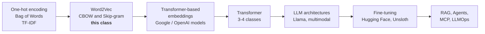
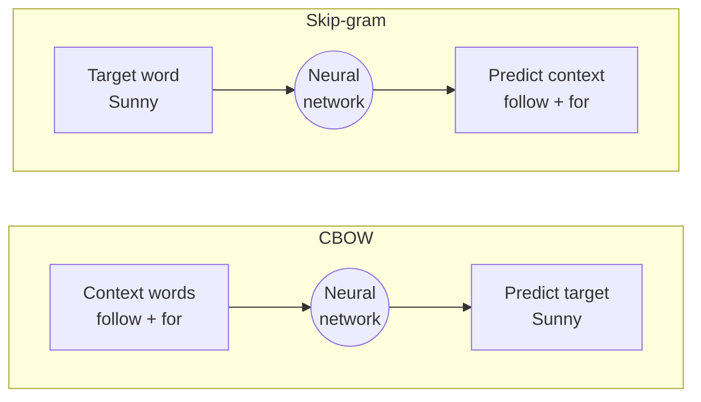
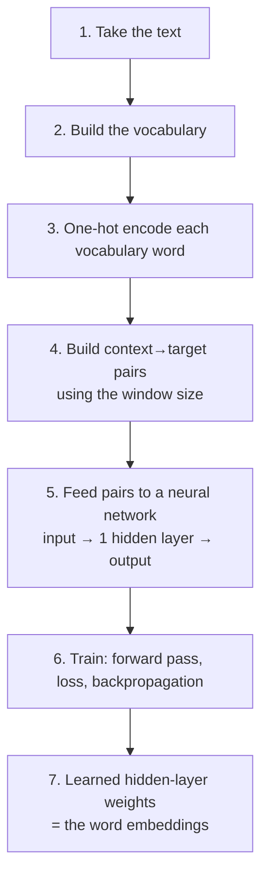
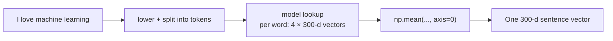

# 🧠 Word2Vec Deep Dive: Window Size, CBOW vs Skip-gram & Pre-trained Embeddings
### 📋 Generative AI Bootcamp | Krish Naik Academy

**🎙️ Mentor:** Sunny Savita
**⏱️ Duration:** ~3.5 hours of teaching + ~1 hour live doubt session | **📅 Session:** Weekend evening live class (date not stated in recording)

---

## 📰 Quick Updates

- **Assignments & resources** live in Sunny's GitHub repository (one folder per class). Assignment 1 solutions were promised for **Monday**; 50+ submissions had already come in. There is no hard deadline, but the weekly timeline lets regular attendees get solutions on time.
- **Notes format:** handwritten blackboard notes are uploaded as PDFs in the class folder on GitHub (and in the dashboard's *Resources* section). Notion notes are shared only as PDFs, never as links. Recordings are under *Live Sessions* on the course dashboard.
- **Month-3 "mega challenge" (idea floated):** a large monthly assignment with prizes (extra course access, gifts, possibly cash). To be announced after a few more topics, up to fine-tuning.
- **Python version:** use **3.11** for this project, because libraries like Gensim don't yet support 3.12.
- **Homework for tomorrow:** generate API keys for **Google** (free), **Hugging Face** (free) and optionally **OpenAI** (paid), for the embedding-model practical.
- **Doubt-session logistics:** Yash also runs a parallel Google Meet room for setup/coding issues, and Sunny takes conceptual doubts live. A student suggested splitting the theory, practical and doubt portions into separate recordings; Sunny will check whether Zoom recordings can be post-processed that way.

---

## 🗺️ The Big Picture: Where This Class Fits

Sunny opened with the roadmap for the next 8-10 classes (~1 to 1.5 months), which lays the base for RAG, agents, MCP and LLMOps:



Why spend this long on fundamentals? Sunny's reasoning: Word2Vec and the transformer aren't strictly needed to *build* applications, but they are asked in interviews and are needed to understand LLM internals at even a 50-60% level.

---

## 🔁 Quick Recap: What Came Before

Sunny recapped the earlier techniques, all of which share one goal: **turn text into numbers so a mathematical model can be trained on it**.

| Technique | Idea | Vector dimension |
|---|---|---|
| One-hot encoding | one slot per vocabulary word, a single 1 | vocabulary size |
| Bag of Words | word counts per document | vocabulary size |
| TF-IDF | counts weighted by how rare a word is across documents | vocabulary size |
| **Word2Vec** | numbers *learned by a neural network* that capture meaning | **hidden-layer size** (hyperparameter; 300 in Google's model) |

Word2Vec was introduced by **Google in 2013** ("Efficient Estimation of Word Representations in Vector Space"); the paper is in the class GitHub folder. The idea from the previous class: represent each word as a vector of feature weights, so that similar words sit close together and vector arithmetic works.

---

## 📚 Two Prerequisites: Vocabulary & Window Size

### Vocabulary
Sunny re-explained the vocabulary as the **set of unique words** in the corpus. It is **case-sensitive**, so `Sunny` and `sunny`, or `Apple` and `apple`, are separate entries. For "I love AI and I love coding" the vocabulary is `{I, love, AI, and, coding}`.

### Window size
**Window size = how many neighbours on each side of a word we consider.** This is the step that converts raw, *unstructured* text into the **(input, output)** pairs a supervised neural network needs.

Sunny walked through "I love deep learning" with window size 1, then window size 2:

| Window = 1: target | context |
|---|---|
| I | love |
| love | I, deep |
| deep | love, learning |
| learning | deep |

With window size 2, "love" gets context `{I, deep, learning}`, "deep" gets `{I, love, learning}`, and so on. Positions with no neighbour on one side simply have fewer context words.

Key points he stressed:

- Window size is a **hyperparameter**: a value you can't derive, only find by experiment.
- A **bigger window gives more context, but too large a window adds noise**, meaning words that aren't actually relevant to the target. In real training he said windows are typically much larger than 1 or 2 (10, 20 or more).
- The vocabulary and the window-based pairs are **separate processes**. The pairs are built from the *raw text* (repeated words produce repeated pairs), while the vocabulary only exists so each word can be turned into a one-hot vector. A student who tried to merge the two got a firm correction.

---

## ⚔️ CBOW vs Skip-gram: Same Data, Opposite Direction

Both techniques come from the same 2013 paper and use the same neural network. The only difference is **how the training data is arranged**.

For "follow Sunny for Gen AI" with window size 1:

**CBOW (Continuous Bag of Words)**: *context → target*

| Input (context) | Output (target) |
|---|---|
| Sunny | follow |
| follow, for | Sunny |
| Sunny, Gen | for |
| for, AI | Gen |
| Gen | AI |

**Skip-gram**: Sunny called this the **"Uno reverse"**. Swap the columns: *target → context*

| Input | Output |
|---|---|
| follow | Sunny |
| Sunny | follow, for |
| for | Sunny, Gen |
| Gen | for, AI |
| AI | Gen |



> 📝 **Interview line:** CBOW predicts the target from its context; skip-gram predicts the context from the target. The architectures are identical; only the data preparation differs. (CBOW = *Continuous Bag of Words*; skip-gram has no expanded full form.)

Sunny noted that if a word appears twice, skip-gram simply produces **multiple output words** for it, and each pair becomes its own training example. He said the pre-trained Google model was trained with skip-gram, because it works well on huge datasets. (See the note on this in the Key Pointers.)

---

## 🏗️ How the Embedding Is Actually Produced

This is what Sunny called "the entire crux" of Word2Vec. He walked through CBOW on a tiny example, step by step:



**Worked example.** Vocabulary of 5 words: `AI, follow, for, Gen, Sunny` → each one-hot vector has length 5. For the training row `(follow, for) → Sunny`:

- Input layer: the one-hot vectors of the two context words, fed **in parallel** (not sequentially).
- **One hidden layer**, shown with 3 neurons for illustration. The input-to-hidden weight matrix is **5 × 3** (and the reverse hidden-to-output matrix is 3 × 5).
- Output layer: 5 values, one per vocabulary word, turned into probabilities with **softmax**. The expected answer is the one-hot vector of `Sunny`.
- Compare predicted vs. actual to get a **loss**, then backpropagate to adjust the weights. This repeats over many **epochs** until the loss is as small as it can get.

**The punchline:** the network is only a vehicle. The prediction itself isn't the goal. The **learned hidden-layer weights are the embedding**, so the embedding dimension equals the hidden-layer size. Google's pre-trained model uses **300**, which is why every word comes out as a 300-dimension vector.

Sunny stressed several design facts:

- **Weights start random** and are tuned by gradient descent; training walks the loss down toward its minimum.
- **No activation function** in the hidden layer. When a student asked why, his reasoning was that the embedding shouldn't be squashed into 0-1, and no non-linearity is needed to capture the relationship; the output layer does use softmax.
- **Hidden-layer size and window size are different hyperparameters.** Window size shapes the data; hidden size sets the embedding dimension. Neither is tied to the other, or to the input data size (just as a house-price network can have 2, 200 or any number of hidden neurons for 3 input features).
- **The features are a black box.** We can't say what each of the 300 numbers "means"; we only rely on the vectors being close for related words.
- BoW/TF-IDF vectors have a dimension equal to the **vocabulary size**; Word2Vec's equals the **hidden-layer size**, which is far smaller and dense.

---

## 💻 Practical: Using Google's Pre-trained Word2Vec with Gensim

Sunny worked in a notebook (`Classical Word Embedding.ipynb`) using the Google News model, trained on Google News text in 2013. The first load downloads a large file and can take 10-15 minutes.

```python
from gensim.models import Word2Vec, KeyedVectors
import gensim.downloader as api

# Google's pre-trained model: 300-dimensional vectors
model = api.load("word2vec-google-news-300")

vec = model["Sunny"]        # one word -> one vector
len(vec)                    # 300
```

Things he demonstrated live:

| Operation | What happened |
|---|---|
| `model["Sunny Savita"]` or a full sentence | `KeyError`: the model only accepts **single words** |
| `model.most_similar("man")` | `woman`, `boy`, `teenager`, … plus `robber`, `suspected` (news-data bias, since the model learned from news and a lot of crime reporting) |
| `model.most_similar("cricket")` | `cricketing`, `cricketers`, `Test_cricket`, `West_Indies_Cricket` |
| `model.similarity("man", "woman")` | ~0.76 (cosine similarity) |
| `model.similarity("man", "men")`-style identical words | 1.0 |
| `model.similarity("happy", "joy")` | surprisingly low (~0.35) |
| Python vs Java | little similarity |
| `model.similarity("Sunny", "sunny")` | ~0.43, because the vocabulary is **case-sensitive**, so they are two different words with different vectors |
| `model.doesnt_match(["php", "java", "dog", "c++"])` | `dog` |
| `king - man + woman` | closest words: `queen`, `princess` (king itself also appears) |
| `model["ChatGPT"]` | `KeyError`: the model was trained in 2013, so it has an **out-of-vocabulary** problem |

Sunny pointed out the model is old and not very accurate; he used it to show the mechanics.

### From words to sentences: Average Word2Vec

Word2Vec only embeds words. To embed a sentence, the popular 2015-16 approach was to **embed each word and average the vectors**:



```python
import numpy as np

sentence = "I love machine learning"
words = sentence.lower().split()

word_vectors = []
for word in words:
    word_vectors.append(model[word])

sentence_vector = np.mean(word_vectors, axis=0)   # column-wise average
sentence_vector.shape                             # (300,)
```

He called this approach dated: modern **transformer-based (SOTA) embedding models** replaced it, and that is the next class. The code was pushed to the class GitHub repo. A second notebook for **custom Word2Vec training** (Gensim `Word2Vec` on your own corpus, with a configurable vector size, window and epochs) was shown during the doubt session, and `KeyedVectors` is what that notebook uses.

---

## ⚖️ Pros and Cons of Word2Vec

| 👍 Pros | 👎 Cons |
|---|---|
| **Fast to train**: a shallow network with only one hidden layer | **Static embeddings**: "bank" in *river bank* and *bank deposit* gets the **same** vector |
| **Captures semantics**: similar words sit close, and relationships like king − man + woman ≈ queen emerge | **Out-of-vocabulary words** (e.g., "ChatGPT") have no vector |
| **Pre-trained model available**, so it is easy to use | **No sub-word handling**: *run, runner, runs* are treated as unrelated words |
| **General-purpose**: used in NLP pipelines, ML models and clustering; dominant until ~2018 | Doesn't scale to deeper contextual understanding; transformers fix this with attention and dynamic embeddings |

Sunny used the *bank* example to motivate why the transformer was invented: Word2Vec gives one fixed vector per word, whereas ChatGPT-style models respond differently depending on context.

---

## 🔗 Word2Vec and the Transformer

A student (Priya) challenged the claim that transformers use Word2Vec internally. Sunny pulled up the *Attention Is All You Need* diagram: the transformer begins with an **input embedding** layer that turns tokens into vectors, and that embedding is then refined by self-attention and feed-forward layers.

Putting it precisely: the transformer uses the **same idea** (a token-to-vector lookup learned by a neural network), but it learns its own embedding table as part of its training rather than importing Google's Word2Vec vectors. As Sunny put it, "they have trained their own model again". The embedding is only the starting point: self-attention then updates it with context, which is exactly what static Word2Vec lacks. He promised a full walkthrough in the transformer classes.

---

## 🗺️ What's Next

- **Tomorrow:** the skip-gram network diagram (one input, multiple outputs), a worked numerical calculation of Word2Vec so the whole flow "is concrete in your head" (about half an hour), and a comparison of **which is more efficient, CBOW or skip-gram**. Also a first look at transformer-based embeddings (Google and OpenAI/Hugging Face embedding models), similarity search and the difference between keyword and semantic search. Bring your API keys.
- **Then:** about 3-4 classes on the transformer, then LLM architectures (Llama; multimodal image/video/audio), then **fine-tuning** (Hugging Face, Unsloth) and projects.
- **Later:** a new assignment, to be released after the next class.

---

## 💬 Live Q&A Highlights

| Question | Answer |
|---|---|
| How could the model give a vector for "Sunny" if news data wouldn't contain it? | "Sunny" is a common word and probably does appear in the news corpus. A genuinely unseen word like "ChatGPT" raises a `KeyError`, which Sunny demonstrated live. |
| Why are neurons used to get a "number" per word if training only predicts words from context? (Sundar) | Training is just the vehicle: the network learns which words appear in which contexts via loss and backprop; the intermediate hidden-layer values are the useful output. Words sharing contexts end up with similar vectors. |
| Is the number of neurons the same as the number of dimensions? Is it the same as the number of hidden layers? (Sankar) | Neurons in the hidden layer = embedding dimension (a hyperparameter). It is *not* the number of layers: Word2Vec uses exactly one hidden layer. Bigger dimension can capture more nuance, and is analogous to model size (1B vs 400B parameters). |
| How are the weights initialised and how do they change? (Bhaavya) | They start as random values and are tuned by forward/backward propagation (gradient descent) until the loss is minimised. Libraries abstract this away, which is why writing a network from scratch in PyTorch helps understanding. |
| Why no activation function in the hidden layer? (Ruchi) | The paper omits it there: no need to squash the embedding to 0-1 or impose a non-linear pattern. The output layer uses softmax. Check the paper for details. |
| Will reinforcement learning be covered? (Ruchi) | Not required. RLHF appears briefly in fine-tuning, and supervised alternatives like DPO and ORPO have largely replaced it. |
| Where do one-hot/BoW/Word2Vec vectors actually get used? (Mazeed) | Primarily to turn data into numbers so a model can be trained; secondary uses include document similarity search. This is the same for GPT and embedding models: an embedding is an intermediate output, not the final response. |
| Can I give "follow, for" to the trained model and get "Sunny" back for custom training? (Mazeed) | That prediction is a training device, not the goal. The goal is the hidden-layer vector, which for "follow" ends up close to "Sunny" because they co-occur. |
| Do I need to learn ML before deep learning? (Mazeed) | No: start with deep learning (ANN) and NLP; one or two ML algorithms is enough. |
| Are repeated words kept when building context-target pairs? (Krishna, Jyoti) | Yes: the vocabulary de-duplicates, but pair generation runs on the raw text, so every occurrence produces its own pairs. The two processes are independent. |
| How do pre-trained weights change, and how many epochs? (Krishna) | Via gradient descent with an optimiser; epochs are a hyperparameter. Real systems test long lists of epoch values for months, which is why only big labs train foundation models. |
| Why 300 dimensions, and why not 5? (Tilak) | Google trained it with 300; you can train your own model with any dimension, e.g., 500, using Gensim. Sunny also showed Copilot generating from-scratch Word2Vec code. |
| What background do I need for this course? (Mohan) | Some deep-learning grounding (neural networks) helps the Gen AI material; the prerequisites section and the paid data-science courses cover it. |
| Resources for Databricks/Snowflake with AWS for MLOps interviews? (Vijay) | None in this course yet. Sunny suggested learning Databricks ETL/PySpark and the Databricks Apps ecosystem and its AI features, and will look for resources to share. |
| Static embeddings: how does "bank" differ across sentences? (Prateek) | Word2Vec always returns one vector per word; contextual models (transformers) produce different vectors. Word2Vec's value was capturing semantics for one corpus; the approach doesn't scale, which is why transformers arrived. |
| Is hidden-layer size capped at 300? (Prateek) | No: 300 is just Google's choice. Gensim lets you set `vector_size` (e.g., 500). |
| Are the vectors the same as tokens? (Prateek) | No: tokens are the text pieces (spaces/sub-words); embeddings are numbers produced from them. |
| Does hidden size depend on window size? (Sandeep) | No: window size is for data preparation; hidden size is how many neurons you choose, independent of the input data. |
| How does GPT generate responses from this? (Sandeep) | Generation is separate: autoregressive next-token prediction (GPT), as opposed to BERT's masked modelling. Wait for the transformer classes. |
| Why was Google late versus OpenAI if it invented the transformer? (Sandeep) | Google published and open-sourced the transformer and BERT; OpenAI refined and productised GPT, with heavy investment. Sunny also noted he finds Claude better for coding than GPT. |
| How do you pick the hidden size? (Narasaiah) | It is a hyperparameter found by experiment, like grid/random search: try values, compare accuracy, pick the best. There is no formula. |
| Do I need DSA for product-company AI interviews? (Shailendra) | Depends on the company: top-tier product firms usually start with DSA rounds; services firms ask more programming and project questions. Check the job description. |
| How do I handle emojis and stars in review text? (Sauvik) | Convert them to text/labels (the Python `emoji` library turns emojis into text) and then to numbers; manual labelling doesn't scale. |
| Are we on track for a 6-7 month timeline? (Sauvik) | Yes, this is the fifth or sixth course Sunny has run like this. |
| Can one-hot vectors be generated once for a whole English dictionary? (Amit) | Yes, one-hot encoding depends only on the vocabulary, so it can be done once. You choose either CBOW or skip-gram for a training run, not both. |
| How does skip-gram handle one word with multiple entries? (Amit) | Each occurrence gives its own pairs; the multiple targets are just multiple outputs, with the loss computed across all of them. |
| Does each hidden neuron map to one feature? (Amit) | No: every input flows to every neuron. We don't know what each dimension represents; the vector is a learned black box. |
| If several words match a context, which comes out? (Kaliraj) | Trained on large data with big windows, the model captures many words that share contexts. The tiny example is only for teaching. |
| How do the context/target slide and the training slide connect? (Kaliraj) | The pairs are the *prepared training data* and the network diagram is the *training step* that consumes it. |
| What if "Sunny" appears twice in training data? (Dwipal) | Pair generation produces entries twice, and training takes both into account, so the final vector blends the contexts. |
| Embedding vs. encoding? (Dwipal) | Encoding (one-hot, BoW) is a manual, count-based process with no training; embeddings are numbers learned by a trained model. |

---

## 🔑 Key Pointers to Remember

- Everything so far has one goal: **convert text into numbers** so a model can learn from it or compare it.
- **Window size** = neighbours considered on each side; it is a **hyperparameter**, and too large a window adds noise.
- **CBOW**: context → target. **Skip-gram**: target → context. Same network, just reversed data preparation.
- The **vocabulary** is case-sensitive and de-duplicated; pair generation uses the raw text and is separate from it.
- Word2Vec's network is **shallow: input → one hidden layer → output**.
- The **embedding is the learned hidden-layer weights**, so embedding dimension = hidden-layer size (300 in Google's model).
- Hidden size and window size are different hyperparameters, and neither is tied to the input data size.
- The prediction is just a training vehicle; the *vector* is the product. Features are an uninterpretable black box.
- Gensim: single words only; `most_similar`, `similarity` (cosine), `doesnt_match` and `king − man + woman ≈ queen` all work on the 300-d vectors.
- **Average Word2Vec** gets a sentence vector by averaging word vectors (a dated technique).
- Weaknesses: **static**, **out-of-vocabulary**, **no sub-word handling**; transformers fix these.
- Interview staples: *What is Word2Vec? CBOW vs skip-gram? Why static? What's in the hidden layer?*
- Verify before quoting in an interview: the class said Google's pre-trained model was trained with skip-gram and that the paper specifies a 3-neuron hidden layer. Those details weren't confirmed against the paper or Google's model page. The 3-neuron network is a teaching illustration, and the original paper describes its architectures as having a projection layer with no hidden non-linearity.

---

## ✅ Action Items After This Class

- [ ] Revise the full Word2Vec pipeline: vocabulary → one-hot → context/target → network → embedding.
- [ ] Practise building CBOW and skip-gram pairs by hand for a short sentence at window sizes 1 and 2.
- [ ] Run the pre-trained Gensim notebook from GitHub (`most_similar`, `similarity`, `doesnt_match`, the king − man + woman analogy).
- [ ] Run the average Word2Vec sentence-vector code and check the shape is `(300,)`.
- [ ] Read the 2013 Word2Vec paper (in the class GitHub folder).
- [ ] If neural networks feel shaky, revisit the ANN prerequisite lectures.
- [ ] Generate API keys: Google and Hugging Face (free), OpenAI (paid, optional).
- [ ] Complete Assignment 1 if you haven't; solutions come Monday.

---

*📝 Notes compiled from the full class transcript and live doubt session, "Word2Vec Deep Dive," Generative AI Bootcamp, Krish Naik Academy.*
